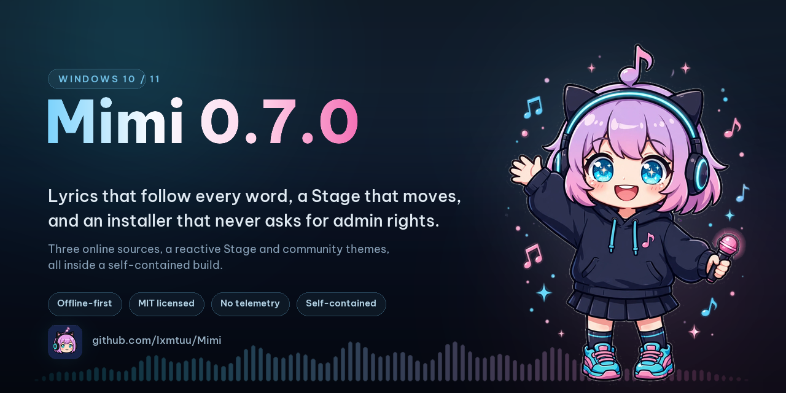
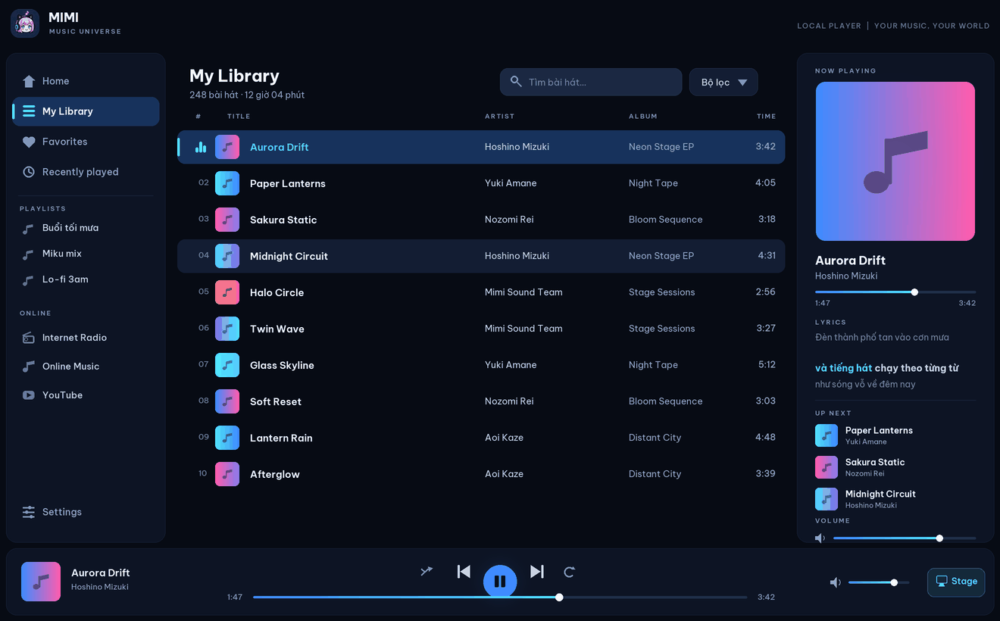
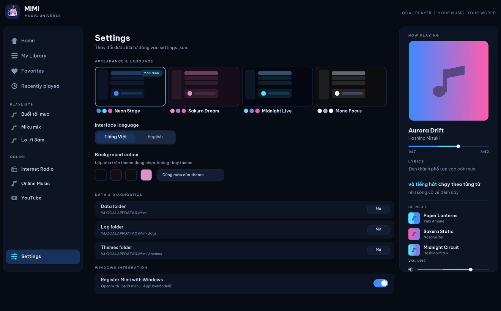

<div align="center">



<br>

<a href="https://github.com/lxmtuu/Mimi/releases/latest">
  
</a>
&nbsp;
<a href="https://github.com/lxmtuu/Mimi/releases/latest">
  
</a>

<br><br>


&nbsp;

&nbsp;


<br><br>

<b>Your music, on your machine.</b><br>
No account · no telemetry · no background downloads.<br>
<sub>Word-by-word lyrics · a Stage that moves · three online sources, each one switchable</sub>
<br><br>
<sub><b>C# / WPF / .NET 8 · NAudio · Windows 10 and 11 · MIT</b></sub>

</div>

---

## Contents

- [Previews](#previews) · [What Mimi does](#what-mimi-does) · [Install](#install-no-build-needed)
- [What is inside](#what-is-inside) · [Requirements](#requirements) · [Build & run](#build-test-and-run)
- [Source layout](#source-layout) · [Design & roadmap](#design--roadmap) · [Licence](#license) · [Privacy](#privacy) · [Contributing](#contributing)

## Previews

<p align="center">
  
  <br>
  <sub><b>Library</b> — track list, search, word-by-word lyrics, Up Next and the transport bar</sub>
</p>

<p align="center">
  
  <br>
  <sub><b>Stage</b> — three large lyric lines, a beat-driven visualizer, three modes (Spectrum · Twin Wave · Halo)</sub>
</p>

<p align="center">
  
  <br>
  <sub><b>Settings</b> — four built-in themes, a custom background tint, Vietnamese/English, data folders and Windows integration</sub>
</p>

> [!NOTE]
> These three pictures are **drawn from the repository's own sources, not screenshots**:
> colour comes from `BuiltInThemes.cs` (the *Neon Stage* theme), labels from
> `UiStrings*.resx`, geometry from `MainWindow.xaml`. They show the design the code
> declares, and they will be swapped for real captures as soon as someone runs Mimi
> on Windows and takes them.

## What Mimi does

| | |
|---|---|
| **Library** | Background folder scan with progress and cancellation; tags and cover art read with TagLib; SQLite FTS5 search that ignores Vietnamese diacritics; sorting, filters, multi-select for favourites and playlists |
| **Playback** | WASAPI shared on the Windows default device, WaveOut as a fallback; drag-to-reorder *Up Next* queue; Shuffle without repeats; Repeat Off / All / One; media keys and the taskbar |
| **Lyrics** | `.lrc` beside the file or embedded in the tag; Enhanced LRC highlights **word by word**; three large lines on the Stage |
| **Stage** | Fullscreen on `F11`, a static Aurora, a beat-driven visualizer with three modes, keys `1` `2` `3` |
| **Interface** | Four built-in themes plus community themes (drop a JSON file into the `themes` folder), a background tint on top of the theme, Vietnamese and English across 455 keys |
| **Online** | Internet Radio (Radio Browser), Audius, and YouTube through Data API v3 with your own key — plays in the official player, no downloading, no caching |

Everything, down to individual behaviours, is listed under [What is inside](#what-is-inside) below.

## Install (no build needed)

No .NET, no Visual Studio, no Git. Take either file from the
[latest release](https://github.com/lxmtuu/Mimi/releases/latest):

| File | When to use it |
|---|---|
| **`Mimi-<version>-Setup.exe`** | Installs into the Start menu, **for your account only**, under `%LOCALAPPDATA%\Programs\Mimi`. No administrator password, no UAC prompt. Uninstall it from *Settings → Apps*. |
| **`Mimi-<tag>-win-x64.zip`** | Portable: unzip it anywhere, run `Mimi.exe`, install nothing at all. |

Both are **self-contained** — the .NET runtime travels inside.
`SHA256SUMS.txt` on the release page lets you check what you downloaded
(`sha256sum -c SHA256SUMS.txt`). The full notes for the current release, with
pictures, are in [`docs/release/0.7.0.md`](docs/release/0.7.0.md).

Two things worth knowing before the first launch:

- **Windows will show the SmartScreen warning, "Windows protected your PC".**
  This build is **not code-signed**, so Windows cannot tell who the publisher
  is. Choose *More info → Run anyway*. That is a missing certificate, not a
  missing source.
- **Your music stays yours.** Uninstalling **does not touch your library**,
  settings or logs in `%LOCALAPPDATA%\Mimi`; the uninstaller asks one question
  and defaults to keeping them. Installing a newer build over an older one
  keeps the library and settings too.

To build it yourself instead: see [Build & run](#build-test-and-run).

## What is inside

- Dark anime-inspired cyan/pink desktop UI with the Mimi app icon
- Four built-in color themes plus community themes: drop a JSON file into
  the per-user `themes` folder (Settings → **Open themes folder**), press
  **Reload themes**, and pick it from the theme list. Format guide:
  [docs/COMMUNITY-THEMES.md](docs/COMMUNITY-THEMES.md); ready-made example:
  [docs/examples/sunset-drive.json](docs/examples/sunset-drive.json)
- Local audio file selection, Explorer drag-and-drop, and a resilient
  recursive folder scan that reports directories it could not read instead of
  discarding the whole result. Folder/file scans run in the background with
  progress and cancellation, and unchanged files reuse known metadata based
  on file size + modified time
- Embedded metadata and cover art read with TagLib-Sharp (title, artist,
  album, genre, year, duration, bitrate, and sample rate), with a filename
  fallback for missing or damaged tags; title, artist, album, genre, year,
  time, and file format are shown in the library. Cover art is cached as
  512px JPEGs for Now Playing and 96px JPEG thumbnails for the track list,
  with the original embedded bytes kept only as a decode/write fallback
- Sortable library columns (title, artist, album, genre, year, duration,
  and format), metadata filters for artist/album/genre/format/playback
  state, and Extended multi-select for batch favorites, playlist additions,
  playlist removal, and library removal
- Play / pause, queue-aware next / previous and auto-advance, ±5-second
  keyboard seek plus ±10-second buttons, volume percentage, and mute.
  Starting a song captures the visible
  filtered/sorted list as its playback context; Shuffle uses a no-repeat
  shuffle bag, Repeat supports Off / All / One, Previous follows the songs
  actually played, and unplayable candidates are skipped without committing
  queue state
- WASAPI shared-mode playback following the Windows default output, with
  WaveOut retained as a fallback. If the default device changes or
  disappears during playback, Mimi pauses, keeps the song and position,
  rebuilds only the output stream, and waits for an explicit Play press
  instead of unexpectedly moving sound to another device. The active
  output is shown in Now Playing and Settings; a missing output is
  reported separately from a corrupt music file. For diagnostics only,
  `MIMI_AUDIO_OUTPUT=wasapi|waveout|auto` can force one backend for a
  same-machine A/B comparison; it is intentionally not an end-user
  Settings switch
- Vietnamese diacritic-insensitive search over track metadata. When SQLite
  is available, the search box uses debounced FTS5 prefix queries and
  relevance ordering in Library/Favorites, while preserving playlist and
  Recently played ordering; an immediate in-memory filter remains the
  fallback while typing or if the catalog search is unavailable
- Playlist management in the sidebar: create, rename, delete, play, add the
  selected song(s) from the track list's **Add to playlist** menu, remove
  songs, and reorder them by dragging or with the Up/Down actions
- An **Up Next** playback queue with drag reordering, Up/Down buttons,
  Play-next / Add-to-queue actions for selected songs, item removal, and
  Clear upcoming. Clicking any song in the track list or the queue plays it
  immediately (Ctrl/Shift-click still only extends the selection)
- Windows media integration through System Media Transport Controls:
  song metadata, cover art, playback state, timeline seeking, shuffle /
  repeat, hardware media keys, and the Windows volume/media flyout.
  Mimi also has taskbar thumbnail Previous/Play/Pause/Next controls,
  taskbar progress, and focus-aware in-window keyboard shortcuts for
  playback, five-second seek, volume steps, track changes, and search
- Direct favorite toggles, a Recently played view backed by playback
  history, and track removal (right-click or Delete key)
- A Settings screen for playback/session, startup/library, Stage Engine,
  a keyboard-shortcut reference, and data/diagnostic options. Mimi
  remembers its window placement,
  visualizer mode, library view/search/filters/sorting, playback modes,
  and reopens the previous song, position, and queue **paused, never
  auto-playing**
- Optional watched folders: new or changed songs in selected folders are
  scanned after a short debounce, while externally deleted files remain in
  the library and are marked missing instead of being silently removed
- Optional per-user Windows registration for **Open with Mimi** (MP3, WAV,
  AIFF/AIF, WMA, M4A, AAC, and FLAC) plus a Start menu shortcut carrying
  Mimi's `Mimi.App` shell identity for Windows media controls. Files opened
  from Explorer are added to the library and played; if Mimi is already
  running, the request is forwarded to that window instead of starting a
  second player. Registration does not change the user's Windows default
  music app
- Library tracks, favorites, playback errors, and play history are restored
  from the SQLite catalog at `%LocalAppData%\Mimi\library.db` (schema v1,
  WAL + transactions); version 4 `settings.json` atomically stores volume,
  mute, shuffle, repeat, the interface-language preference, other
  preferences, the library-view/window state, and the paused session
  including its queue. Older settings versions migrate with defaults for
  the new playback and language options. On first use, an
  existing legacy `library.json` / `favorites.json` pair is imported only
  when the catalog is empty, then archived as `.bak` files. If SQLite cannot
  be opened, Mimi falls back to the legacy JSON library instead of failing
  startup. The same catalog stores ordered playlists and supplies the FTS5
  index used by the main-window search box
- Rolling diagnostic logs in `%LocalAppData%\Mimi\logs`, with global exception
  logging so unexpected failures are traceable
- Stage Engine visualizer (beta): worker-thread 32-band FFT with dB/AGC
  scaling, Neon Spectrum / Twin Wave / Halo Circle modes, fullscreen Stage
  (`F11`), live FPS/draw-time diagnostics, sampled before the volume gain,
  and fading out while paused or stopped
- Modular MVVM architecture with dependency injection and automated tests;
  Windows Release builds and unit tests are verified by GitHub Actions.
  Current version is **`0.7.0`** (Phase 6 — lyrics and the online gate;
  Phase 5 `v0.6.0` was the localisation/theme phase). Phase 4 (`v0.5.0`) was
  closed by owner waiver with accepted limitations. Phase 4 delivered the queue /
  playback-mode, Windows media-control/keyboard, WASAPI output-device,
  and diagnostic backend-override slices are implemented. Automated
  restore/build/test has also passed on a real Windows machine at
  `a056377` (0 warnings/errors and 83 passed / 0 failed / 0 skipped), and
  short forced/auto backend runs produced measurable loopback audio on
  the same Realtek endpoint. Those roughly 22-second runs are
  preliminary: a later Windows 11 checkpoint at `6ca298c` verified three
  synthetic 30-second fixtures (metadata, distinct covers, playlist order,
  and audible WASAPI playback). Direct Quick Settings checks then passed
  A1–A6 (metadata, cover, state sync, Play/Pause, Next, and Previous).
  A read-only GSMTC probe then verified that the Magenta and clean-restart
  Cyan timelines and seek bounds reach Windows and advance while playing.
  A full-card Quick Settings screenshot shows only Previous/Play/Next—no
  visible progress/time, FastForward/Rewind, or Shuffle/Repeat—and labels
  the source `Unknown app`. A real-Windows retest after enabling the
  opt-in registration passed the ProgID and RegisteredApplications
  entries, all eight audio extensions, the Start menu shortcut and its
  icon, the `Mimi.App` AppUserModelID, and GSMTC app recognition. A
  later Quick Settings image/report at `9a925f3` then confirmed the
  visible source name `Mimi`, the correct Cyan title, artist, and
  artwork, and Previous/Pause/Next while playing; it still showed no
  seek bar, elapsed/duration time, or separate FastForward/Rewind
  buttons. A follow-up real-Windows operation at the same code
  checkpoint then used the card's Next control to advance and its
  Previous control to return successfully, refreshing the earlier
  direct A5/A6 evidence; the earlier direct session remains the
  operational evidence for A4 Play/Pause. The real-Windows run at
  `7be7675` passed
  the Release build but exposed a flaky parallel scan-progress ordering
  test (82/83). After the counter/report pair was serialized and a
  32-file regression test was added, the clean real-Windows retest at
  `9a925f3` passed restore and `git diff --check`, an initial targeted
  scan-progress run (2/2), the full suite (84 passed / 0 failed /
  0 skipped), and the Release build (0 warnings / 0 errors); a later
  local Windows retest recorded the focused scan-progress regression
  at 20/20 consecutive runs. A natural-end auto-advance failure found
  at `57b14a3` was fixed in `589a1e0`, after which a real fixture
  retest advanced Cyan to Magenta, so A12 passes. The observed Quick
  Settings card still blocks A7's visual criterion and A8, and exposes
  no FastForward/Rewind or Shuffle/Repeat controls for A9–A11
  (`BLOCKED/N/A`). The project owner has since directly accepted the
  taskbar, media-key/keyboard, device-disconnect, and reconnect gates
  recorded in `ROADMAP.md` (`b0cd13a`), while app-level no-output
  remains blocked, D-03 remains provisional after longer loopback
  A/B runs. The project owner closed Phase 4 by waiver on 2026-11-01
  without upgrading those unresolved gates to PASS. Their
  repeatable manual procedures, result template, loopback CSV analyzer,
  read-only GSMTC timeline probe, and current reconciliation matrix
  live in the [Windows Acceptance Kit](docs/acceptance/README.md)


## Requirements
- Windows 10 version 1809 or later / Windows 11, with Windows Terminal or
  PowerShell
- Git
- .NET 8 SDK (not only the .NET Runtime)
- Internet connection on first build to restore NuGet packages

## Build, test, and run
Open `Mimi.sln` in Visual Studio 2022 (with the .NET desktop development
workload) and set `Mimi.App` as the startup project, or use PowerShell from
this folder:

```powershell
dotnet restore Mimi.sln
dotnet build Mimi.sln --configuration Release
dotnet test tests\Mimi.Tests\Mimi.Tests.csproj --configuration Release
dotnet run --project src\Mimi.App\Mimi.App.csproj
```

### Detailed Windows Terminal setup

Mimi is a WPF application, so run the commands below in **Windows Terminal** or
**PowerShell** on Windows 10/11. Visual Studio is not required if you only want
to build and run from the terminal.

#### 1. Check for, or install, Git and the .NET 8 SDK

Check what you already have:

```powershell
git --version
dotnet --list-sdks
```

You need to see a Git version and at least one .NET SDK starting with `8.`. If
either is missing, install them with `winget`:

```powershell
winget install -e --id Git.Git --source winget
winget install -e --id Microsoft.DotNet.SDK.8 --source winget
```

Afterwards, close Terminal and open it again so Windows picks up the new
environment variables, then repeat the two checks above. Make sure it is the
**.NET 8 SDK**: the runtime alone can run an already-built app but cannot build
the source.

#### 2. Clone the repository and pick the right branch

If you have not cloned Mimi yet:

```powershell
New-Item -ItemType Directory -Force "$HOME\source" | Out-Null
Set-Location "$HOME\source"

git clone https://github.com/lxmtuu/Mimi.git
Set-Location .\Mimi
```

`main` is the branch to build from; release tags hang off it. If you were sent
here from an older note that named a working branch, switch back to `main`:

```powershell
Set-Location "C:\path\to\Mimi"

git fetch --all --prune
git switch main
git pull --ff-only
```

Check the branch and the state of your working tree:

```powershell
git branch --show-current
git status
git log -1 --oneline
```

The first command must print `main`. If `git status` shows uncommitted local
changes, look at them before switching branches; avoid `git reset --hard`
unless you are certain, because it can throw away work you have not saved.

#### 3. Restore packages, build, and run the unit tests

From the repository root (the folder containing `Mimi.sln`), run them in order:

```powershell
dotnet restore .\Mimi.sln
dotnet build .\Mimi.sln --configuration Release --no-restore
dotnet test .\tests\Mimi.Tests\Mimi.Tests.csproj --configuration Release --no-build
```

The first restore needs internet access to fetch NAudio, CommunityToolkit.Mvvm,
Microsoft.Extensions.DependencyInjection, Microsoft.Data.Sqlite, TagLibSharp,
Serilog, xUnit, and their dependencies. Build and tests are good when Terminal
reports something like:

```text
Build succeeded.
Passed!  - Failed:     0
```

#### 4. Run the application

Straight from source:

```powershell
dotnet run --project .\src\Mimi.App\Mimi.App.csproj
```

That builds the Debug configuration if needed and opens Mimi. To run the Release
build from step 3 instead, use:

```powershell
.\src\Mimi.App\bin\Release\net8.0-windows10.0.19041.0\Mimi.exe
```

Once the window is open you can choose **Add music files**, **Scan a folder**,
or drag files or folders in from Explorer. While a scan runs, a progress bar and
a **Cancel** button appear in the library header. Then click a track to play it
immediately, search for a Vietnamese song using undiacritized keywords, click
column headers to sort, use the **Filters** row to narrow by
artist/album/genre/format/playback state, hold `Ctrl`/`Shift` to select several
tracks for favourite/delete/playlist actions, open **Recently played** to see
your listening history, use the **+** button under **PLAYLISTS** to create a
playlist, right-click the selected tracks and pick **Add to playlist**, then
drag tracks inside the playlist (or use the **↑ Up / ↓ Down** buttons) to
reorder them.
Open **Settings** to change the Stage mode and the restore options; add a folder
to **Watched folders**, copy another track in from Explorer so Mimi picks it up
by itself, then close and reopen Mimi and check that the track and position come
back paused. Under **Windows integration**, enable **Show Mimi in Windows' Open
with menu**, right-click an audio file in Explorer, and choose
**Open with → Mimi**; if Mimi is already running, the track must be handed to
that window instead of starting a second Mimi.
Play a track so the **Up Next** panel takes the queue from the filtered list,
then drag one track to reorder it, use **Play next / Add to queue** on the
selected tracks, switch on **Shuffle**, cycle the Repeat button through all three
states **Off → All → One**, try **−10s / +10s**, turn on **Mute** and check the
slider still holds the volume percentage you set once you unmute. Press
**Previous** after a track has played for more than three seconds to check it
restarts, then press it again near the start to go back to the track you
actually heard before. Close and reopen Mimi to check the track, the position,
Up Next, and the mute/shuffle/repeat state.
While playing, open the Windows volume flyout to check the title, cover art, and
the Previous/Play/Pause/Next buttons; try dragging the timeline (if your Windows
build supports it), change Shuffle/Repeat from the flyout, minimize Mimi, then
use the media keys on the keyboard, the headset, or the lock screen. Hover the
Mimi icon on the taskbar to try the thumbnail Previous/Play/Pause/Next buttons
and the taskbar progress bar. Open **Keyboard Shortcuts** in Settings, try
`Ctrl+F` and `Ctrl+←/→`, then click an empty non-interactive area to try Space,
5-second seek with `←/→`, and volume with `↑/↓`; these keys deliberately do not
grab focus while you are typing in the search box or using a list or slider.
Check the small label under **VOLUME** and the **Audio output** entry in
Settings: normally it must read `WASAPI shared · [device name]`. While a track is
playing, change the default output device in Windows Settings or Quick Settings;
Mimi must pause by itself, keep the track and position, show the output banner,
and only continue on the new device once you press Play. Try unplugging a USB
headset, dropping a Bluetooth connection, or switching off the device in use:
Mimi must not crash and must not mark the track as broken; plug it back in or
pick another device and the output label must update. If you have them, add a
mono file and 44.1/48/96 kHz or multichannel files to check WASAPI shared
format conversion.

**Measuring WASAPI ↔ WaveOut A/B (diagnostics only):** close Mimi completely
before each backend change, because a running Mimi process keeps the old backend
and single-instance hands a new open request to that same process. From
PowerShell at the repository root, run each pair below in turn; the environment
variable only affects the current PowerShell window and does not create a
backend switch in Settings:

```powershell
$env:MIMI_AUDIO_OUTPUT = 'wasapi'
Start-Process -FilePath '.\src\Mimi.App\bin\Release\net8.0-windows10.0.19041.0\Mimi.exe' -Wait

$env:MIMI_AUDIO_OUTPUT = 'waveout'
Start-Process -FilePath '.\src\Mimi.App\bin\Release\net8.0-windows10.0.19041.0\Mimi.exe' -Wait

$env:MIMI_AUDIO_OUTPUT = 'auto'
Start-Process -FilePath '.\src\Mimi.App\bin\Release\net8.0-windows10.0.19041.0\Mimi.exe' -Wait

Remove-Item Env:MIMI_AUDIO_OUTPUT -ErrorAction SilentlyContinue
```

Keep the same endpoint, music file, Windows/app volume, sample rate, and
enhancement settings for both runs. The label must read `WASAPI shared ·
[endpoint]` or `WaveOut diagnostic · [endpoint]` respectively; the log records
the forced backend as well. Compare Play/Pause/seek latency and stability
(glitches or dropouts, track changes, device switch or unplug), and write down
both the measurement method and the machine. The 100 ms/200 ms figures in the
code are *requested/configured* latency, **not measured end-to-end latency**.
`auto` restores the default WASAPI → WaveOut fallback; an invalid value is
logged as a warning and falls back to `auto`.

A smoke run on 29/10/2026 at commit `04ab178` on the Speakers (Realtek(R) Audio)
endpoint produced sound in all three modes and had loopback signal; a re-analysis
at `a056377` showed each CSV run about 22 seconds long. That result does not
replace a longer stability test or physically unplugging and reconnecting the
device; see the per-gate table and status in `ROADMAP.md`, and the repeatable
procedure with its result template in the
[Windows Acceptance Kit](docs/acceptance/README.md).

Finally, press `F11` for the fullscreen Stage (`Esc` leaves the Stage).

#### 5. Open the data and log folders

Mimi keeps the library catalog, favourites, listening history, settings, and the
cover-art cache in `%LocalAppData%\Mimi`. Open those folders from PowerShell:

```powershell
explorer "$env:LOCALAPPDATA\Mimi"
explorer "$env:LOCALAPPDATA\Mimi\logs"
```

The main files are `library.db` (the SQLite catalog; expect `library.db-wal` /
`library.db-shm` beside it while the app is writing), `settings.json` (the
current schema version, holding mute/shuffle/repeat, the watched-folder list,
window and view state, and the paused session with its queue), extracted cover
art in `cache\covers\` (usually a `{hash}-512.jpg` and `{hash}-96.jpg` pair; the
older raw-byte cache is upgraded by the app in the background when the library
opens), and daily rolling logs written as `logs\mimi-YYYYMMDD.log`.
`library.json` and `favorites.json` are now only a migration/fallback source for
older builds; once imported into SQLite they are renamed to `.bak` files kept as
a backup.

#### 6. Updating the source later

When the branch has new commits:

```powershell
git status
git pull --ff-only
dotnet restore .\Mimi.sln
dotnet build .\Mimi.sln --configuration Release --no-restore
dotnet test .\tests\Mimi.Tests\Mimi.Tests.csproj --configuration Release --no-build
dotnet run --project .\src\Mimi.App\Mimi.App.csproj
```

#### Troubleshooting

- **`dotnet` is not recognized:** close and reopen Terminal after installing the
  SDK, then run `where.exe dotnet` and `dotnet --list-sdks`. If the SDK list is
  empty, reinstall the `Microsoft.DotNet.SDK.8` package from step 1.
- **Branch not found:** run `git fetch --all --prune`, check with
  `git branch -r`, then try `git switch main` again.
- **Restore fails with `NU1301`:** check the internet connection, proxy, or
  firewall, and whether NuGet is reachable, then run
  `dotnet restore .\Mimi.sln` again.
- **Build says a file is locked:** close the running `Mimi.exe` window and build
  again. A running app can hold files in the `bin` folder locked.
- **Build or tests fail:** keep the whole output, for example
  `dotnet build .\Mimi.sln --configuration Release 2>&1 | Tee-Object .\build.log`,
  and attach `build.log` when reporting the problem.

## Source layout
- `src/Mimi.App` — WPF views, view models, dependency-injection composition,
  logging, dialogs, and the `Mimi.exe` entry point
- `src/Mimi.Core` — shared models, service contracts, the `PlaybackQueue`
  state machine and shuffle-bag primitive, and Vietnamese search
  normalization
- `src/Mimi.Audio` — NAudio WASAPI shared-mode playback, WaveOut fallback,
  a diagnostic-only backend override for A/B testing, and Windows
  output-device watching/recovery behind `IAudioPlayer`
- `src/Mimi.Library` — asynchronous audio-file discovery, TagLib-Sharp
  metadata/cover extraction, the SQLite library catalog, and JSON
  settings/legacy-library migration fallback
- `src/Mimi.Visualizer` — ring-buffer capture and testable FFT/AGC analysis
- `tests/Mimi.Tests` — xUnit tests for scanning, metadata, SQLite catalog
  search/playlists/history, user-data migration/archive, playback queue
  and shuffle-bag behavior, audio-output status/backend selection,
  Vietnamese search normalization, and spectrum analysis
- `docs/acceptance` — repeatable real-Windows acceptance checklist and
  result template; `ROADMAP.md` remains the decision/status record
- `tools` — diagnostic utilities that are not part of the shipped app:
  the PowerShell loopback-CSV analyzer for Phase 4 A/B measurements and a
  read-only GSMTC session inspector for SMTC timeline/control diagnosis

## Notes
This is a first working foundation, not a finished commercial product. Online streaming is intentionally not implemented yet. Each streaming provider requires an official API/SDK, authorization, and compliance with that provider's playback and licensing rules. Do not scrape protected services or attempt to bypass DRM.

## Design & roadmap
See **[ROADMAP.md](ROADMAP.md)** for the full product design and phased development
roadmap (in Vietnamese): vision and IP principles for the anime × Vocaloid-inspired
"Mimi Neon Stage" design system, screen specs, target architecture, per-subsystem
designs (audio, SQLite library, 60fps visualizer, lyrics, bilingual vi/en UI),
Phase 0–7 plan with exit criteria, audit findings, and open decisions.
For executing the remaining manual Windows gates, use the
**[Windows Acceptance Kit](docs/acceptance/README.md)** and copy its
result template for each test session.
Phase closeout records:
[Phase 4](docs/acceptance/PHASE-4-CLOSEOUT.md) ·
[Phase 5](docs/acceptance/PHASE-5-CLOSEOUT.md) ·
[Phase 6](docs/acceptance/PHASE-6-CLOSEOUT.md).
Online acceptance (Audius, YouTube) is tracked item by item in
[ONLINE-ACCEPTANCE.md](docs/acceptance/ONLINE-ACCEPTANCE.md).

Change history: **[CHANGELOG.md](CHANGELOG.md)**.
Packaging and release: **[docs/engineering/PACKAGING.md](docs/engineering/PACKAGING.md)**.

## Rename note
This app was previously named **MikuVerse Music** and is now **Mimi** (application project `src/Mimi.App/Mimi.App.csproj`, namespace `Mimi`, output `Mimi.exe`). On first launch, an existing library/favorites saved under `%LocalAppData%\MikuVerseMusic` are copied automatically to `%LocalAppData%\Mimi`; when the SQLite catalog is empty, those JSON records are then imported into `library.db` and the imported JSON files are archived as `.bak`. The old `MikuVerseMusic` folder is left untouched.

## License
Mimi is released under the **MIT License** — see **[LICENSE](LICENSE)**.
Third-party libraries and assets keep their own licences, credited in
**[THIRD-PARTY-NOTICES.md](THIRD-PARTY-NOTICES.md)**; note that TagLibSharp is
LGPL-2.1, which is why published builds keep it as a separate assembly instead
of a single-file executable.

## Privacy
Mimi runs entirely on your machine and has **no telemetry**: no account, no
analytics, no "phone home". Library, settings and logs live in
`%LocalAppData%\Mimi`; delete that folder to remove everything. A YouTube API
key is read from the environment or a data-folder file and is never written to
settings or logs. Details, including the threat model and what Mimi deliberately
does not do: **[SECURITY.md](SECURITY.md)**.

## Contributing
Bug reports, PRs and theme files are welcome. Read
**[CONTRIBUTING.md](CONTRIBUTING.md)** first — it covers the build commands, the
commit convention, the test gates (no hard-coded UI strings, no hard-coded
colours, no `StaticResource` for theme brushes or focus rings) and the
project boundaries that will not be accepted.

## Branding and assets
The current UI uses original abstract shapes and colors. The Mimi mascot
(`src/Mimi.App/Assets/Mascot/mimi-mascot-v1.png`) is an original
AI-assisted illustration created for this project; it is not based on any
third-party character. Before distributing any build, review all fonts, images, audio samples, icons, dependencies, and trademarks for appropriate licensing. A commercial product should have its own identity unless rights for third-party character assets are secured.
