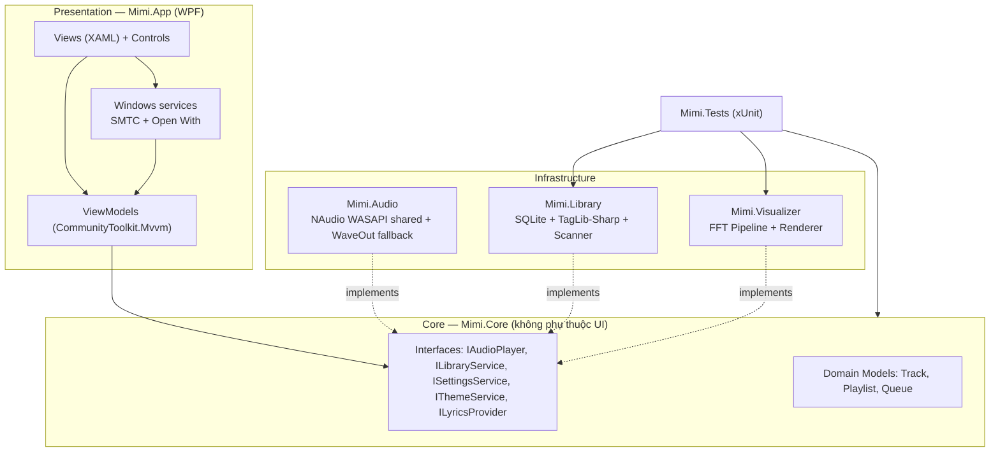
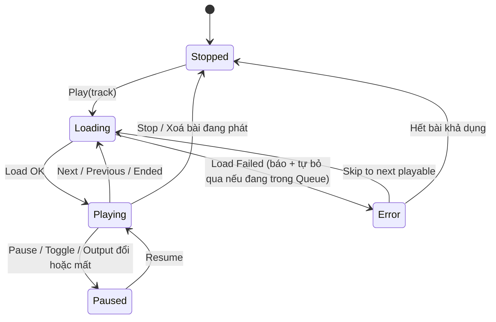
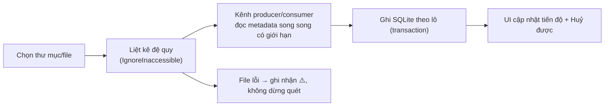

# MIMI — LỘ TRÌNH THIẾT KẾ & PHÁT TRIỂN PHẦN MỀM
## Ứng dụng nghe nhạc phong cách Anime × Hatsune Miku-inspired

| Thuộc tính | Nội dung |
|---|---|
| Tên sản phẩm | **Mimi** — Music Universe |
| Loại tài liệu | Product Design & Development Roadmap (Thiết kế sản phẩm + Lộ trình phát triển) |
| Phiên bản tài liệu | 1.1 — 29/10/2026 |
| Trạng thái | Baseline để triển khai (thay thế `BUILD-NEXT.md`) |
| Nền tảng | Windows 10/11 Desktop |
| Công nghệ hiện tại | C# 12 · WPF · .NET 8 · NAudio 2.2.1 · CommunityToolkit.Mvvm · Microsoft.Extensions.DependencyInjection · Serilog · xUnit · JSON persistence |
| Mô hình phát hành | **Mã nguồn mở, miễn phí cho cộng đồng** (GitHub: `lxmtuu/Mimi`) |
| Ưu tiên tính năng số 1 | **Visualizer (sân khấu sóng nhạc)** |
| Ngôn ngữ giao diện mục tiêu | **Song ngữ Tiếng Việt / English** (chuyển đổi tại runtime) |
| Đầu ra build | `Mimi.sln` → `src/Mimi.App` → `Mimi.exe` · Namespace `Mimi.*` · Dữ liệu `%LocalAppData%\Mimi` |

> **Định vị một câu:** *Mimi là một "sân khấu nghe nhạc anime" trên desktop — nơi thư viện nhạc local của bạn được trình diễn cùng visualizer neon teal/hồng lấy cảm hứng từ văn hoá Vocaloid, chạy hoàn toàn offline, tôn trọng bản quyền và thuộc về cộng đồng.*

---

## MỤC LỤC

1. [Tầm nhìn, sứ mệnh & định vị](#1-tầm-nhìn-sứ-mệnh--định-vị)
2. [Nguyên tắc vàng về IP: "Miku-inspired", không phải "Miku chính thức"](#2-nguyên-tắc-vàng-về-ip-miku-inspired-không-phải-miku-chính-thức)
3. [Người dùng mục tiêu & hành trình sử dụng](#3-người-dùng-mục-tiêu--hành-trình-sử-dụng)
4. [Nguyên tắc thiết kế sản phẩm](#4-nguyên-tắc-thiết-kế-sản-phẩm)
5. [Design System — "Mimi Neon Stage"](#5-design-system--mimi-neon-stage)
6. [Kiến trúc thông tin & đặc tả màn hình](#6-kiến-trúc-thông-tin--đặc-tả-màn-hình)
7. [Kiến trúc kỹ thuật đích](#7-kiến-trúc-kỹ-thuật-đích)
8. [Thiết kế chi tiết từng phân hệ](#8-thiết-kế-chi-tiết-từng-phân-hệ)
9. [Lộ trình triển khai theo Phase](#9-lộ-trình-triển-khai-theo-phase)
10. [Backlog ưu tiên (MoSCoW)](#10-backlog-ưu-tiên-moscow)
11. [Quy trình phát triển & CI/CD](#11-quy-trình-phát-triển--cicd)
12. [Chiến lược kiểm thử](#12-chiến-lược-kiểm-thử)
13. [Đăng ký rủi ro (Risk Register)](#13-đăng-ký-rủi-ro-risk-register)
14. [Chỉ số đo thành công (KPI)](#14-chỉ-số-đo-thành-công-kpi)
15. [Sổ quyết định cần chốt (Decision Log)](#15-sổ-quyết-định-cần-chốt-decision-log)
16. [Phụ lục A — Kết quả rà soát hiện trạng](#phụ-lục-a--kết-quả-rà-soát-hiện-trạng-29102026)
17. [Phụ lục B — Bảng kiểm chứng định dạng trên Windows](#phụ-lục-b--bảng-kiểm-chứng-định-dạng-âm-thanh-trên-windows)
18. [Phụ lục C — Thuật ngữ](#phụ-lục-c--thuật-ngữ)

---

## 1. Tầm nhìn, sứ mệnh & định vị

### 1.1. Tầm nhìn (Vision)
Biến việc nghe nhạc local — vốn đang khô khan trong các trình phát mặc định — thành một **buổi biểu diễn trực quan** mang đậm văn hoá anime/Vocaloid, nơi mỗi bài hát có sân khấu riêng: sóng nhạc neon, ảnh bìa, lời hát chạy chữ kiểu karaoke và một linh vật gốc (original mascot) mang tên **Mimi**.

### 1.2. Sứ mệnh (Mission)
- Phát nhạc local **nhanh, ổn định, không quảng cáo, không thu thập dữ liệu** (offline-first).
- Mang lại trải nghiệm thị giác "live stage" mượt 60fps mà các trình phát phổ thông không có.
- Mở mã nguồn để cộng đồng fan anime/Vocaloid cùng đóng góp theme, bản dịch và tính năng — theo cách **tôn trọng tuyệt đối bản quyền** của nghệ sĩ và chủ sở hữu IP.

### 1.3. Giá trị khác biệt (Differentiators)
| # | Khác biệt | Ý nghĩa |
|---|---|---|
| 1 | **Visualizer-first**: sân khấu sóng nhạc là trung tâm, không phải tính năng phụ | Lý do người dùng chọn Mimi thay vì Groove/Media Player |
| 2 | **Anime aesthetic có hệ thống**: Design System neon teal × sakura pink, mascot gốc, theme pack cộng đồng | Nhận diện cảm xúc mạnh, hợp văn hoá fan |
| 3 | **Offline & riêng tư tuyệt đối**: không tài khoản, không telemetry bắt buộc | Niềm tin cộng đồng open-source |
| 4 | **Song ngữ Việt/Anh ngay từ thiết kế** | Hiếm có ở phần mềm fan-made; tiếp cận cả người dùng VN và quốc tế |

### 1.4. Ngoài phạm vi (Non-goals) — nói rõ để chống phình phạm vi
- ❌ Không scrape, không tải lậu, không bẻ DRM của bất kỳ dịch vụ streaming nào.
- ❌ Không phân phối artwork/voicebank/logo chính thức của Hatsune Miku hay bất kỳ IP nào khi chưa có giấy phép.
- ❌ Không làm mobile/web trong giai đoạn này (kiến trúc lõi tách lớp để tương lai có thể tái sử dụng).
- ❌ Không đồng bộ cloud, không mạng xã hội trong app cho tới v1.0.

---

## 2. Nguyên tắc vàng về IP: "Miku-inspired", không phải "Miku chính thức"

Hatsune Miku là tài sản trí tuệ của **Crypton Future Media, INC.** Một dự án open-source phát hành công khai **không được** đóng gói hình ảnh, logo, tên thương mại hay giọng hát chính thức nếu chưa có license (kể cả license CC BY-NC của Miku cũng có điều kiện chặt chẽ và không bao phủ mọi loại sử dụng trong phần mềm). Thiết kế của Mimi tuân thủ mô hình 3 tầng an toàn pháp lý sau:

| Tầng | Nội dung | Quy tắc |
|---|---|---|
| **Tầng 1 — Core gốc (mặc định theo app)** | Mascot **Mimi** là nhân vật *nguyên bản* do dự án sáng tạo: cảm hứng từ tinh thần "ca sĩ ảo tương lai" (tóc teal, tai nghe, sân khấu neon) nhưng **kiểu tóc, trang phục, tỉ lệ, logo đều thiết kế riêng**, không sao chép tạo hình Miku | Được đóng gói & phát hành tự do theo license của dự án |
| **Tầng 2 — Theme cộng đồng (người dùng tự nạp)** | Theme Engine cho phép người dùng tự đưa ảnh/màu của họ vào thư mục `Themes\` trên máy cá nhân | App chỉ cung cấp *cơ chế*; repo & bản phát hành **không chứa** asset IP của bên thứ ba. Kèm điều khoản: người dùng chịu trách nhiệm về asset họ nạp |
| **Tầng 3 — Hợp tác có license (tương lai, có cổng duyệt)** | Nếu sau này xin được phép chính thức (VD: Piapro/Crypton collaboration) mới phát hành theme mang IP thật | Bắt buộc có văn bản license lưu trong `docs/legal/` trước khi merge |

**Checklist pháp lý bắt buộc trước mỗi bản phát hành công khai:** rà soát asset (font OFL/MIT, icon, ảnh), license thư viện (NAudio MIT; TagLib-Sharp LGPL-2.1 — dùng dạng NuGet dynamic link + ghi attribution), không dùng từ "Hatsune Miku" làm tên app/tên tính năng chính thức (chỉ dùng mô tả "Vocaloid-inspired" trong tài liệu giới thiệu kèm disclaimer *"Mimi is a fan-inspired, non-commercial open-source project. Hatsune Miku is a trademark of Crypton Future Media, INC. This project is not affiliated with or endorsed by Crypton."*).

---

## 3. Người dùng mục tiêu & hành trình sử dụng

### 3.1. Personas
| Persona | Chân dung | Nhu cầu cốt lõi (Job-to-be-done) |
|---|---|---|
| **A — Fan anime/Vocaloid (16–30)** | Nghe nhạc Nhật, Vocaloid covers, OST; thích cá nhân hoá desktop | "Khi tôi nghe nhạc Vocaloid, hãy cho tôi một sân khấu neon sống động để vừa nghe vừa chill/để màn hình phụ" |
| **B — Nhà sưu tầm nhạc local** | Có 500–20.000 file FLAC/MP3, ghét phụ thuộc streaming | "Hãy quét thư viện lớn của tôi thật nhanh, hiện đúng metadata/ảnh bìa, tìm kiếm không dấu được, đừng làm mất dữ liệu" |
| **C — Contributor cộng đồng** | Dev/designer/dịch giả fan dự án | "Hãy cho tôi kiến trúc rõ ràng, theme format và quy trình đóng góp dễ để tôi gửi PR đầu tiên trong 1 buổi tối" |

### 3.2. Hành trình chính (Core Journey)
```
Cài đặt → Mở app (màn hình chào + mascot) → Thêm thư mục nhạc (quét nền có tiến độ)
→ Thư viện hiện metadata/ảnh bìa → Chọn bài → NOW PLAYING + Visualizer Stage
→ Yêu thích / tạo Playlist → Hát theo Lyrics → Đổi Theme / đổi ngôn ngữ VI–EN
→ Đóng app → Mở lại: khôi phục bài & vị trí & queue của phiên trước
```

### 3.3. Yêu cầu trải nghiệm then chốt
- Thời gian từ mở app → nghe được bài đầu tiên: **< 3 thao tác** với người mới.
- Mọi thao tác phát nhạc chính làm được bằng **bàn phím & media keys** (không cần chuột).
- Không bao giờ mất thư viện/favorites vì lỗi ghi file hoặc nâng cấp phiên bản (migration có kiểm thử).

---

## 4. Nguyên tắc thiết kế sản phẩm

1. **Stage First** — Nhạc đang phát và visualizer luôn là nhân vật chính của màn hình; mọi thứ khác lùi về phụ trợ.
2. **Offline First, Privacy Always** — Mọi tính năng lõi chạy không cần mạng; dữ liệu ở máy người dùng.
3. **Never Lose User Data** — Ghi dữ liệu luôn atomic + có migration + có backup trước khi nâng cấp schema.
4. **Performance is a Feature** — Ngân sách hiệu năng là yêu cầu bắt buộc (60fps visualizer, quét 10.000 file không treo UI), đo được bằng số.
5. **Accessible by Default** — Tương phản đạt WCAG 2.2 AA, focus nhìn thấy được, tôn trọng `prefers-reduced-motion` của Windows.
6. **Bilingual by Design** — Không hard-code chuỗi UI; mọi text qua tài nguyên `Strings` để dịch VI/EN và cộng đồng dịch thêm.
7. **Respect Creators** — Chỉ tích hợp nguồn nhạc/lời/ảnh khi điều khoản cho phép rõ ràng; ghi attribution đầy đủ.

---

## 5. Design System — "Mimi Neon Stage"

Design System kế thừa bảng màu hiện tại của app (đang có trong `App.xaml`) và chuẩn hoá thành **Design Tokens** để dùng nhất quán + làm nền cho Theme Engine.

### 5.1. Bảng màu (Color Tokens)

| Token | Hex | Vai trò | Ghi chú |
|---|---|---|---|
| `color.bg.app` | `#0B101B` | Nền ứng dụng (sân khấu đêm) | Kế thừa `BgColor` hiện tại |
| `color.bg.panel` | `#121C2B` | Panel/Card | Kế thừa `PanelColor` |
| `color.bg.raised` | `#172638` | Card lồng, input, badge | Đang dùng rải rác → gom thành token |
| `color.brand.teal` | `#39C5BB` | Màu thương hiệu chính (Miku-teal family) | Điểm neo cảm hứng Vocaloid |
| `color.brand.teal.bright` | `#47E6D0` | Accent phát sáng, nút Play, sóng nhạc | = `AccentColor` hiện tại |
| `color.brand.sakura` | `#FF8FCB` | Accent phụ (hồng sakura) | = `PinkColor` hiện tại |
| `color.brand.sakura.hot` | `#FF5CAE` | Đỉnh sóng nhạc, trạng thái "hot" | Đang có trong gradient visualizer |
| `color.text.primary` | `#F3F7FF` | Chữ chính trên nền tối | Tương phản > 12:1 trên `bg.app` |
| `color.text.secondary` | `#9BAEC3` | Chữ phụ, mô tả | Đạt AA cho chữ thường |
| `color.text.muted` | `#8296AE` | Label, caption | Chỉ dùng cho chữ ≥ 11px |
| `⚠️ color.text.faint` | ~~`#60758D`~~ → `#7E93AC` | Footer/meta (cần nâng sáng) | Mã hiện tại **chưa đạt AA** cho chữ 10px → sửa ở Phase 1 |
| `color.state.success/warning/error` | `#3ED598 / #FFB020 / #FF5C7A` | Trạng thái hệ thống | Không dùng teal/hồng cho lỗi để tránh nhầm brand |
| `gradient.stage` | `#183E4D → #252542 → #171A2A` | Nền hero/Now Playing | Kế thừa gradient hiện tại |
| `gradient.spectrum` | `#47E6D0 → #FF5CAE` (dọc) | Cột sóng nhạc | Kế thừa visualizer hiện tại |

**Quy tắc:** cấm hard-code hex trong View (trừ file token); mọi màu qua `ResourceDictionary` theo token. Dark theme là mặc định; Light theme ("Daylight Stage") để Phase 5 khi Theme Engine hoàn thiện.

### 5.2. Typography
| Hạng mục | Lựa chọn | Lý do |
|---|---|---|
| Font chính (UI + Display) | **Be Vietnam Pro** (Google Fonts, OFL) — Regular/Medium/SemiBold/ExtraBold | Hỗ trợ **tiếng Việt hoàn hảo** (dấu, đa tầng), phong cách hiện đại hợp anime-tech; fallback `Segoe UI Variable` |
| Font số/mono | **Cascadia Mono** | Thời gian phát, thông số kỹ thuật |
| Thang chữ (px) | Display 30/36 · H1 21/28 · H2 17/24 · Body 13/18 · Small 12/16 · Caption 11/14 · Micro 10/13 (chỉ cho label in hoa, tracking +8%) | Chuẩn hoá từ kích thước đang dùng trong `MainWindow.xaml` |

### 5.3. Không gian, hình khối, hiệu ứng
- **Spacing:** lưới 4px (4/8/12/16/24/32). **Radius:** card 16–20, nút 10–12, badge 999 (kế thừa hiện tại).
- **Elevation kiểu "phát sáng sân khấu":** hạn chế `DropShadowEffect` hàng loạt (đắt GPU/CPU — bài học từ visualizer v1); glow chỉ dành cho phần tử anh hùng (nút Play, cột sóng) và phải đo hiệu năng.
- **Icon:** dùng bộ vector nhất quán (**Fluent UI System Icons** hoặc Lucide, license MIT) — **loại bỏ** kiểu "icon bằng chữ" hiện tại (`MUSIC`, `LOVE`, `Folder`, `▶|`) ở Phase 1–2.
- **Motion:** hover 120ms, chuyển panel 200–250ms `CubicEase`; visualizer phản ứng theo nhạc nhưng UI chrome không rung theo bass; tắt/giảm motion khi Windows bật giảm chuyển động.
- **Mascot Mimi (brief sáng tạo):** nhân vật ca sĩ ảo nguyên bản — tóc teal buộc hai bên *kiểu riêng của Mimi* (ngắn/vừa, phụ kiện ngôi sao–tai nghe mèo "Mi"), trang phục sân khấu tương lai teal×trắng×hồng. Cần bộ tối thiểu: avatar tròn, biểu cảm (vui/ngủ/lỗi), pose chào cho empty-state, pose "biểu diễn" cho Stage mode. Tuyệt đối không trace/copy tạo hình nhân vật có bản quyền. (Quyết định thuê artist hay dùng đóng góp cộng đồng: xem [Decision Log D-06](#15-sổ-quyết-định-cần-chốt-decision-log).)

### 5.4. Theme Engine (đặc tả tóm tắt)
- **Theme Pack** = thư mục chứa `theme.json` (ghi đè token màu/gradient) + `assets/` (ảnh nền, avatar mascot tuỳ chọn) + `LICENSE.txt` của tác giả theme.
- Theme tích hợp sẵn: `Neon Stage` (mặc định) · `Sakura Dream` · `Midnight Live` · `Mono Focus`.
- App **chỉ nạp** theme từ `%LocalAppData%\Mimi\Themes\`; validate JSON bằng schema, lỗi → quay về mặc định và báo lỗi thân thiện (không crash).

---

## 6. Kiến trúc thông tin & đặc tả màn hình

### 6.1. Sơ đồ điều hướng
```
Shell (Sidebar + Nội dung + Now Playing)
├── Home            — chào + nghe gần đây + yêu thích nổi bật + lối tắt thêm nhạc
├── My Library      — toàn bộ thư viện (bảng/lưới, sắp xếp, lọc)
├── Favorites       — bài đã thích
├── Playlists       — danh sách + chi tiết 1 playlist (CRUD, kéo thả thứ tự)
├── Queue           — hàng đợi phát (Now / Next)
├── Stage           — Visualizer toàn màn hình (F11) + Lyrics lớn
├── Lyrics          — lời đồng bộ trong panel Now Playing
└── Settings        — Thư viện & quét · Âm thanh · Giao diện/Theme · Ngôn ngữ · Phím tắt · Chẩn đoán · Giới thiệu
```

### 6.2. Khung cửa sổ chính (Shell) — wireframe mục tiêu
```
┌──────────────────────────────────────────────────────────────────────────┐
│ ◈ MIMI  Music Universe                    [Tìm kiếm........]   [VI|EN]   │  Header: search toàn cục + đổi ngôn ngữ
├────────────┬──────────────────────────────────────────┬──────────────────┤
│ YOUR SPACE │  HERO (gọn, thu được khi có nhạc)        │  NOW PLAYING     │
│ ⌂ Home     │ ┌──────────────────────────────────────┐ │ ┌──────────────┐ │
│ ♪ Library  │ │ Tiêu đề mục      [Sắp xếp] [Xem]    │ │ │  ẢNH BÌA     │ │
│ ♥ Favorite │ │ # │ Bài hát │ Nghệ sĩ │ Album │ ◐  │ │ │  + sóng nhạc │ │
│ ≡ Playlist │ │ 1 │ ...     │ ...     │ ...   │ 3:45│ │ │  phủ dưới    │ │
│ + Tạo mới  │ │ ... (ảo hoá danh sách 10k dòng)    │ │ └──────────────┘ │
│            │ └──────────────────────────────────────┘ │  Tên bài — Nghệ sĩ│
│ THƯ VIỆN   │  Trạng thái rỗng: mascot + nút Thêm nhạc │  ──●──────── 1:23 │
│ + Thêm file│                                          │  ⏮  ▶/⏸  ⏭  🔀 🔁 │
│ ▸ Quét thư │                                          │  Âm lượng ──●── 70%│
│   mục      │                                          │  [Lời] [Hàng đợi] │
├────────────┴──────────────────────────────────────────┴──────────────────┤
│ MIMI vX.Y · 1.234 bài · Đang phát: ...                    [Stage ⛶ F11]│  Status bar thật (thay footer trang trí)
└──────────────────────────────────────────────────────────────────────────┘
```
**Responsive:** ≥1280px đủ 3 cột; 900–1279px Now Playing thu thành thanh dưới (mini-player); <900px sidebar thành icon-rail. Bỏ giới hạn cứng `MinWidth=1050` hiện tại (hạ xuống 760 kèm layout thích ứng, Phase 2).

### 6.3. Đặc tả từng màn hình (tóm tắt triển khai)

| Màn hình | Thành phần chính | Trạng thái bắt buộc | Ghi chú từ hiện trạng |
|---|---|---|---|
| **Home** | Hero chào theo giờ, Nghe gần đây, Yêu thích, Playlist gợi ý | Rỗng (chưa có nhạc) | Nút HOME hiện tại **chưa có handler** → nối ở Phase 0 |
| **Library** | Bảng: ♥/Ảnh bìa/Bài hát/Nghệ sĩ/Album/Thể loại/Năm/Thời lượng/Định dạng; sắp xếp theo cột; tìm kiếm không dấu; lọc nâng cao; chọn nhiều | Đang quét (tiến độ + Huỷ), lỗi từng file (badge ⚠️) | Phase 3 đã có metadata TagLib, cột Cover dùng thumbnail 96px, các cột Title/Artist/Album/Genre/Year/Time/Format có thể bấm để sắp xếp, bộ lọc nghệ sĩ/album/thể loại/định dạng/trạng thái phát, chọn nhiều bằng Ctrl/Shift cho favorites/xoá/thêm-gỡ playlist hàng loạt, quét nền có tiến độ/huỷ, ảnh bìa 512px ở Now Playing, kéo-thả từ Explorer và ô tìm kiếm FTS5 có debounce/huỷ truy vấn cũ (lọc trong bộ nhớ làm lớp tức thời/fallback). Playlist giữ nguyên thứ tự riêng nên nút sắp xếp bị khoá ở chế độ xem playlist |
| **Favorites** | Như Library, lọc `is_favorite` | Rỗng có hướng dẫn | Đã có cột ♥ bấm trực tiếp, menu chuột phải và lưu vào SQLite (JSON chỉ còn fallback/import cũ) |
| **Playlists** | CRUD, kéo-thả bài vào, đổi thứ tự, phát tất cả/xáo trộn | Rỗng, trùng tên | Đã có sidebar playlist: tạo/đổi tên/xoá/phát, thêm bài đang chọn qua menu **Add to playlist**, gỡ bài và đổi thứ tự bằng kéo-thả hoặc Up/Down; dữ liệu nằm ở SQLite. Chưa kéo bài từ Library thả thẳng vào một hàng playlist; shuffle dùng chung `PlaybackQueue` toàn cục của Phase 4 khi phát playlist thay vì một công tắc riêng trong từng playlist |
| **Queue** | Đang phát / Kế tiếp, kéo sắp xếp, xoá khỏi hàng đợi | Rỗng | Đã có panel **Up Next** ở cột Now Playing: nguồn là danh sách đang nhìn tại lúc phát, kéo sắp xếp hoặc Up/Down, double-click phát ngay, Play Next/Add to Queue cho bài đang chọn, xoá một bài và Clear upcoming. `PlaybackQueue` ở Core giữ History/Current/Upcoming và chỉ commit sau khi audio nạp thành công |
| **Now Playing** | Ảnh bìa lớn, sóng nhạc phủ, seek, shuffle/repeat/mute, % volume | Chưa chọn bài, file lỗi | Đã có seek slider + nút −10s/+10s, Shuffle-bag, Repeat Off/All/One, Mute giữ nguyên % volume của slider và nhãn % hiệu dụng; Previous phát lại từ đầu nếu đã nghe hơn 3 giây, ngược lại quay đúng lịch sử đã phát. Metadata/bìa/trạng thái/timeline còn được đồng bộ lên SMTC của Windows, kèm thumbnail controls và taskbar progress. Nhãn output WASAPI/WaveOut hiện dưới Volume; khi thiết bị đổi hoặc mất, banner báo nhạc đã Pause và yêu cầu bấm Play để tiếp tục |
| **Stage (toàn màn hình)** | Visualizer chiếm trọn, lời lớn, thông tin bài tối giản, ẩn con trỏ | Tạm dừng (sóng hạ dần) | Điểm nhấn sản phẩm (Phase 1) |
| **Settings** | Playback/phiên nghe, khởi động/thư viện, Stage Engine, dữ liệu/chẩn đoán, khôi phục mặc định; mọi thay đổi lưu ngay | — | Đã có màn hình Settings trong cửa sổ chính và `settings.json` schema v3: volume/mute, shuffle/repeat, thông tin output WASAPI/WaveOut và quy tắc Pause khi đổi thiết bị, chế độ visualizer, bật/tắt khôi phục phiên/chế độ xem/vị trí cửa sổ, danh sách thư mục theo dõi, đăng ký **Open with Mimi** theo tài khoản Windows hiện tại, bảng **Keyboard Shortcuts**, tự nâng cấp cache bìa cũ, reset preferences. Phiên trước được nạp về đúng bài/vị trí/History/Up Next ở trạng thái Pause; theme/ngôn ngữ vẫn thuộc Phase 5 |
| **Diagnostics** | Phiên bản, thư mục dữ liệu/log, nút mở log, xuất thông tin hỗ trợ | — | Nhóm Data & Diagnostics trong Settings đã hiện phiên bản và mở được thư mục dữ liệu/log; xuất gói hỗ trợ vẫn chưa làm |

---

## 7. Kiến trúc kỹ thuật đích

Tại thời điểm rà soát ban đầu, dự án là 1 project WPF với `MainWindow.xaml.cs` 435 dòng ôm toàn bộ logic — phù hợp prototype nhưng **không kiểm thử được và khó nhận đóng góp** (file còn phình thêm sau các vá Phase 0, càng củng cố nhu cầu refactor theo Phase 2). Kiến trúc đích (đạt ở Phase 2, chuyển đổi dần, không "viết lại từ đầu"):

**Hiện trạng code sau Phase 2 (29/10/2026):** repo đã có `Mimi.sln` gồm `Mimi.App`, `Mimi.Core`, `Mimi.Audio`, `Mimi.Library`, `Mimi.Visualizer` và `Mimi.Tests`. `MainWindow.xaml.cs` còn 145 dòng glue-code; nghiệp vụ nằm ở `MainWindowViewModel`/`TrackItemViewModel` và các contract `IAudioPlayer`, `ILibraryService`, `IUserDataService`. FFT/AGC đã tách thành `SpectrumAnalyzer` để test độc lập. Các phần SQLite, async scanner, theme/lyrics trong sơ đồ vẫn là đích của các Phase sau, chưa được tính là đã triển khai.

**Cập nhật nền tảng Phase 3 (29/10/2026):** commit `875b325` nâng app/manifest lên `0.4.0` (đang phát triển, chưa tag) và [Windows CI restore/build/test đã đạt](https://github.com/lxmtuu/Mimi/actions/runs/40830179675) với 39 khai báo test/45 case ước tính theo `Fact`/`Theory`+`InlineData`. `Mimi.Library` nay chứa scanner bất đồng bộ có tiến độ/huỷ + fingerprint `file_size`/`mtime`, `TagLibTrackMetadataReader` (metadata + cache ảnh bìa theo hash, chưa resize 96/512) và `SqliteLibraryCatalog` schema v1 dùng WAL/transaction/FTS5; Core có thêm `ILibraryCatalog`/`ITrackMetadataReader`. App khởi tạo SQLite ở nền, nhập JSON cũ chỉ khi catalog rỗng rồi archive JSON thành `.bak`, fallback về JSON nếu SQLite không mở được, ghi lịch sử nghe/Recently played, hiện cột Artist/Album/Time, ảnh bìa và nhận kéo-thả Explorer. Đây **chưa phải điểm đóng Phase 3**: UI chưa nối tìm kiếm vào FTS5 và chưa có playlist UI (catalog/playlist mới ở tầng dữ liệu), chưa có `FileSystemWatcher`, “Open with Mimi”, settings/phiên nghe đầy đủ; mục tiêu 10.000 bài/tìm <100ms và kiểm thử nâng cấp trên Windows thật vẫn chưa đo.

**Cập nhật Playlist UI + FTS5 (29/10/2026):** commit `5e68112` và [Windows CI restore/build/test đã đạt](https://github.com/lxmtuu/Mimi/actions/runs/40832238679) đã nối ô tìm kiếm vào `SearchTracksAsync` bằng debounce 180ms, cancellation/version chống kết quả cũ ghi đè và thứ hạng FTS cho Library/Favorites (Playlist/Recently played vẫn giữ thứ tự riêng; lọc trong bộ nhớ là lớp tức thời và fallback khi catalog không khả dụng). Sidebar nay quản lý playlist thật: tạo/đổi tên/xoá/phát, thêm bài đang chọn qua menu, gỡ bài, kéo-thả đổi thứ tự hoặc dùng Up/Down; thao tác kéo-thả nằm ở `PlaylistReorderBehavior`, hộp nhập tên dùng `TextPromptWindow` qua `IDialogService`, và `MainWindow.xaml.cs` vẫn giữ 145 dòng. Phase 3 vẫn chưa đóng vì sắp xếp cột/lọc nâng cao/chọn nhiều, resize bìa, `FileSystemWatcher`, “Open with Mimi”, settings/phiên nghe và các phép đo/nâng cấp trên Windows thật còn mở.

**Cập nhật sắp xếp/lọc/chọn nhiều (29/10/2026):** commit `5c6b6fe` và [Windows CI restore/build/test đã đạt](https://github.com/lxmtuu/Mimi/actions/runs/40833824003) bổ sung cột Genre/Year, tiêu đề cột có mũi tên sắp xếp tăng/giảm cho Title/Artist/Album/Genre/Year/Duration/Format, hàng bộ lọc nghệ sĩ/album/thể loại/định dạng/trạng thái phát và nút Clear đưa tìm kiếm/bộ lọc/sắp xếp về mặc định của chế độ xem. Tìm kiếm hoặc đổi chế độ xem sẽ tự xoá sắp xếp tuỳ chỉnh để FTS, Recently played và Playlist giữ đúng thứ tự nghiệp vụ; chế độ Playlist khoá nút sắp xếp hoàn toàn. `SelectedItemsBehavior` đồng bộ `ListView.SelectedItems` (Extended) với `SelectedTracks` trong ViewModel, từ đó favorites, **Add to playlist**, gỡ khỏi playlist và xoá khỏi thư viện đều xử lý được một hoặc nhiều bài; thao tác thêm vào playlist đếm riêng số bài thêm được/bỏ qua. Phase 3 vẫn chưa đóng vì resize bìa, watcher/file association, settings/phiên nghe và cổng hiệu năng/nâng cấp trên Windows thật còn mở.

**Cập nhật ảnh bìa 96/512 (29/10/2026):** commit `83d7c9e`, hai commit build `875d18f`/`87e9daa` và [Windows CI cuối đã đạt restore/build/test](https://github.com/lxmtuu/Mimi/actions/runs/40835745150) đưa SkiaSharp 4.154.0 vào `Mimi.Library` để tạo cặp JPEG `{hash}-512.jpg`/`{hash}-96.jpg` ngay khi quét; `CoverArtPaths` trong Core là quy ước dùng chung, ảnh quá 25 megapixel hoặc codec không đọc được sẽ fallback cache byte gốc để không làm hỏng lượt quét. Danh sách bài có cột thumbnail 96px, Now Playing dùng biến thể 512px, còn cache byte gốc đã lưu từ bản trước được `CoverArtOptimizer` nâng cấp ở nền sau khi thư viện hiện lên và ghi lại đường dẫn mới vào SQLite. Bộ test tăng lên 44 khai báo/52 case ước tính. Vì gói SkiaSharp 4 kèm native PDB rất lớn, `Mimi.App.csproj` loại PDB và runtime asset ngoài Windows ngay sau `ResolvePackageAssets`; artifact app của CI cuối là 29.556.665 byte thay vì 108.187.331 byte ở lần tích hợp đầu. Phase 3 vẫn chưa đóng vì watcher/file association, settings/phiên nghe và cổng hiệu năng/nâng cấp trên Windows thật còn mở.

**Cập nhật Settings + khôi phục phiên (29/10/2026):** commit `d925891` và [Windows CI restore/build/test đã đạt](https://github.com/lxmtuu/Mimi/actions/runs/40838010802) nâng `settings.json` lên schema v2 (v1 chỉ có volume vẫn đọc được), chuẩn hoá giá trị khi nạp/lưu và giữ ghi atomic. Sidebar có màn hình **Settings** cho volume, khôi phục phiên, khôi phục chế độ xem thư viện (view/playlist/tìm kiếm/lọc/sắp xếp/bài đang chọn), nhớ vị trí cửa sổ, tự nâng cấp cache bìa cũ, chế độ Stage, mở thư mục dữ liệu/log và reset preferences; logic nằm ở `MainWindowViewModel.Settings.cs`, vị trí cửa sổ nằm ở `WindowPlacementBehavior` có kẹp bounds vào màn hình hiện tại nên `MainWindow.xaml.cs` vẫn 145 dòng. Vị trí nghe được lưu khi đổi bài/tạm dừng/tua, định kỳ khoảng 5 giây và khi đóng app; lần mở sau nạp đúng bài ở trạng thái Pause, không tự phát và không tính thêm một lượt nghe. Bộ test tăng lên 47 khai báo/55 case ước tính; artifact app là 29.574.126 byte. Phase 3 vẫn chưa đóng vì watcher/file association và cổng hiệu năng/nâng cấp trên Windows thật còn mở.

**Cập nhật theo dõi thư mục (29/10/2026):** commit `0da4091` (kèm sửa escape dữ liệu test ở `f675dbb`) và [Windows CI cuối đã đạt](https://github.com/lxmtuu/Mimi/actions/runs/40839876614) bổ sung `ILibraryFolderWatcher` ở Core và `FileSystemLibraryFolderWatcher` ở `Mimi.Library`. Settings lưu công tắc + danh sách **Watched folders**; sự kiện tạo/sửa/đổi tên/xoá được gom với debounce 1 giây và buffer 64 KiB, tự fallback rescan thư mục khi buffer tràn. `MainWindowViewModel.WatchedFolders.cs` xếp hàng thay đổi sau các lượt quét thủ công, quét bài mới/sửa ở nền, còn file bị xoá ngoài Mimi chỉ được đánh dấu Missing chứ không âm thầm biến mất khỏi thư viện. Bộ test tăng lên 51 khai báo/59 case ước tính; artifact app là 29.586.896 byte. Phase 3 vẫn chưa đóng vì “Open with Mimi” và cổng hiệu năng/nâng cấp trên Windows thật còn mở.

**Cập nhật “Open with Mimi” (29/10/2026):** commit `2bf927e` và [Windows CI restore/build/test đã đạt](https://github.com/lxmtuu/Mimi/actions/runs/40842261976) hợp nhất danh sách đuôi nhạc vào `SupportedAudioFiles` ở Core rồi bổ sung `IFileAssociationService`/`WindowsFileAssociationService`. Tuỳ chọn trong Settings chỉ ghi ProgID `Mimi.AudioFile`, `OpenWithProgids`, `Applications`, App Paths và Capabilities dưới `HKCU` cho tài khoản hiện tại; Mimi không sửa `UserChoice` nên không tự chiếm ứng dụng mặc định. App nhận file/thư mục từ command line, đưa file vào Library và phát bài playable đầu tiên; `SingleInstanceCoordinator` giữ một tiến trình chính theo SID người dùng và chuyển các lần mở sau qua named pipe để Explorer không tạo nhiều cửa sổ/player cạnh tranh nhau. Bộ test tăng lên 53 khai báo/68 case ước tính; artifact app là 29.600.066 byte. Các mục code chính của Phase 3 đã đủ, nhưng Phase vẫn chưa đóng cho tới khi nghiệm thu nâng cấp và đo 10.000 bài/tìm <100ms/cuộn-quét trên Windows thật.

**Cập nhật Queue + chế độ phát Phase 4 (29/10/2026):** commit `ab7308f` nâng app/manifest lên `0.5.0` (đang phát triển, chưa tag) và [Windows CI restore/build/test đã đạt](https://github.com/lxmtuu/Mimi/actions/runs/40846049669). Core có `PlaybackQueue<T>` tách ngữ cảnh nguồn, lịch sử đã phát, bài hiện tại và Up Next; nó dùng shuffle-bag không lặp trong một vòng, tạo vòng mới cho Repeat All mà không bắt đầu ngay bằng bài vừa kết thúc khi còn lựa chọn khác, giữ thứ tự nguồn khi tắt shuffle và chỉ chuyển trạng thái khi ViewModel xác nhận audio đã nạp thành công nên file lỗi bị bỏ qua an toàn. Panel **Up Next** hỗ trợ kéo sắp xếp, Up/Down, phát ngay, xoá và Clear; menu bài hát có Play Next/Add to Queue cho cả lựa chọn nhiều bài. Now Playing có Shuffle, Repeat Off/All/One, Mute + % volume hiệu dụng và tua −10s/+10s; Previous quay về đầu bài sau 3 giây, nếu không sẽ đi theo lịch sử đã nghe thật. `settings.json` schema v3 lưu mute/shuffle/repeat cùng ngữ cảnh/History/Up Next của phiên Pause và vẫn migration được từ v1/v2. Bộ test hiện có 56 khai báo/71 case ước tính (đã thay các test `PlaybackNavigator` cũ bằng test queue mới); artifact app là 29.625.596 byte. Phase 4 chưa đóng vì SMTC/media keys, nút thumbnail taskbar, bảng phím tắt trong Settings, đánh giá WasapiOut/thay đổi thiết bị xuất âm và nghiệm thu Windows thật còn mở.

**Cập nhật tích hợp media Windows Phase 4 (29/10/2026):** commit `a138544`, các sửa CI tính đến `f530ba9` và [Windows CI cuối đã đạt restore/build/test](https://github.com/lxmtuu/Mimi/actions/runs/40850352056) đưa riêng `Mimi.App` lên `net8.0-windows10.0.19041.0` với `SupportedOSPlatformVersion` 17763 (Windows 10 1809). `WindowsMediaControlsService` ở App layer lấy SMTC theo HWND của cửa sổ chính, marshal mọi callback về UI dispatcher và đồng bộ title/artist/album/genre/year, ảnh bìa qua `InMemoryRandomAccessStream` được giữ sống, trạng thái Play/Pause, Next/Previous, Shuffle/Repeat cùng timeline mỗi giây; lệnh Play/Pause của Windows dùng command không-toggle và seek tuyệt đối đi qua cùng đường clamp của ViewModel. `MainWindow` có taskbar thumbnail Previous/Play/Pause/Next + progress/description, còn `MainWindow.Keyboard.cs` xử lý Space/mũi tên theo focus (nhường ô nhập, button, slider và danh sách), Ctrl+←/→, Ctrl+F, F11/Esc và media-key fallback chỉ khi SMTC không sẵn sàng để tránh toggle hai lần; Settings có bảng Keyboard Shortcuts. Artifact app tăng lên 36.264.898 byte (hơn 6.639.302 byte so với lát queue, chủ yếu do WinRT projection của target Windows SDK); bộ test không đổi 56 khai báo/71 case ước tính vì lát này thuộc App/Windows integration. Phase 4 vẫn chưa đóng: cần nghiệm thu flyout/màn hình khoá/taskbar/media keys/phím tắt trên Windows thật, rồi đánh giá WasapiOut và xử lý đổi thiết bị xuất âm.

**Cập nhật WASAPI + thiết bị xuất âm Phase 4 (29/10/2026):** commit `ff17c07` và [Windows CI đã đạt restore/build/test](https://github.com/lxmtuu/Mimi/actions/runs/40855564811) chuyển `AudioService` sang **WasapiOut shared mode, event sync, latency yêu cầu 100ms** trên endpoint Render/Multimedia mặc định của Windows, tận dụng AutoConvertPcm của WASAPI và up-mix riêng file mono sang stereo sau visualizer tap; `WaveOutEvent` 200ms/3 buffer chỉ còn là fallback khi WASAPI không mở được. Core có `AudioOutputStatus`/`AudioOutputChangedEventArgs` và `AudioOutputUnavailableException`, còn `WindowsAudioDeviceWatcher` ở `Mimi.Audio` đăng ký `IMMNotificationClient`, debounce 300ms và marshal việc dựng lại stream về synchronization context của app. Khi endpoint mặc định đổi, biến mất hoặc stream dừng vì lỗi thiết bị, service giữ nguyên reader/vị trí, chỉ dispose output cũ rồi mở output mới ở trạng thái Pause—không tự chuyển tiếng sang loa khác; ViewModel phân biệt “không có output” với file hỏng nên không ghi playback-error oan và hiển thị nhãn output + banner trong Now Playing/Settings. Bộ test tăng lên 60 khai báo/75 case ước tính nhờ 4 test cho status/exception; artifact app là 36.278.739 byte. Quyết định D-03 mới được chốt ở mức kiến trúc/triển khai có fallback; Phase 4 vẫn chưa đóng cho tới khi đo A/B độ trễ/ổn định WASAPI ↔ WaveOut và nghiệm thu rút USB, Bluetooth, disable/không có output cùng các exit gate tương tác khác trên Windows thật.

**Xác minh Windows thật + lát hỗ trợ A/B (29/10/2026):** người dùng đã chạy trực tiếp trên Windows tại trạng thái sau `b74e5cd`: NuGet restore thành công, Release build đạt **0 warning/0 error**, unit test **75/75 passed**, `git diff --check` sạch và working tree sạch. Kết quả này xác nhận cổng build/test tự động trên máy thật, nhưng **không** thay thế bằng chứng runtime cho SMTC/flyout/media keys/taskbar, rút USB/Bluetooth, disable/không có output hay phép đo D-03. Commit `9f19f40` và [Windows CI `40872986566`](https://github.com/lxmtuu/Mimi/actions/runs/40872986566) bổ sung cơ chế chẩn đoán `MIMI_AUDIO_OUTPUT=auto|wasapi|waveout`: `auto` giữ WASAPI shared → WaveOut fallback, `wasapi` tắt WaveOut fallback, `waveout` bỏ WASAPI và báo trạng thái `WaveOutForced`/`WaveOut diagnostic` để tránh lẫn với fallback thật; giá trị sai được log cảnh báo rồi quay về `auto`. Parser nằm ở Core, lựa chọn được đọc một lần khi `AudioService` khởi tạo và xuất hiện trong log/diagnostics, không thêm công tắc Settings cho người dùng cuối. Cùng commit này, mỗi thumbnail task của SMTC sở hữu và tự dispose `CancellationTokenSource` của nó trong `finally`, còn task bị thay thế chỉ bị Cancel để tránh dispose tranh chấp. Bộ test tăng lên 62 khai báo/83 case ước tính; artifact app của CI là 36.280.049 byte. Trạng thái Phase 4 được ghi nhận là **Code complete — Acceptance pending**; các cổng P4-A…P4-H ở mục Phase 4 vẫn phải có kết quả trên Windows thật trước khi chốt D-03 hoặc đóng phase.

**Nghiệm thu Windows thật đợt 2 (29/10/2026, commit được kiểm tra: `04ab178`):** máy Windows đã fast-forward từ `b74e5cd` lên `04ab178`, restore thành công, Release build đạt **0 warning/0 error** và unit test thực tế đạt **83/83** với 0 test thất bại; working tree sạch. Sau khi xác nhận không còn tiến trình Mimi, người kiểm tra chạy tuần tự `MIMI_AUDIO_OUTPUT=wasapi|waveout|auto` trên cùng endpoint mặc định **Speakers (Realtek(R) Audio)**, đối chiếu log để xác nhận backend thực tế, dùng UI Automation bấm Play trong Mimi và phát cùng bài khoảng 20 giây cho mỗi lượt. Cả ba lượt đều khởi tạo SMTC, phát nhạc và thoát bình thường; `waveout` mở đúng WaveOut forced, còn `wasapi` và `auto` đều mở WASAPI shared. Tín hiệu loopback số của Windows được thu ở định dạng 48 kHz, stereo, float 32-bit:

| Chế độ | Backend thực tế | Buffer sau mốc bắt đầu | Buffer có tín hiệu | Tỉ lệ có tín hiệu | Đến buffer có tín hiệu đầu tiên | Khoảng callback lớn nhất | RMS trung bình |
|---|---|---:|---:|---:|---:|---:|---:|
| `wasapi` | WASAPI shared | 320 | 318 | 99,38% | 139,93ms | 111,47ms | 0,2769 |
| `waveout` | WaveOut forced | 321 | 319 | 99,38% | 141,06ms | 65,72ms | 0,2770 |
| `auto` | WASAPI shared | 320 | 319 | 99,69% | 123,48ms | 64,35ms | 0,2777 |

Cột “đến buffer có tín hiệu đầu tiên” là phép đo sơ bộ ở tầng phần mềm từ mốc kích hoạt phép thử tới buffer loopback đầu tiên vượt ngưỡng tín hiệu; nó **không** phải latency âm học/đầu-cuối tính từ lệnh Play tới loa và không thể dùng riêng để xếp hạng backend. Trong các mẫu 20 giây này, RMS ba lượt rất sát nhau và không quan sát thấy chuỗi im lặng kéo dài lặp lại giữa bài—các buffer không có tín hiệu nằm quanh thời điểm bắt đầu. Lượt WASAPI forced có một khoảng callback **111,47ms** cần theo dõi, nhưng buffer tại thời điểm đó vẫn có tín hiệu; lượt `auto` cũng dùng WASAPI nhưng khoảng lớn nhất chỉ 64,35ms. Vì vậy dữ kiện đơn lẻ này mới là tín hiệu để lặp lại phép thử dài hơn, chưa chứng minh dropout/pop nghe được hay WASAPI kém ổn định hơn WaveOut. Phân loại hiện tại là **P4-A đạt một phần** (SMTC khởi tạo/phát nhạc, chưa thao tác trực tiếp flyout), **P4-G đạt một phần** (đã có vòng loopback A/B ngắn, chưa đủ kết luận ổn định dài hạn/latency vật lý), còn **P4-B…P4-F chưa nghiệm thu**. Dữ liệu thô và log đầy đủ hiện được giữ ngoài repo trên máy kiểm tra; Phase 4 vẫn **Code complete — Acceptance pending** và D-03 vẫn là quyết định tạm thời.

**Nghiệm thu S0/S1 bằng Acceptance Kit (29/10/2026, commit được kiểm tra: `a056377`):** máy Windows đã ở đúng branch/commit, `git pull --ff-only` báo đã cập nhật và working tree sạch trước/sau kiểm tra. **S0 đạt (`PASS`)**: restore thành công, Release build 0 warning/0 error, unit test thực tế 83 passed/0 failed/0 skipped; app Release khởi chạy với WASAPI Shared trên Speakers (Realtek(R) Audio) và Windows media controls được khởi tạo. Script `tools/Analyze-LoopbackCsv.ps1` đã chạy thật trên ba CSV cũ có cùng header `elapsed_ms,bytes,rms,peak,callback_gap_ms`, tạo thành công Markdown/JSON trong thư mục ignored `artifacts/acceptance/`. Toàn bộ file có 353/354/354 dòng và thời lượng khoảng 22 giây; gap p50 lần lượt là 62,489/62,365/62,288ms, p95 là 63,926/63,774/63,679ms, p99 là 64,346/64,219/64,017ms và max là 111,472/65,719/64,352ms cho WASAPI/WaveOut/auto. Chỉ WASAPI forced có một gap >100ms và cả ba đều có 0 chuỗi im lặng sau tín hiệu đầu tiên, củng cố cách phân loại điểm 111,472ms là `Observation` đơn lẻ thay vì lỗi ổn định đã chứng minh. CSV có khoảng hai giây pre-roll nên `TimeToFirstSignal` khoảng 2,17 giây tính từ đầu file không được dùng làm latency từ lệnh Play; analyzer đã được bổ sung mốc trigger tường minh cho các lượt sau. Đợt đối chiếu S1 cho kết quả **P4-A `PARTIAL`** (A1/A3 một phần; A2/A5 `BLOCKED` vì chưa có fixture cover/queue phù hợp; A4 và A6–A12 `NOT RUN`), **P4-B `NOT RUN`** cho B1–B6, và **P4-C `PARTIAL`** (C5/C7 chỉ có bằng chứng mô phỏng/một phần focus như Ctrl+F, Space trong ô tìm kiếm và mũi tên trên slider; C1–C4 chưa chạy bằng phím media vật lý, C6 `N/A/NOT RUN`). Chưa phát hiện Blocker/Major mới đã được chứng minh, nhưng S1 chưa hoàn tất; quyết định hiện tại là **chưa mở Draft PR và chưa chuyển sang S2** cho tới khi hoàn thành thao tác trực tiếp còn thiếu của S1. Báo cáo chi tiết vẫn được giữ ngoài repo trên máy kiểm tra.

**Kết quả Quick Settings trực tiếp và điều tra A7 (29/10/2026):** lượt kiểm tra tiếp theo trên Windows 11 đã xác nhận A1 metadata, A2 ảnh bìa, A3 đồng bộ Play/Pause, A4 Play/Pause từ thẻ, A5 Next và A6 Previous đều `PASS`; A6 quay lại Cyan với thẻ Windows và UI Mimi cùng đồng bộ. A7 chưa được phân loại vì thẻ không hiện progress bar hay thời gian bài để so với app, còn thay đổi được ghi nhận sau 10 giây chưa xác định là thành phần nào. Rà soát tĩnh tại `ccdb489` cho thấy `WindowsMediaControlsService` gọi đồng bộ trạng thái/timeline mỗi giây, dùng `AudioFileReader.CurrentTime` cho Position, lấy `TotalTime` hoặc duration metadata làm End/MaxSeek và kẹp vị trí trong duration; vì vậy chưa có căn cứ sửa code chỉ từ việc thẻ không vẽ timeline. Script chỉ-đọc `tools/Inspect-SmtcSession.ps1` được thêm để phân biệt timeline không được xuất bản với trường hợp Windows đã nhận timeline nhưng Quick Settings không hiển thị. Lượt chạy thật tại `7c14775` thành công với exit code 0 và thấy session `Mimi.exe`; mẫu Cyan đầu tiên bắt đầu ở `30.107 / 30.119` giây nên việc Position không đổi trong 11,26 giây trong khi `LastUpdatedTime` tiến khoảng 10,77 giây được phân loại là lượt đo bắt đầu quá sát cuối bài, **không đủ kết luận**. Một lượt khác trên Magenta ở trạng thái `Playing` ghi Position tăng từ khoảng 2,46 lên 7,29 giây trong 5,17 giây, duration khoảng 30,119 giây và các cờ seek/FastForward/Rewind đều bật. Lượt Cyan sạch tiếp theo tại `2a26e90` phát lại playlist từ đầu bằng UI Automation và ghi cùng bài Cyan đang `Playing` ở cả mẫu đầu/cuối, Position `2.161 → 9.161` giây trên duration `30.119` giây, `TimelinePublished = True`, `StartedNearEnd = False`, `RawPositionDeltaSeconds = 7.000`, `LastUpdatedDeltaSeconds = 6.998` và `WallClockDeltaSeconds = 7.206`; quan sát Cyan đứng ở cuối bài do đó đã được khép lại như tiền điều kiện đo không hợp lệ thay vì lỗi `CurrentTime`. Ảnh Quick Settings chụp từ xa trong lượt này chỉ thấy một phần mép bảng, nhưng ảnh toàn thẻ do chủ dự án cung cấp sau đó cho thấy title/artist/cover Cyan đúng và hàng điều khiển chỉ gồm Previous/Play/Next; không thấy progress/thời gian, FastForward/Rewind hay Shuffle/Repeat. Nút giữa là Play nên ảnh chụp ở trạng thái có thể phát tiếp/Paused; kết hợp với báo cáo trực tiếp trước đó rằng không có timeline để kéo, phần hiển thị/seek trên thẻ được phân loại `BLOCKED/N/A` cho bề mặt/build này, trong khi A7 đã đạt ở tầng xuất bản/tiến triển dữ liệu GSMTC và vẫn `PARTIAL` ở tiêu chí trực quan. Cùng ảnh ghi nhận nhãn nguồn `Unknown app`, được tách thành `Minor/Observation` về app identity của bản unpackaged chứ không phải căn cứ kết luận lỗi timeline. Sau checkpoint này, bản sửa identity đã được kiểm tra lại trên Windows thật: tiến trình unpackaged tự đặt AppUserModelID `Mimi.App` trước khi tạo cửa sổ/SMTC, `AppMediaId` dùng cùng ID, và sau khi bật đăng ký Windows theo tài khoản, registry `Mimi.AudioFile`, mục RegisteredApplications, đăng ký 8 định dạng âm thanh, shortcut `Mimi.lnk` cùng icon Mimi đều `PASS`; AppUserModelID đọc được là `Mimi.App` và GSMTC nhận diện ứng dụng `PASS`. Báo cáo chưa ghi riêng nhãn nhìn thấy ở đầu thẻ Quick Settings, nên quan sát trực quan chưa đóng dù tầng đăng ký/identity/GSMTC đã đạt. Cùng lượt kiểm tra trước đó, source tại `7c14775` đạt test thực tế 83/83 và build 0 warning/0 error sang output riêng do tiến trình Mimi đang chạy khóa DLL ở output mặc định. A8 hiện `BLOCKED` ở bề mặt thẻ, A9 mới được đối chiếu source nhưng chưa chạy ±10 giây, còn A10–A12 `NOT RUN`; P4-A vì thế vẫn `PARTIAL`.

**Phát hiện và bản sửa race tiến trình quét thư viện (30/10/2026):** lượt kiểm tra lại trên Windows thật tại `7be7675` ghi Git đồng bộ và Release build 0 warning/0 error, nhưng unit test chỉ đạt 82/83. Test `ScanFolderAsync_FindsSupportedFilesAndReportsProgress` có thể thất bại không ổn định vì `LibraryService` quét song song bằng `Parallel.ForEachAsync`, dùng `Interlocked.Increment` để cấp số file đã xử lý rồi gọi `IProgress.Report` ở bước riêng; một worker mang số lớn hơn có thể báo cáo trước worker mang số nhỏ hơn. Bản sửa serialize đúng cặp tăng bộ đếm + `Report` bằng một gate trong mỗi lượt quét, giữ nguyên mức song song của việc đọc metadata, đồng thời siết test hai file thành dãy `[1, 2]` và thêm regression test 32 file yêu cầu `ProcessedFiles` tăng đúng `1..32` (suite tăng thêm một test). Đây là lỗi `Minor` ở thứ tự tiến trình quét/độ ổn định test, không phải bằng chứng mất dữ liệu thư viện. Retest trên Windows thật tại `9a925f3` sau đó được thực hiện trên checkout sạch đúng upstream và đạt restore + `git diff --check`, targeted Release 2/2 cho hai test liên quan, full suite **84/84** (0 failed/0 skipped) cùng Release build 0 warning/0 error; kết quả 82/83 không còn xuất hiện. Tuy nhiên một số phiên thực thi từ xa bị kết thúc giữa chừng nên chiến dịch 20 lượt targeted liên tiếp chưa được xác nhận đầy đủ; hồ sơ không khẳng định 20/20 và giữ bằng chứng lặp dài này làm mục theo dõi còn lại của phát hiện `Minor`.

**Xác nhận trực quan Quick Settings tại `9a925f3` (30/10/2026):** ảnh/báo cáo mới xác nhận đầu thẻ hiện tên nguồn `Mimi` thay vì `Unknown app`; title `Acceptance One - Cyan Signal`, artist `Mimi Acceptance Lab` và cover Cyan đều đúng, hàng điều khiển hiện Previous/Pause/Next khi đang phát. Ảnh vẫn không có seek bar, thời gian elapsed/duration hay nút FastForward/Rewind riêng, qua đó củng cố phân loại A7 trực quan/A8 là `BLOCKED/N/A` trên shell/build hiện tại mà không phủ nhận timeline GSMTC đã được xác minh. Ảnh tĩnh ban đầu không nêu riêng biểu tượng nguồn hay taskbar grouping/thumbnail. Lượt thao tác thực tế tiếp nối trên cùng checkpoint code `9a925f3` sau đó đã nhấn Next trên thẻ để chuyển sang bài tiếp theo và Previous để quay lại bài trước, cả hai đều `PASS`, qua đó làm mới trực tiếp bằng chứng A5/A6 trên checkpoint hiện tại; lượt này không báo cáo riêng một thao tác Play/Pause mới nên A4 vẫn dựa trên phiên thao tác trực tiếp đã ghi trước đó, trong khi P4-B vẫn `NOT RUN`. Phần nhãn trực quan `Unknown app` vì vậy đã khép lại, còn Phase 4 vẫn chưa đóng.

**Kiểm tra fixture S1 và phát hiện auto-advance (31/10/2026, Windows thật, commit `57b14a3`):** xác minh thư mục `C:\Users\Public\MimiPhase4Tools\Fixtures\AcceptanceS1\Mimi-Acceptance-Fixtures\` có đủ ba MP3 tổng hợp 30,126 giây, tag/ảnh bìa riêng; fixture không kèm manifest hash phát hành nên SHA-256 được lưu làm fingerprint, không coi là đối chiếu với checksum kỳ vọng. Release chạy bằng hồ sơ thử nghiệm cô lập, thư viện SQLite xác nhận đủ cả Cyan/Magenta/Amber; log ghi nhận mở thành công 3 tệp hỗ trợ, volume 5%, Shuffle Off và Repeat Off. GSMTC nhận đúng nguồn `Mimi.App`, metadata/thumbnail Cyan và timeline tăng từ 17,19 giây đến gần 30,11/30,119 giây. Sau khi bài Cyan kết thúc tự nhiên, cả 35 mẫu trong khoảng 34,46 giây tiếp tục trả về Cyan/Paused ở vị trí 30,107 giây; không chuyển sang bài kế tiếp trong queue. Theo luồng mở nhiều tệp, cả ba bài đã được thêm vào thư viện và queue context được lập từ các bài đang thấy; kết quả này ghi **A12 FAIL (cần điều tra playback-ended/auto-advance)**, không chỉ là lượt lấy mẫu sát cuối bài. A7 đạt một phần ở tầng SMTC/GSMTC (nguồn và timeline được xuất bản, vị trí tiến triển); phần quan sát thanh tiến trình trên Quick Settings vẫn chưa được kiểm tra lại trực quan. Việc chụp UI Mimi thất bại hai lần theo cùng lỗi quyền sở hữu window ID, nên dừng UI automation theo quy trình skill; không dùng lượt này để chấm các tiêu chí UI khác. Sau phép thử, tiến trình Mimi được đóng bình thường, hồ sơ `%LOCALAPPDATA%\Mimi` khôi phục và SHA-256 khớp đủ 4 tệp với bản sao lưu. A12 hiện chặn việc đóng Phase 4; roadmap là thay đổi duy nhất trong working tree.

**Sửa và retest A12 (31/10/2026, Windows thật, base `57b14a3`):** nguyên nhân là `AudioService.Output_PlaybackStopped` chỉ phát `PlaybackEnded` khi `reader.Position >= reader.Length`; với fixture MP3/WASAPI, callback dừng bình thường ở **30,107/30,119 giây**, nên phép so sánh byte-vị-trí tuyệt đối bỏ sót việc hết stream. Lệnh Stop chủ động đã tháo handler trước `output.Stop()`, callback có exception vẫn đi nhánh phục hồi riêng; vì thế sửa điều kiện callback dừng bình thường với track còn nạp được coi là kết thúc tự nhiên, đồng thời log vị trí/duration để chẩn đoán. `dotnet restore Mimi.sln` đạt; Release build **0 warning/0 error**; full test suite **84/84 passed**, 0 failed/skipped. Retest Release trên hồ sơ trống cô lập với ba fixture và WASAPI Shared: GSMTC thấy Cyan `Playing` qua các mẫu đầu, sau đó Cyan `Paused` ở **30,107/30,119s**, rồi ngay mẫu kế tiếp Magenta `Playing` ở **0,131s** và tiếp tục tới mẫu cuối **10,131s**; log ghi `Audio playback reached end at 30.1072108/30.1191609 seconds`. **A12 PASS sau bản sửa**; GSMTC source `Mimi.App`, metadata/cover và timeline đều được xuất bản. Probe gắn cờ `StartedNearEnd` vì cửa sổ 37 giây dài hơn track còn lại, nhưng mẫu đã ghi trực tiếp điểm chuyển Cyan→Magenta nên đủ cho tiêu chí auto-advance. Hồ sơ người dùng được khôi phục sau khi đóng Mimi bình thường; SHA-256 khớp đủ bốn tệp với bản sao lưu. A12 không còn là blocker; Phase 4 vẫn chờ các cổng nghiệm thu khác, trong đó UI chưa kiểm tra được do lỗi window ID đã ghi ở mục trên.

**Kết quả A/B loopback S3 (31/10/2026, Release trên Windows 11, endpoint mặc định Headphones (Realtek(R) Audio)):** dùng tone WAV liên tục 440 Hz/6 phút, app volume 5%, capture WASAPI loopback 192 kHz stereo float trong cửa sổ xấp xỉ 300 giây. Ba lượt WASAPI continuous hợp lệ đều có 100% buffer tín hiệu, RMS trung bình 0,07248–0,07253, p99 gap 63,847–64,113 ms, max 115,209–119,587 ms; mỗi lượt có đúng một gap >100 ms nhưng buffer vẫn có tín hiệu, không có gap >2×median hay silent run. Hai lượt WaveOut continuous sạch (#1/#3) đều có 100% tín hiệu, RMS 0,07225/0,07254, p99 64,147/64,205 ms, max 97,288/115,844 ms; không có silent run, một trong hai có một gap >100 ms. Đã bổ sung lượt WaveOut 5 phút có điều khiển GSMTC và lượt WASAPI 5 phút có cùng kịch bản: Pause/Play, seek ±10s, Next, Previous giữa bài/ở đầu và Next lần nữa đều được chấp nhận trên cả hai backend; WaveOut seek đo được +10,00s/−9,53s. Lượt WaveOut có điều khiển đạt 96,96% buffer tín hiệu, p99 64,169ms, max 87,755ms, 0 gap >100ms; các silent run lớn nhất khoảng 5,95s (Pause) và ba khoảng 1,06s (đổi bài). WASAPI có điều khiển đạt 97,07% tín hiệu, p99 64,186ms, max 85,532ms; các khoảng lặng tương ứng với Pause/đổi bài. Vì vậy có đủ 3 lượt 5 phút hợp lệ cho mỗi backend, cùng một lượt điều khiển trên mỗi backend; lượt điều khiển không dùng để đếm buffer silence như thể phát tone liên tục. Các lượt WaveOut cũ #2/#4/#5 vẫn bị loại: #2 không có loopback signal trong 144,356 giây đầu dù GSMTC báo Playing/Position tiến, #4/#5 có peak tới 0,985/RMS cao khác tone; nguồn lệch chưa được cô lập nên không quy kết cho app. Loopback số không đo latency âm học/đầu-cuối, do đó **P4-G còn `PARTIAL` và D-03 chưa chốt** cho tới khi có phép đo latency vật lý cùng kết quả được xem xét. CSV và báo cáo nằm trong thư mục ignored `artifacts/acceptance/`.

**Kiểm tra đổi endpoint mặc định S2 (31/10/2026, Release):** trong profile acceptance cô lập, Mimi phát Cyan qua WASAPI trên default `Headphones (Realtek(R) Audio)`; GSMTC Position tiến từ 6,211 lên 8,201 giây. Đổi role Multimedia sang `Speakers (Realtek(R) Audio)` khiến log xác nhận rebuild Headphones→Speakers; GSMTC chuyển sang `Paused` và giữ cùng Cyan tại 25,161 giây qua các mẫu. Đổi default về Headphones tạo rebuild Speakers→Headphones; session vẫn Pause, vị trí vẫn 25,161 giây. Sau đó `TryPlayAsync` của session Mimi được chấp nhận; probe ghi Magenta `Playing` với Position tăng 4,581→6,581 giây trong 2,143 giây. Default ban đầu Headphones được khôi phục; profile người dùng SHA-256 khớp 4/4 tệp và Mimi đóng bình thường. Đây là bằng chứng cho đường đổi default/rebuild/tiếp tục thủ công (P4-D/F `PARTIAL`), không thay thế unplug USB/Bluetooth hay tình huống không còn output (P4-E `NOT RUN`).

**Điều kiện phần cứng/quyền cho S2 (31/10/2026):** Windows liệt kê hai render endpoint Realtek (Headphones/Speakers) và một Bluetooth adapter MediaTek, nhưng không có USB audio endpoint hoặc Bluetooth audio endpoint đang kết nối. Phiên shell hiện không elevated. Vì vậy P4-D/F đã kiểm tra đổi default endpoint bằng API nhưng phần rút/ngắt/kết nối lại thiết bị vật lý chưa chạy; P4-E `BLOCKED` do không thể disable mọi render endpoint trong phiên không-admin một cách an toàn/khôi phục được. Không thay đổi trạng thái endpoint hệ thống; default vẫn Headphones Realtek.



**Nguyên tắc kiến trúc**
- **MVVM + DI:** ViewModel qua `CommunityToolkit.Mvvm` (source-generator `ObservableProperty`/`RelayCommand`); đăng ký dịch vụ bằng `Microsoft.Extensions.DependencyInjection` trong `App.xaml.cs`.
- **Tách project theo phân hệ** (`.sln` gồm `Mimi.App`, `Mimi.Core`, `Mimi.Audio`, `Mimi.Library`, `Mimi.Visualizer`, `Mimi.Tests`) — Core không tham chiếu WPF/NAudio để unit-test thuần.
- **Logging chuẩn:** Serilog ghi file xoay vòng tại `%LocalAppData%\Mimi\logs\` (thay file debug rời rạc); handler `DispatcherUnhandledException` + `TaskScheduler.UnobservedTaskException` ghi log và hiện thông báo thân thiện thay vì chết im lặng.
- **Async có kỷ luật:** mọi I/O (quét, đọc metadata, ghi DB) là `async` + `CancellationToken` + báo tiến độ `IProgress<T>`; cấm chặn UI thread.
- **Version dữ liệu:** mọi định dạng lưu (settings JSON, SQLite) có `schema_version` + migration từng bước + sao lưu 1 bản trước khi migrate.

---

## 8. Thiết kế chi tiết từng phân hệ

### 8.1. Audio Engine & Playback
- **Đầu ra (Phase 4, đã triển khai — chờ đo nghiệm thu):** mặc định dùng **`WasapiOut` shared mode + event sync** trên endpoint Multimedia mặc định, yêu cầu latency 100ms và dựa vào AutoConvertPcm cho sample-rate/format; file mono được up-mix sang stereo sau visualizer tap, còn `WaveOutEvent` 200ms/3 buffer là fallback. Biến chẩn đoán `MIMI_AUDIO_OUTPUT` có thể ép WASAPI hoặc WaveOut cho cùng một build/endpoint khi đo A/B, nhưng không phải tuỳ chọn Settings của người dùng cuối; các hằng 100ms/200ms không được diễn giải là latency đầu-cuối đã đo. `WindowsAudioDeviceWatcher` nghe thay đổi endpoint; output được dựng lại quanh reader hiện tại và luôn để Pause khi thiết bị đổi/mất. Quyết định D-03 chỉ được coi là nghiệm thu xong sau phép đo A/B độ trễ/ổn định trên Windows thật.
- **Máy trạng thái phát nhạc (chuẩn hoá mọi chuyển đổi, sửa gốc các lỗi trạng thái hiện tại):**

  *Quy tắc sắt rút ra từ rà soát: chỉ gán "bài hiện tại" **sau khi Load thành công**; file lỗi bị đánh dấu `⚠️` trong thư viện, không làm kẹt nút Play.*
- **Queue & thứ tự phát:** `PlaybackQueue` là nguồn sự thật duy nhất cho Next/Previous/Ended. Khi người dùng phát từ Library/Favorites/Playlist/Search, queue = **danh sách đang nhìn thấy** (đã lọc) tại thời điểm phát — sửa triệt để lỗi "Next nhảy ngoài Favorites" hiện tại.
- **Shuffle:** thuật toán *shuffle-bag* (phát hết 1 vòng không lặp mới xáo lại); **Repeat:** Off / All / One. Lưu lịch sử phát để Previous quay đúng bài vừa nghe khi shuffle.
- **Tích hợp Windows (Phase 4, đã triển khai — chờ nghiệm thu thật):** media keys toàn cục qua **SMTC** (System Media Transport Controls) — hiện tên bài/ảnh bìa trên overlay Windows, điều khiển từ bàn phím/màn hình khoá; nút thumbnail trên taskbar; phím tắt trong app (Space, Ctrl+←/→, ←/→ tua 5s, ↑/↓ volume, Ctrl+F tìm kiếm, F11 Stage, Esc thoát Stage) — có bảng tra cứu trong Settings. SMTC sống ở `WindowsMediaControlsService` của `Mimi.App`, không đưa WinRT xuống Core/Audio.
- **Định dạng:** không tin vào đuôi file. Phase 0 lập [bảng kiểm chứng decode](#phụ-lục-b--bảng-kiểm-chứng-định-dạng-âm-thanh-trên-windows) trên Win10/11 thật (MP3/WAV/AIFF qua NAudio; AAC/M4A/WMA/FLAC qua Media Foundation) rồi mới công bố danh sách hỗ trợ chính thức; cân nhắc bổ sung `.ogg/.opus` bằng decoder tương thích license (đánh giá ở Phase 3).

### 8.2. Library & Metadata (SQLite)
- **Công nghệ:** `Microsoft.Data.Sqlite` + migration thủ công có version (nhẹ, kiểm soát tốt) — thay `library.json`/`favorites.json` (có bộ nhập dữ liệu cũ tự động lần chạy đầu, giữ file JSON làm backup `.bak`).
- **Lược đồ cốt lõi:**
```sql
tracks(id PK, file_path UNIQUE, title, artist, album, album_artist,
       duration_ms, year, genre, format, bitrate, sample_rate,
       file_size, file_mtime, added_at, last_played_at, play_count,
       is_favorite, is_missing, has_error)
playlists(id PK, name, created_at, updated_at)
playlist_tracks(playlist_id FK, track_id FK, position, added_at, PK(playlist_id, position))
play_history(id PK, track_id FK, played_at, completed)
settings(key PK, value_json)
schema_migrations(version PK, applied_at)
-- Tìm kiếm toàn văn: FTS5 trên (title, artist, album) + cột *_normalized bỏ dấu tiếng Việt
```
- **Metadata:** TagLib-Sharp đọc ID3/Vorbis/MP4 tags + ảnh bìa nhúng; ảnh bìa cache xuống `%LocalAppData%\Mimi\cache\covers\{hash}-512.jpg` và `{hash}-96.jpg` để Now Playing/danh sách không phải giải mã ảnh gốc lớn. Thiếu tag → fallback tên file + cờ `metadata_source`; ảnh codec không xử lý được → fallback byte gốc theo hash.
- **Pipeline quét (sửa gốc lỗi "1 thư mục lỗi = mất tất cả"):**

  Mục tiêu: quét 10.000 file UI vẫn phản hồi; rescan tăng dần theo `file_mtime/size`; `FileSystemWatcher` theo dõi thư mục đã đăng ký (Phase 3, có debounce + tắt được).
- **Tìm kiếm tiếng Việt:** chuẩn hoá bỏ dấu (NFD + loại `CombiningDiacriticalMarks`, `đ→d`) cả phía truy vấn và dữ liệu — gõ "Miku" hay "miku", "Nhac" vẫn tìm thấy "Nhạc".
- **Hiện trạng triển khai nền tảng (29/10/2026):** schema v1 trong `SqliteLibraryCatalog` đã có `tracks`, `playlists`, `playlist_tracks`, `play_history`, `settings`, `schema_migrations`, các cột normalized và FTS5 external-content + trigger đồng bộ; thư viện/favorites/lịch sử dùng SQLite là đường chính, còn `settings.json` schema v3 là nơi app lưu volume/mute, shuffle/repeat, chế độ visualizer, tuỳ chọn khởi động, trạng thái chế độ xem thư viện, vị trí cửa sổ, danh sách thư mục theo dõi và phiên nghe cùng hàng đợi đang tạm dừng. Scanner hiện dùng `Parallel.ForEachAsync` giới hạn tối đa 4 luồng (thay cho Channel producer/consumer trong sơ đồ), ghi upsert theo transaction và tái dùng metadata khi `file_size`+`mtime` không đổi và đường dẫn bìa đã là biến thể 512px hiện hành. Cache ảnh bìa dùng SkiaSharp để ghi cặp JPEG 512/96 theo SHA-256; ảnh không decode được hoặc vượt 25 megapixel mới fallback byte gốc, và cache cũ được nâng cấp ở nền khi app mở. Ô tìm kiếm ở `MainWindow` đã dùng FTS5 của catalog qua debounce/cancellation và version chống race, đồng thời giữ bộ lọc trong bộ nhớ làm phản hồi tức thời/fallback. `FileSystemLibraryFolderWatcher` theo dõi các thư mục người dùng đăng ký trong Settings bằng sự kiện đã debounce, đồng bộ bài mới/sửa và đánh dấu Missing cho file đã xoá; ngân sách tìm <100ms trên thư viện 10.000 bài vẫn chưa được đo trên Windows thật.

### 8.3. Visualizer — "Stage Engine" (ƯU TIÊN SỐ 1 ⭐)
Đây là linh hồn sản phẩm nên được thiết kế như một phân hệ độc lập có ngân sách hiệu năng riêng.

- **Pipeline đích:**
```
AudioFileReader (unity gain)
  → VisualizerTap (ISampleProvider, ghi ring-buffer, KHÔNG chặn luồng audio)
  → FFT Worker (thread riêng: Hann window → FFT 2048 → dải logarit → chuẩn hoá dB + AGC → làm mượt theo thời gian)
  → Kênh khung hình bất biến (immutable frames, chỉ giữ frame mới nhất)
  → Renderer (CompositionTarget.Rendering ~60fps)
  → VolumeSampleProvider (âm lượng áp SAU điểm lấy mẫu) → Output
```
  Ba sửa chữa nền tảng so với v1 hiện tại: (1) lấy mẫu **trước volume** để vặn nhỏ tiếng sóng vẫn đầy; (2) chuẩn hoá biên độ theo **dB + tự động khuếch đại (AGC)** thay hệ số cứng `×40`; (3) khi Pause/Stop, mức sóng **hạ dần về 0** (decay theo thời gian) thay vì đóng băng.
- **Công nghệ vẽ (cổng quyết định D-04):** Bước 1 dùng **`DrawingVisual`/`StreamGeometry`** (thuần WPF, không thêm phụ thuộc) với brush đóng băng dùng lại, **cấm cấp phát trong vòng lặp vẽ**. Bước 2 chỉ chuyển **SkiaSharp** nếu số đo cho thấy cần hiệu ứng particles/glow nặng hơn. Loại bỏ hoàn toàn mô hình "64 Rectangle + 64 DropShadow" của v1.
- **Chế độ trình diễn (ra mắt dần):** `Neon Spectrum` (cột) → `Twin Wave` (sóng đôi) → `Halo Circle` (vòng tròn quanh ảnh bìa) → `Particle Stage` (hạt theo beat) → `Lyrics Reactive` (nền phản ứng khi có lời). Phát hiện nhịp (beat detection bằng năng lượng dải bass) làm nền cho Particle/Stage — Phase 1 phần sau.
- **Ngân sách hiệu năng (tiêu chí nghiệm thu cứng):** 60fps ±5% ở 1080p trên iGPU phổ thông; CPU của riêng visualizer < 5% một nhân; 0 allocation/frame ở renderer (kiểm bằng profiler); tự hạ xuống 30fps khi cửa sổ không focus hoặc Windows ở chế độ tiết kiệm pin.

### 8.4. Lyrics
- Thứ tự nguồn an toàn pháp lý: **(1)** file `.lrc` cùng thư mục/tên với bài hát (người dùng tự có), **(2)** lời nhúng trong tag, **(3)** nhà cung cấp có license rõ ràng (chỉ sau cổng pháp lý Phase 6). Hiển thị đồng bộ từng dòng kiểu karaoke (tô sáng chạy chữ), cỡ chữ lớn ở Stage mode; hỗ trợ offset ± để khớp nhạc.

### 8.5. Online / Streaming (cổng nghiên cứu — không cam kết phát hành)
- Chỉ thiết kế **interface** `IStreamingProvider` (Search/Browse/Playback qua SDK chính thức) và tài liệu đánh giá điều khoản từng nhà cung cấp trong `docs/legal/`. Điều kiện triển khai bất kỳ provider nào: điều khoản **cho phép rõ ràng** phát trên desktop client bên thứ ba + OAuth (token mã hoá bằng DPAPI, **không bao giờ** nhúng client secret) + attribution theo yêu cầu. Không đạt → không làm. Đây là cam kết giữ dự án open-source được an toàn lâu dài.

### 8.6. Song ngữ Việt/Anh (Localization)
- Toàn bộ chuỗi UI chuyển vào `Resources/Strings.vi-VN.resx` + `Strings.en-US.resx` (en là fallback); đổi ngôn ngữ **tức thì không khởi động lại** qua `LocalizationService`; lần đầu tự chọn theo ngôn ngữ Windows.
- Quy ước dịch: giữ tên riêng (Mimi, Stage, Library có bản dịch "Thư viện"), thuật ngữ kỹ thuật phổ thông giữ English khi tự nhiên hơn (Playlist, Queue → kèm chú thích). Cộng đồng thêm ngôn ngữ chỉ cần gửi 1 file `.resx` (có hướng dẫn trong `CONTRIBUTING.md`).

### 8.7. Settings & khôi phục phiên
`settings.json` có `version`, ghi atomic (ghi file tạm → `File.Move(overwrite)`): âm lượng/mute, shuffle/repeat, kích thước & vị trí cửa sổ, cột sắp xếp, theme, ngôn ngữ, thư mục theo dõi, bài & vị trí & queue của phiên trước (khôi phục ở trạng thái Pause, không tự phát tiếng gây giật mình).

**Hiện trạng sau lát đầu Phase 4:** schema v3 đã lưu volume/mute, shuffle/repeat, chế độ visualizer, vị trí cửa sổ, view/playlist, tìm kiếm, bộ lọc, cột sắp xếp, bài đang chọn, bài/vị trí của phiên trước, ngữ cảnh nguồn/History/Up Next của `PlaybackQueue`, cùng công tắc và danh sách thư mục cho `FileSystemWatcher`. File v1/v2 vẫn được migration với mặc định an toàn cho trường mới; theme/ngôn ngữ thuộc Phase 5.

---

## 9. Lộ trình triển khai theo Phase

> **Cách đọc:** Mỗi Phase kết thúc bằng một bản build chạy được + tiêu chí nghiệm thu (Exit Criteria) kiểm chứng được. Cỡ công việc: **S** ≤ 3 buổi, **M** ≈ 1–2 tuần, **L** ≈ 3–5 tuần, **XL** > 5 tuần (ước lượng cho 1 dev bán thời gian ~10–15h/tuần, chỉ để lập thứ tự — không phải cam kết ngày tháng). Thứ tự đã phản ánh lựa chọn của chủ dự án: *ổn định trước → Visualizer làm điểm nhấn sớm → kiến trúc bền cho cộng đồng → thư viện mạnh → song ngữ/theme → lyrics → phát hành công khai.*

### Phase 0 — Ổn định nền tảng (đề xuất tag `v0.1.1`) · Cỡ: **M**
**Mục tiêu:** sửa toàn bộ lỗi đúng/sai từ rà soát 29/10/2026, biến prototype thành bản dùng hằng ngày không khó chịu.

**Trạng thái 29/10/2026:** phần code đã triển khai trên branch `arena/cdda374d-mimi` (commit `2f4318a`) và [Windows CI build Release đã đạt](https://github.com/lxmtuu/Mimi/actions/runs/40820442896). Phase **chưa đóng** cho tới khi hoàn tất kiểm chứng định dạng và kiểm thử tay các tiêu chí Exit trên Windows 10/11 thật.
- [x] Quét thư mục từng cấp: thư mục con không đọc được chỉ bị bỏ qua cục bộ, không theo junction/symlink và báo số thư mục đã bỏ qua thay vì trả rỗng im lặng (`Services/LibraryService.cs`)
- [x] Next/Previous/Ended đi theo **danh sách đang lọc**; gán bài hiện tại **sau khi Load thành công**; file lỗi → đánh dấu + tự bỏ qua
- [x] Seek: dùng sự kiện kéo Thumb + hỗ trợ phím mũi tên; hết lỗi kẹt cờ seek làm đóng băng thanh tiến trình
- [x] Xoá bài khỏi thư viện (menu chuột phải + phím Delete); nút **HOME** có chức năng; cột ♥ bấm trực tiếp để thích/bỏ thích
- [x] Visualizer v1 vá nhanh: sóng hạ dần khi pause/stop; lấy mẫu trước volume; tắt ghi file debug ở bản Release (`[Conditional("DEBUG")]`); dùng chung hằng số `BandCount`
- [x] Lưu JSON kiểu atomic + dọn favorites "chết" khi thư viện khôi phục thành công; lưu volume; dọn dead code (`wasPlaying`, handler rỗng…)
- [x] Thay `FolderBrowserDialog` (WinForms) bằng `Microsoft.Win32.OpenFolderDialog`, bỏ `UseWindowsForms`
- [x] Thêm `.editorconfig`, bổ sung `.gitignore` chuẩn Visual Studio, `app.manifest` khai báo DPI PerMonitorV2, icon tạm thời cho `Mimi.exe`
- [x] Thêm GitHub Actions build Release trên Windows để kiểm chứng compile/đóng gói cơ bản ngay từ Phase 0
- [ ] Điền [bảng kiểm chứng định dạng](#phụ-lục-b--bảng-kiểm-chứng-định-dạng-âm-thanh-trên-windows) trên máy Windows thật
- **Exit:** mọi mục P0 (Phụ lục A) đóng; mở app → quét thư mục có thư mục con bị khoá vẫn ra nhạc; Next trong Favorites không thoát Favorites; file nhạc hỏng không làm kẹt Play; build Release không sinh file debug.

### Phase 1 — Visualizer "Stage Engine" Beta (`v0.2.0`) · Cỡ: **L** ⭐
**Mục tiêu:** đưa điểm nhấn sản phẩm lên chuẩn trình diễn 60fps.

**Trạng thái 29/10/2026:** phần code đã triển khai trên branch `arena/cdda374d-mimi` (commit `199729d`) và [Windows CI build Release đã đạt](https://github.com/lxmtuu/Mimi/actions/runs/40822288933). Phase **chưa đóng** cho tới khi đo FPS/CPU/mức cấp phát và nghiệm thu thị giác trên máy Windows tham chiếu thật.
- [x] Tách pipeline: ring-buffer + FFT worker thread + khung hình bất biến (mục 8.3)
- [x] Renderer `DrawingVisual` chạy theo `CompositionTarget.Rendering`; brush/pen đóng băng; không cấp phát buffer/brush/pen/control trong vòng lặp vẽ
- [x] Chuẩn hoá dB + AGC; làm mượt theo thời gian thực (không phụ thuộc số cửa sổ FFT)
- [x] 3 chế độ: Neon Spectrum / Twin Wave / Halo Circle; Stage toàn màn hình (F11, Esc thoát, ẩn trỏ chuột)
- [x] Tự giảm xuống 30fps khi cửa sổ mất focus hoặc Windows bật Battery Saver; chỉ số Diagnostics trong panel chính và Stage hiện fps + thời gian vẽ
- **Exit:** đạt ngân sách hiệu năng mục 8.3 trên máy tham chiếu; bài to/nhỏ sóng đều đẹp (không bão hoà/câm); pause → sóng hạ mượt về sàn.

### Phase 2 — Kiến trúc bền vững cho cộng đồng (`v0.3.0`) · Cỡ: **L**
**Mục tiêu:** codebase để người khác đóng góp được: MVVM, test, CI.

**Trạng thái 29/10/2026:** phần code đã triển khai trên branch `arena/cdda374d-mimi` (chuỗi commit `7ba4e58`…`64011ca`), app/manifest đã nâng lên `0.3.0` và [Windows CI build + unit test đã đạt](https://github.com/lxmtuu/Mimi/actions/runs/40825705081). Phase **chưa đóng/tag** cho tới khi nghiệm thu trên Windows thật: khởi động qua DI, toàn bộ thao tác MVVM, log/crash handler, layout/DPI/focus, có PR mẫu qua CI và contributor mới build thử theo README. Bộ test FFT mới cũng phát hiện và sửa lỗi thang magnitude bị chia thừa một lần theo `FftSize`; mức sóng vì thế cần nghiệm thu lại cùng checklist Phase 1.
- [x] Tạo `Mimi.sln` + tách project theo mục 7; chuyển logic khỏi `MainWindow.xaml.cs` sang `MainWindowViewModel`, `TrackItemViewModel` và service contract
- [x] DI + Logging (Serilog) + xử lý crash toàn cục có log
- [x] Unit test xUnit: LibraryService (lọc/trùng/quét đệ quy), chuẩn hoá tìm kiếm bỏ dấu, thuật toán dải FFT/AGC/decay, playback navigation, shuffle-bag, migration dữ liệu rename
- [x] Mở rộng GitHub Actions sẵn có: restore/build/test `Mimi.sln` trên `windows-latest`, tải TRX + artifact build, annotation khi test lỗi; cảnh báo biên dịch = lỗi qua `Directory.Build.props`
- [x] Layout co giãn hơn (`MinWidth` 1050 → 960, cột có `MinWidth`, panel Now Playing cuộn khi cửa sổ thấp), icon vector thay icon-chữ, focus-visible + nhãn accessibility; nâng tương phản chữ phụ/mờ — biến thể mini-player/icon-rail dưới 900px vẫn thuộc thiết kế tương lai
- **Exit:** `MainWindow.xaml.cs` < 150 dòng (chỉ còn glue-code); CI xanh trên PR mẫu; contributor mới build được theo README trong < 15 phút.

### Phase 3 — Thư viện chuyên nghiệp (`v0.4.0`) · Cỡ: **XL**
**Mục tiêu:** từ "danh sách file" thành thư viện nhạc thật.

**Trạng thái 29/10/2026:** nền tảng dữ liệu/quét đã triển khai trên branch `arena/cdda374d-mimi` ở commit `875b325`; `5e68112` bổ sung Playlist UI/FTS5, `5c6b6fe` bổ sung sắp xếp cột/lọc nâng cao/chọn nhiều, `83d7c9e` cùng các commit build `875d18f`/`87e9daa` bổ sung ảnh bìa resize 96/512, `d925891` bổ sung Settings + khôi phục phiên đang tạm dừng, `0da4091`/`f675dbb` bổ sung theo dõi thư mục và `2bf927e` bổ sung “Open with Mimi” + single-instance. Các lát Phase 3 chạy trên app/manifest `0.4.0` tại thời điểm triển khai (chưa tag; branch hiện đã sang `0.5.0` của Phase 4); [CI nền tảng](https://github.com/lxmtuu/Mimi/actions/runs/40830179675), [CI Playlist UI + FTS5](https://github.com/lxmtuu/Mimi/actions/runs/40832238679), [CI sắp xếp/lọc/chọn nhiều](https://github.com/lxmtuu/Mimi/actions/runs/40833824003), [CI ảnh bìa cuối](https://github.com/lxmtuu/Mimi/actions/runs/40835745150), [CI Settings/phiên nghe](https://github.com/lxmtuu/Mimi/actions/runs/40838010802), [CI theo dõi thư mục](https://github.com/lxmtuu/Mimi/actions/runs/40839876614) và [CI Open with Mimi](https://github.com/lxmtuu/Mimi/actions/runs/40842261976) đều đạt restore/build/test. Các mục code chính đã đủ; Phase **chưa đóng** cho tới khi hoàn tất toàn bộ cổng hiệu năng/nâng cấp trên Windows thật.
- [x] SQLite schema v1 có `schema_migrations`, WAL/foreign keys/transaction; app nhập `library.json`/`favorites.json` cũ khi catalog rỗng, archive JSON thành `.bak` sau khi nhập thành công và fallback về JSON nếu SQLite không mở được
- [ ] Kiểm thử nâng cấp bằng dữ liệu/binary thật từ v0.1.x/v0.2/v0.3 trên Windows 10/11, gồm cả trường hợp tắt app giữa lúc ghi/migrate
- [x] Metadata bằng TagLib-Sharp: title/nghệ sĩ/album/album artist/thể loại/năm/thời lượng/bitrate/sample-rate, fallback tên file khi tag lỗi; trích xuất ảnh bìa vào cache theo hash; cột Cover/Title/Artist/Album/Genre/Year/Time/Format; catalog có FTS5 external-content trên trường gốc + trường đã bỏ dấu
- [x] Nối ô tìm kiếm của UI vào FTS5 (debounce, huỷ truy vấn cũ, hạng liên quan cho Library/Favorites; giữ thứ tự Playlist/Recently played và fallback lọc trong bộ nhớ khi catalog không khả dụng)
- [x] Sắp xếp theo cột Title/Artist/Album/Genre/Year/Duration/Format, lọc nâng cao theo metadata/trạng thái phát và chọn nhiều cho thao tác favorites/playlist/xoá hàng loạt
- [x] Resize ảnh bìa thành JPEG 96/512 bằng SkiaSharp, hiện thumbnail trong danh sách và ảnh lớn ở Now Playing; fallback byte gốc khi codec/ghi file thất bại và tự nâng cấp cache cũ ở nền
- [x] Quét file/thư mục bất đồng bộ, song song có giới hạn, có tiến độ + nút huỷ; bỏ qua thư mục không đọc được/reparse point; rescan tăng dần bằng fingerprint kích thước file + `mtime`
- [x] Theo dõi thư mục đăng ký trong Settings bằng `FileSystemWatcher` (debounce 1 giây, tắt được, rescan khi buffer tràn; file bị xoá được đánh dấu Missing)
- [x] Tầng catalog có Playlists CRUD, thêm/xoá bài và đổi thứ tự; app ghi `play_history`, cập nhật lượt nghe/lần nghe cuối và có mục **Recently played**
- [x] Playlist UI: sidebar tạo/đổi tên/xoá/phát playlist, thêm một/nhiều bài đang chọn từ thư viện qua menu, gỡ một/nhiều bài, kéo-thả đổi thứ tự và nút Up/Down khả dụng bằng bàn phím/chuột
- [x] Settings cho volume/visualizer/khởi động/thư viện/dữ liệu + reset preferences; lát Phase 3 đưa `settings.json` lên v2 để khôi phục vị trí cửa sổ, view/playlist/tìm kiếm/lọc/sắp xếp và bài/vị trí phiên trước ở trạng thái Pause (Phase 4 đã nâng tiếp lên v3 cho chế độ phát + queue)
- [x] Kéo-thả file/thư mục từ Explorer vào cửa sổ app
- [x] Mở file bằng "Open with Mimi": đăng ký đuôi file tuỳ chọn ở phạm vi tài khoản Windows hiện tại, nhận file/thư mục qua command line và chuyển yêu cầu sang tiến trình chính đang chạy
- **Exit:** thư viện 10.000 bài: cuộn mượt (ảo hoá), tìm < 100ms, quét nền không treo UI; tắt app giữa lúc ghi không hỏng DB. **Chưa đo/chưa đóng** trên máy Windows tham chiếu.

### Phase 4 — Hoàn thiện trải nghiệm phát nhạc (`v0.5.0`) · Cỡ: **M**
**Trạng thái 30/10/2026 — Code complete · Acceptance pending:** các lát code queue/chế độ phát (`ab7308f`), tích hợp media Windows (`a138544`…`f530ba9`), WASAPI/thiết bị xuất âm (`ff17c07`) và override backend phục vụ A/B (`9f19f40`) đã triển khai trên app/manifest `0.5.0` (chưa tag); [Windows CI queue `40846049669`](https://github.com/lxmtuu/Mimi/actions/runs/40846049669), [Windows CI media `40850352056`](https://github.com/lxmtuu/Mimi/actions/runs/40850352056), [Windows CI output `40855564811`](https://github.com/lxmtuu/Mimi/actions/runs/40855564811) và [Windows CI override `40872986566`](https://github.com/lxmtuu/Mimi/actions/runs/40872986566) đều đạt restore/build/test. Trên máy Windows thật, commit `04ab178` đã restore/build với 0 warning/0 error, test thực tế **83/83**, và hoàn thành smoke/A-B loopback khoảng 20 giây cho `wasapi|waveout|auto` trên cùng endpoint Realtek. Đợt chạy Acceptance Kit tại `a056377` xác nhận thêm **S0 `PASS`** (83 passed/0 failed/0 skipped) và analyzer đọc đúng ba CSV; đối chiếu S1 cho P4-A `PARTIAL`, P4-B `NOT RUN`, P4-C `PARTIAL`, còn P4-D…P4-F vẫn chờ phiên thiết bị, P4-G vẫn `PARTIAL` và P4-H vẫn mở. Một checkpoint phụ trên Windows 11 tại checkout `6ca298c` đã nhập ba MP3 fixture tổng hợp 30 giây, xác nhận metadata chính/ba ảnh bìa khác nhau trong thư viện, playlist `Acceptance S1` đúng thứ tự 1→2→3, tiếng phát ra loa Realtek ở WASAPI Shared và trạng thái cuối Shuffle/Repeat `Off`; checkpoint này gỡ điều kiện fixture cho A2/A5, nhưng bằng chứng Next hiện có là thao tác trong app chứ không phải flyout, nên A2/A5 chuyển từ `BLOCKED` sang `NOT RUN` và P4-A vẫn `PARTIAL`. Một lượt đối chiếu tiếp tại `2a8b879` ghi Windows 11 Home Single Language 26H2 (OS Build 26300.9711); cả ba MP3 thực tế có SHA-256 khác bộ đã xuất nên provenance fixture còn là `Observation`, dù các quan sát chức năng trong app vẫn gắn với đúng bộ file đã nhập. Lượt mở bằng `Win+N`/UI Automation ban đầu không tạo thêm bằng chứng, nhưng lượt thao tác trực tiếp Quick Settings sau đó đã xác nhận **A1–A6 `PASS`** (metadata, cover, đồng bộ trạng thái, Play/Pause, Next và Previous; A6 quay lại Cyan đồng bộ ở cả thẻ lẫn app). Probe GSMTC chỉ-đọc sau đó đã xác nhận Windows nhận timeline/seek bounds của Mimi: Position trên Magenta tăng xấp xỉ 2,46 → 7,29 giây trong 5,17 giây, còn lượt Cyan sạch tại `2a26e90` tăng 2,161 → 9,161 giây với `RawPositionDeltaSeconds = 7.000` so với `WallClockDeltaSeconds = 7.206`. Mẫu Cyan bắt đầu sát cuối bài trước đó được khép lại như lượt đo không hợp lệ. Ảnh toàn thẻ Quick Settings sau đó cho thấy chỉ có Previous/Play/Next, không có progress/thời gian, FastForward/Rewind hay Shuffle/Repeat nhìn thấy được; nhãn nguồn lại là `Unknown app` dù title/artist/cover đúng. A7 vẫn `PARTIAL` với phần progress/thời gian trên thẻ `BLOCKED/N/A`, A8 `BLOCKED` ở bề mặt nhìn thấy, A9 mới đối chiếu source, còn A10–A12 `NOT RUN`; `Unknown app` là `Minor/Observation` riêng về identity của bản unpackaged. Lượt kiểm tra lại sau khi bật đăng ký Windows đã xác nhận ProgID/RegisteredApplications, 8 định dạng, shortcut Start + icon, AppUserModelID `Mimi.App` và GSMTC nhận diện ứng dụng đều đạt. Ảnh Quick Settings tại `9a925f3` sau đó xác nhận nhãn nguồn nhìn thấy là `Mimi`, title/artist/cover Cyan đúng và Previous/Pause/Next hiển thị khi đang phát; vẫn không có seek bar/thời gian hay nút FastForward/Rewind riêng. Lượt thao tác thực tế tiếp nối trên cùng checkpoint code sau đó nhấn Next để chuyển bài và Previous để quay lại, cả hai đều `PASS`, làm mới trực tiếp A5/A6; lượt này không báo cáo riêng một thao tác Play/Pause mới nên A4 vẫn dựa trên phiên trực tiếp trước đó. Cùng checkpoint tại `7be7675`, Windows thật đạt Release build 0/0 nhưng suite là 82/83 do race thứ tự `ProcessedFiles` khi quét song song; bản sửa đã serialize increment + `Report` và bổ sung regression 32 file. Retest tại `9a925f3` trên checkout sạch sau đó đạt restore/diff-check, targeted 2/2, full suite 84/84 và Release build 0/0; chỉ chiến dịch lặp 20 lượt liên tiếp chưa được xác nhận đầy đủ vì một số phiên thực thi từ xa bị kết thúc giữa chừng. Rà soát tĩnh cùng dữ liệu Magenta/Cyan chưa cho căn cứ sửa đường timeline hiện tại. Chưa có Blocker/Major mới đã chứng minh, nhưng S1 chưa xong nên chưa mở Draft PR. Phase **chưa đóng** và D-03 chưa chốt nghiệm thu.
- [x] Queue **Up Next** có UI kéo sắp xếp + Up/Down/phát ngay/xoá/Clear và Play Next/Add to Queue; Shuffle-bag + Repeat Off/All/One; Mute + % volume hiệu dụng; nút tua nhanh −10s/+10s; settings schema v3 khôi phục chế độ phát và queue của phiên Pause
- [x] Bổ sung tua ±5s trong hệ phím tắt của lát tích hợp Windows
- [x] Media keys + SMTC overlay của Windows; taskbar thumbnail controls + progress; bảng phím tắt trong Settings
- [x] Bản sửa identity cho nhãn nguồn `Unknown app`: tiến trình unpackaged đặt explicit AppUserModelID `Mimi.App` trước cửa sổ/SMTC, SMTC `AppMediaId` dùng cùng ID, và đăng ký Windows theo tài khoản tạo/cập nhật shortcut Start mang ID để shell phân giải tên/icon; lượt Windows thật sau khi bật đăng ký đã `PASS` cho ProgID `Mimi.AudioFile`, RegisteredApplications, 8 định dạng, shortcut `Mimi.lnk` + icon, AppUserModelID `Mimi.App` và GSMTC nhận diện ứng dụng; ảnh Quick Settings tại `9a925f3` sau đó xác nhận nhãn nguồn nhìn thấy là `Mimi`, khép lại phần `Unknown app` ở tiêu chí trực quan mà không tự suy ra biểu tượng nguồn/taskbar grouping
- [x] Sửa race thứ tự tiến trình quét thư viện phát hiện ở lượt Windows thật 82/83 tại `7be7675`: serialize cặp tăng bộ đếm + `IProgress.Report` trong `LibraryService`, siết test hai file theo dãy `[1, 2]` và thêm regression 32 file theo dãy `1..32`; retest Windows thật tại `9a925f3` đạt targeted 2/2, full suite 84/84 và Release build 0/0 trên checkout sạch; retest cục bộ tại `57b14a3` sau đó đạt thêm regression tiến trình quét 20/20 lượt liên tiếp
- [x] Chuyển mặc định sang WasapiOut shared mode, giữ WaveOut làm fallback; xử lý đổi/rút thiết bị âm thanh giữa chừng bằng cách giữ bài/vị trí, tự Pause và dựng lại output
- [x] Bổ sung override chẩn đoán `MIMI_AUDIO_OUTPUT` để ép WASAPI/WaveOut ngay trên cùng build và endpoint khi đo A/B; không phơi bày thành công tắc Settings của người dùng cuối
- [x] Smoke test Windows thật tại `04ab178`: ba chế độ mở đúng backend, phát được nhạc khoảng 20 giây trên Speakers (Realtek(R) Audio), thu được loopback có tín hiệu và thoát bình thường
- [x] Bổ sung [Windows Acceptance Kit](docs/acceptance/README.md): checklist phiên S0–S5, mẫu báo cáo kết quả, `tools/Analyze-LoopbackCsv.ps1` và probe GSMTC chỉ-đọc `tools/Inspect-SmtcSession.ps1` để các cổng còn lại được kiểm tra lặp lại được; analyzer đã chạy thật đúng schema của ba CSV tại `a056377`; probe cũng đã chạy thật thành công trên Windows, xác nhận timeline GSMTC của Magenta tiến triển và được bổ sung cờ `StartedNearEnd`; lượt Cyan sạch tại `2a26e90` cho `StartedNearEnd = False` cùng Position tăng 7,000 giây trong 7,206 giây đồng hồ, khép lại lượt bắt đầu sát cuối bài trước đó như tiền điều kiện đo không hợp lệ. Bộ kit tự nó không làm thay đổi trạng thái của P4-A…P4-H
- [x] Checkpoint fixture trên Windows 11 tại `6ca298c`: ba MP3 tổng hợp Cyan/Magenta/Amber được thư viện hiển thị đúng metadata chính và ba cover phân biệt, playlist `Acceptance S1` có đúng ba bài theo thứ tự, người kiểm thử nghe được tiếng qua `Speakers (Realtek(R) Audio)` và trạng thái cuối là Shuffle/Repeat `Off`; đây là tiền điều kiện cho S1, không thay thế thao tác trực tiếp A1–A12 trên flyout
- [ ] **P4-A — SMTC/flyout:** metadata, ảnh bìa, trạng thái, timeline và các nút điều khiển đúng trên Windows thật *(PARTIAL: A1–A6 đã `PASS` bằng thao tác trực tiếp trên Quick Settings; xuất bản/tiến triển timeline A7 đã xác minh ở tầng GSMTC trên cả Magenta và Cyan sạch — duration/seek bounds hợp lệ, Position trên Cyan tăng 7,000 giây trong 7,206 giây khi Playing. Ảnh toàn thẻ cho thấy chỉ có Previous/Play/Next và không thấy progress/thời gian, FastForward/Rewind hay Shuffle/Repeat, nên A7 trực quan/A8 là `BLOCKED/N/A` trên bề mặt thẻ hiện tại và A7 tổng thể vẫn `PARTIAL`; quan sát Cyan ở 30.107/30.119 giây đã khép lại như lượt đo bắt đầu quá sát cuối bài; A9–A11 `BLOCKED/N/A` vì thẻ không hiện FastForward/Rewind/Shuffle/Repeat; A12 `PASS` sau khi sửa callback kết thúc và retest fixture thật ngày 31/10/2026. Ảnh lịch sử ban đầu có nhãn `Unknown app`, nhưng đăng ký Windows, shortcut Start, AppUserModelID `Mimi.App` và GSMTC nhận diện đã được Windows thật xác nhận `PASS`, và ảnh Quick Settings tại `9a925f3` đã xác nhận nhãn nguồn nhìn thấy là `Mimi` nên `Minor` nhãn nguồn đã khép; ảnh mới chụp khi đang phát vẫn không hiện progress/thời gian; lượt thao tác thực tế tiếp nối tại `9a925f3` đã nhấn Next để chuyển bài và Previous để quay lại, cả hai đều `PASS`, làm mới A5/A6 trên checkpoint hiện tại, còn A4 vẫn dựa trên phiên thao tác trực tiếp trước đó vì lượt mới không báo cáo riêng Play/Pause)*
- [x] **P4-B — Taskbar:** thumbnail Previous/Play/Pause/Next và progress phản ánh đúng trạng thái phát *(PASS theo xác nhận nghiệm thu trực tiếp của chủ dự án ngày 31/10/2026; xác nhận bao phủ B1–B6, chi tiết từng tiểu mục chưa ghi trong phiên này)*
- [x] **P4-C — Media keys/keyboard:** phím cứng và phím tắt hoạt động đúng một lần, không toggle hai lần và không phá focus của ô nhập/button/slider/danh sách *(PASS theo xác nhận nghiệm thu trực tiếp của chủ dự án ngày 31/10/2026; xác nhận đã hoàn tất phần media keys/bàn phím, chi tiết từng tiểu mục chưa ghi trong phiên này)*
- [x] **P4-D — Mất thiết bị:** rút USB hoặc ngắt Bluetooth giữa lúc phát không crash, giữ bài/vị trí và dừng ở Pause *(PASS theo xác nhận nghiệm thu trực tiếp của chủ dự án ngày 31/10/2026 cho phần ngắt thiết bị; chi tiết endpoint, bài/vị trí và quan sát chưa ghi trong phiên này)*
- [ ] **P4-E — Không có output:** disable endpoint hoặc không còn output không đánh dấu bài hợp lệ là corrupt và không làm queue tự chạy loạn *(BLOCKED: shell nâng quyền đã xác nhận; disable 13 endpoint con không làm CoreAudio mất output, còn lệnh disable bốn driver cha gặp CIM Generic failure trước khi tắt thiết bị nào; chưa chạy được kiểm tra app-level no-output.)*
- [x] **P4-F — Kết nối lại:** endpoint mới/cũ xuất hiện lại được nhận diện và chỉ phát tiếp sau khi người dùng bấm Play *(PASS theo xác nhận nghiệm thu trực tiếp của chủ dự án ngày 31/10/2026 cho phần kết nối lại thiết bị; chi tiết endpoint và việc chỉ tiếp tục sau Play chưa ghi trong phiên này)*
- [ ] **P4-G — A/B D-03:** dùng `MIMI_AUDIO_OUTPUT` để đo độ trễ/ổn định WASAPI ↔ WaveOut trên cùng máy, endpoint, file và điều kiện âm lượng; ghi phương pháp đo thay vì dùng hằng latency yêu cầu làm kết quả *(PARTIAL: đã có 3 lượt 5 phút hợp lệ cho mỗi backend và một control-run trên mỗi backend. P99 loopback 63,85–64,21ms. Thử đo từ lệnh Play tới tín hiệu mic bằng chirp: một lượt WASAPI mic threshold ~387ms, một lượt WaveOut ~2370ms, nhưng người dùng nghe WaveOut chirp gần như ngay; mic đang xử lý/khử tín hiệu nên số đầu-cuối không nhất quán và không dùng được để so backend. Cần phép đo latency vật lý đáng tin cậy trước khi chốt D-03.)*
- [ ] **P4-H — Chốt hồ sơ:** tiếp tục ghi kết quả đầy đủ của P4-A…P4-G vào `ROADMAP.md` khi các cổng còn lại có bằng chứng, sau đó mới quyết định chốt D-03 và đóng Phase 4 *(đã ghi S0/S1, bằng chứng Windows trực tiếp A1–A6/A12, giới hạn Quick Settings A7–A11, sửa playback-ended, retest suite/build và 20/20 regression loop, kiểm tra đổi default endpoint, blocker thiết bị/quyền S2, cùng A/B loopback 5 phút có control sequence trên hai backend; lượt đối chiếu hồ sơ sau `b0cd13a` đã đồng bộ README/Windows Acceptance Kit và gom trạng thái tại [bảng Phase 4 closeout](docs/acceptance/PHASE-4-CLOSEOUT.md); Phase 4 còn pending: chủ dự án xác nhận đã nghiệm thu ba phần taskbar (P4-B), media keys/bàn phím (P4-C), và ngắt/kết nối lại thiết bị (P4-D/F); chi tiết từng tiểu mục chưa được ghi. P4-A vẫn PARTIAL; P4-E BLOCKED do Windows CIM không cho tắt endpoint/driver; P4-G PARTIAL do chưa có phép đo latency âm học đáng tin cậy nên D-03 chưa chốt)*
- **Thứ tự nghiệm thu đề xuất:** thực hiện theo [Windows Acceptance Kit](docs/acceptance/README.md) — (1) một phiên tương tác ở chế độ `auto` với bài có metadata/ảnh bìa để kiểm tra lần lượt flyout SMTC, taskbar thumbnail/progress, media keys vật lý và phím tắt theo từng trạng thái focus; (2) một phiên thiết bị dùng USB/Bluetooth hoặc endpoint phụ để đổi thiết bị mặc định, rút/ngắt thiết bị đang phát, disable/không còn output rồi kết nối lại, đối chiếu crash, bài/vị trí, nhãn/banner, lỗi corrupt và việc phải bấm Play; (3) một vòng A/B dài hơn với từng backend bị ép trên cùng playlist/endpoint/volume và vị trí bắt đầu, gồm nhiều bài và các thao tác Pause/seek/Next, báo cáo phân bố khoảng callback (p50/p95/p99/max, số khoảng >100ms và >2 lần trung vị), các chuỗi buffer im lặng sau giai đoạn khởi động và mọi glitch nghe được kèm thời điểm trong log. Không dùng riêng thời gian tới buffer loopback đầu tiên để kết luận latency vật lý.
- **Exit:** điều khiển trọn vẹn không cần chuột; overlay media của Windows hiện đúng bài/ảnh bìa; đổi output device không crash.

**Retest cục bộ Phase 4 trên Windows (31/10/2026, commit `57b14a3`):** `dotnet restore Mimi.sln` thành công; Release build thành công với **0 warning/0 error**; full suite **84/84 passed**; `git diff --check` sạch trước khi ghi dòng này. Regression `ScanFilesAsync_ReportsProcessedFilesInStrictlyIncreasingOrder` đạt **20/20 lượt liên tiếp** trên checkout hiện tại, đóng mục chiến dịch lặp còn thiếu ở retest trước. Ba fixture WAV tổng hợp 30 giây có metadata/bìa nhúng và SHA-256 đã được tạo tại `artifacts/acceptance/fixtures/manifest.json` (thư mục ignored). Bản Release khởi chạy; log xác nhận WASAPI Shared trên `Headphones (Realtek(R) Audio)`, khôi phục session pause cũ rồi nhận 3 fixture như external-open request. Probe GSMTC 12 mẫu trả `SourceAppUserModelId = Mimi.App`, timeline tăng 11 giây và duration 248.021 giây, nhưng title là `videoplayback` thay vì fixture; do không xác định được session/metadata đúng bài nên không tính A7 đạt và cần điều tra khi có thể cô lập phiên media khác. Computer-use không lấy được cửa sổ Release sau hai lần làm mới vì lỗi `window id ... no longer belongs to Mimi.App; current owner is Mimi.App`, nên taskbar/flyout chưa kiểm tra được. Ứng dụng đã đóng bình thường; thư mục `%LocalAppData%\Mimi` được khôi phục từ bản sao 13 file với toàn bộ SHA-256 khớp, và trạng thái test được giữ riêng trong TEMP. Không đổi output mặc định. P4-A còn A7 chưa kết luận cùng A8–A12 chưa chạy; P4-B chưa chạy; P4-C còn thiếu media key vật lý; P4-D/E/F chưa thử đổi/mất/khôi phục output; P4-G còn thiếu khối A/B dài tối thiểu. Phase 4 và D-03 vẫn **Acceptance pending**.

**Xác minh bộ fixture S1 có sẵn trên máy (31/10/2026):** tại `C:\Users\Public\MimiPhase4Tools\Fixtures\AcceptanceS1\Mimi-Acceptance-Fixtures\` có đúng ba MP3 synthetic Cyan/Magenta/Amber cùng `README.txt`. TagLib xác nhận mỗi file có title/artist/album/genre/year, duration **30.126 giây**, mono 44.1kHz/96kbps và một ảnh bìa JPEG nhúng **600×600**; ba hash ảnh bìa đều khác nhau. SHA-256 MP3 theo thứ tự Cyan/Magenta/Amber: `F16440A2497A718D48DD818F3802B14E447F67CCBB8A7B7C30F6B985D673829E`, `DB16CEED5000F6BB139210AD8DE362920AA02D77A3330E0AD384E5A0FC22F546`, `F322960C8A71EB58CB90BC5FD2F82F75057103656F857950AA3D7C7358D05CD0`. Nội dung xác nhận phù hợp với fixture S1 đã dùng trước; thư mục không có manifest/hash phát hành để đối chiếu độc lập, nên các hash trên được ghi làm fingerprint của bộ đang có trên máy.

**Rà soát Mute/Volume của Mimi và phép đo mic (31/10/2026):** app không có cài đặt riêng để tắt output; có nút Mute và slider Volume ở Now Playing. Profile người dùng hiện tại ghi `IsMuted=false`, `Volume=0.1755` (~18%); profile test ban đầu cũng `IsMuted=false` nhưng volume chỉ 5%, sau đó kiểm tra lại ở 20%. Windows ghi Speakers 56%, Headphones 46% và Microphone Array 83%, cả ba đều không mute. Ở 20%, người dùng xác nhận nghe được tone từ Speakers. Mic không bắt được tone liên tục, nhưng bắt được chirp 500–1800Hz: mức vượt ngưỡng RMS 0,005 sau khoảng 387ms ở WASAPI và 2370ms ở WaveOut. Người dùng nghe chirp WaveOut gần như ngay, nên độ trễ phát hiện mic rõ ràng bị ảnh hưởng bởi xử lý/khử nhiễu của Microphone Array; hai số không đại diện latency backend. Không thay đổi mute/volume/output của profile người dùng; default Multimedia đã được khôi phục Headphones. Tổng hợp ở ignored `artifacts/acceptance/acoustic-latency-summary.json`, không lưu audio thô. D-03 vẫn tạm thời, P4-G `PARTIAL`.

**Thử điều khiển cửa sổ Mimi qua computer-use (31/10/2026):** theo yêu cầu trực tiếp của người dùng, mở Release bằng profile UI-test cô lập và bộ fixture S1; log xác nhận WASAPI Shared trên Headphones và nhận đủ ba fixture. Ba lần thử gắn điều khiển, gồm inventory ứng dụng và `listWindows()` với các window ID mới, đều trả `window id ... no longer belongs to Mimi.App; current owner is Mimi.App` dù hai inventory xác nhận cửa sổ thuộc `Mimi.App`; chưa có thao tác chuột/phím UI nào được thực hiện. Dừng UI automation theo hướng dẫn skill computer-use sau lỗi ownership lặp lại. Mimi đóng bình thường, default Headphones giữ nguyên, profile người dùng khôi phục và 13/13 hash khớp acceptance backup; build Release 0 warning/0 error, full suite 84/84 passed, `git diff --check` sạch. P4-B/P4-C vẫn chưa nghiệm thu trực tiếp.

**Bổ sung nghiệm thu S3 và kiểm tra cuối Phase 4 (31/10/2026, Windows thật):** chạy chuỗi GSMTC đã sửa kiểu dữ liệu seek trên WaveOut; Pause/Play, seek +10s (Δ +10,000s), seek −10s (Δ −9,531s), Next, Previous giữa bài, Previous ở đầu và Next lần nữa đều được chấp nhận. Capture WaveOut 299,920ms: 4.809 buffers, 96,96% có tín hiệu, RMS trung bình 0,05558, p50/p95/p99 gap 62,373/63,656/64,169ms, max 87,755ms, 0 gap >100ms và 0 gap >2×median. Bốn cụm silence lớn nhất khớp với Pause (5,948s) và ba chuyển bài (~1,06s mỗi cụm). Cùng loại control-run WASAPI trước đó đạt p99 64,186ms/max 85,532ms; các silence thuộc Pause/chuyển bài. Tính cả hai lượt control-run với ba lượt tone liên tục hợp lệ mỗi backend, hiện có ba capture dài hợp lệ cho từng backend; các WaveOut capture bất thường trước đó vẫn bị loại khỏi so sánh. Thử đo latency âm học qua Microphone Array với tone 440Hz ở volume app 5%: GSMTC Play được chấp nhận trên cả Headphones và sau khi tạm đổi role Multimedia sang Speakers, nhưng mic không ghi nhận tone sau lệnh; không tính latency từ hai lượt này. Role Multimedia được xác minh khôi phục chính xác về Headphones. Không ghi file audio thô; metric RMS/tone theo buffer và marker lệnh còn lưu cục bộ trong ignored `artifacts/acceptance/`. `dotnet build Mimi.sln -c Release --no-restore` đạt 0 warning/0 error; `dotnet test Mimi.sln -c Release --no-build` đạt 84/84, 0 failed/skipped; `git diff --check` sạch trước khi ghi cập nhật. Mimi đã đóng bình thường, profile thử nghiệm được cất riêng, 13/13 file trong `%LOCALAPPDATA%\Mimi` khớp SHA-256 với acceptance backup và default endpoint không bị thay đổi. P4-G được nâng chất lượng bằng chứng nhưng vẫn PARTIAL vì chưa lấy được tín hiệu mic để đo latency âm học; Phase 4 chưa thể đóng do các cổng tương tác/thiết bị còn thiếu nêu trong P4-H.

**Cập nhật nghiệm thu chủ dự án (31/10/2026):** chủ dự án xác nhận đã nghiệm thu xong ba phần trực tiếp: P4-B taskbar, P4-C media keys/bàn phím, và P4-D/F ngắt/kết nối lại thiết bị. Các cổng được ghi `PASS` theo xác nhận của chủ dự án; kết quả từng tiểu mục/endpoint chưa được gửi để ghi chi tiết. P4-A còn `PARTIAL`; P4-E chưa chạy được app-level no-output dù đã thử với quyền nâng cao; P4-G còn `PARTIAL` và D-03 chưa chốt. P4-H vẫn mở chờ phần A/E/G và quyết định cuối.

**Đối chiếu hồ sơ P4-H sau `b0cd13a` (31/10/2026):** `README.md` và `docs/acceptance/README.md` đã được đồng bộ với các cổng ở trên; [bảng Phase 4 closeout](docs/acceptance/PHASE-4-CLOSEOUT.md) gom ảnh chụp bằng chứng tại code checkpoint `589a1e0` và hồ sơ `b0cd13a`. Lượt đối chiếu này không đổi trạng thái cổng, không ghi waiver thay chủ dự án và không đóng Phase 4. Việc còn lại trước khi chính thức chuyển Phase 5 là một lượt vận hành Shuffle/Repeat trong app để bổ sung bằng chứng UI, quyết định waiver/hoãn cho phần Quick Settings không phơi bày điều khiển, xử lý P4-E/D-03, rồi chốt P4-H và checkpoint tích hợp branch.
### Phase 5 — Song ngữ & Theme cộng đồng (`v0.6.0`) · Cỡ: **L**
- [ ] Trích toàn bộ chuỗi UI sang `.resx`; dịch VI/EN đầy đủ (kể cả hộp thoại lỗi); chuyển ngôn ngữ tức thì; font Be Vietnam Pro đóng gói
- [ ] Theme Engine + 4 theme sẵn có + schema validate; tài liệu "Tự làm theme Mimi" cho cộng đồng; áp dụng Design Tokens triệt để (0 hex hard-code ngoài token)
- [ ] Bộ mascot Mimi v1 xuất hiện ở empty-states/Home/Stage theo brief mục 5.3 (asset gốc, có ghi nguồn tác giả)
- **Exit:** đổi VI↔EN không sót chuỗi Anh/Việt lẫn lộn (quét tự động tìm hard-code); nạp theme lỗi không crash; kiểm tra tương phản AA cả 4 theme.

### Phase 6 — Lyrics & cổng Online (`v0.7.0`) · Cỡ: **M** (Lyrics) + Spike nghiên cứu
- [ ] Lyrics `.lrc` + embedded, đồng bộ karaoke, chỉnh offset; chế độ lời lớn trên Stage
- [ ] *Spike (không cam kết code phát hành):* hoàn thiện `IStreamingProvider` + bộ hồ sơ đánh giá điều khoản trong `docs/legal/`; chỉ triển khai provider nào vượt cổng pháp lý mục 8.5
- **Exit:** bài có `.lrc` hát đúng nhịp ±100ms sau offset; hồ sơ pháp lý kết luận rõ "làm/không làm" từng provider bằng văn bản.

### Phase 7 — Phát hành công khai `v1.0.0` · Cỡ: **L**
- [ ] Chốt LICENSE cho code của dự án (đề xuất MIT — D-01) + trang attribution của mọi thư viện/asset; disclaimer IP (mục 2) trong app & README
- [ ] Đóng gói cài đặt + auto-update (so sánh Velopack/Inno Setup/MSIX — D-02), ký số (cân nhắc SignPath Foundation miễn phí cho OSS), kênh phát hành GitHub Releases kèm checksum; installer/MSIX phải bảo toàn Windows app identity (shortcut Start mang AppUserModelID `Mimi.App` cho bản unpackaged hoặc identity trong manifest cho bản packaged) và gỡ sạch khi uninstall
- [ ] `CHANGELOG.md` theo Keep a Changelog + SemVer; `CONTRIBUTING.md`, issue/PR templates, Dependabot; chính sách bảo mật dữ liệu (Privacy: offline, không telemetry)
- [ ] Lượt kiểm thử phát hành đầy đủ (mục 12) trên Win10 & Win11 sạch (máy ảo), kiểm tra nâng cấp từ v0.6 → v1.0 giữ nguyên thư viện
- **Exit:** người lạ tải bản phát hành → cài → nghe nhạc + Stage + đổi VI/EN thành công mà không cần cài .NET (self-contained) ; quy trình phát hành lặp lại được bằng 1 workflow.

---

## 10. Backlog ưu tiên (MoSCoW)

| Mức | Hạng mục |
|---|---|
| **Must** (v1.0 bắt buộc) | Phát local ổn định + định dạng đã kiểm chứng · Queue/Shuffle/Repeat · SQLite metadata + bìa · Visualizer 60fps · Song ngữ VI/EN · Không mất dữ liệu khi nâng cấp · Installer + LICENSE |
| **Should** | SMTC/media keys · Lyrics LRC · Theme Engine · FileSystemWatcher · WasapiOut · Particle Stage |
| **Could** | Beat detection nâng cao · Equalizer 10 band · Crossfade/gapless · ReplayGain · Mini-player luôn-nổi · Thống kê nghe nhạc cuối năm kiểu "Mimi Wrapped" (offline) |
| **Won't (giai đoạn này)** | Streaming lậu/scrape · Mobile · Đồng bộ cloud · Bán hàng trong app |

---

## 11. Quy trình phát triển & CI/CD

- **Nhánh:** trunk-based — `main` luôn build được; nhánh ngắn `feat/*`, `fix/*`, `docs/*`; PR bắt buộc qua CI (build + test, Windows runner vì WPF không build trên Linux).
- **Commit:** Conventional Commits (`feat(visualizer): ...`, `fix(library): ...`) để sinh CHANGELOG bán tự động.
- **CI mẫu (GitHub Actions):** `windows-latest` → `dotnet restore` → `dotnet build -c Release` → `dotnet test` → (khi tag `v*`) đóng gói + tạo GitHub Release.
- **Cổng chất lượng:** 0 cảnh báo mới; mọi thay đổi chạm dữ liệu người dùng phải kèm test migration; mọi tính năng UI kèm đủ 3 trạng thái rỗng/đang tải/lỗi và chuỗi ở cả VI+EN.

## 12. Chiến lược kiểm thử

| Tầng | Nội dung | Công cụ |
|---|---|---|
| Unit | Scanner, chuẩn hoá tiếng Việt, FFT bands, shuffle-bag, settings/migration | xUnit (`Mimi.Tests`) |
| Integration | SQLite migrations từ mọi phiên bản cũ, đọc metadata bộ file mẫu đủ định dạng | xUnit + file mẫu tự sinh |
| UI/Manual | Checklist phát hành: cài sạch, quét thư mục lỗi quyền, file hỏng, rút tai nghe, đổi DPI 100–200%, bàn phím-only, VI/EN | [Windows Acceptance Kit](docs/acceptance/README.md) + checklist trong PR release |
| Hiệu năng | Visualizer fps/CPU, quét 10k file, khởi động lạnh | Profiler + trang Diagnostics |
| Tương thích | Win10 22H2 + Win11, .NET runtime self-contained | Máy ảo sạch |

## 13. Đăng ký rủi ro (Risk Register)

| ID | Rủi ro | Mức | Giảm thiểu |
|---|---|---|---|
| R-01 | Vi phạm IP Hatsune Miku khi phát hành công khai | **Cao** | Mô hình 3 tầng (mục 2); mascot gốc; rà soát asset trước release; disclaimer |
| R-02 | Định dạng nhận theo đuôi nhưng không giải mã được thật (FLAC/AAC qua Media Foundation tuỳ máy) | Cao | Bảng kiểm chứng Phase 0; chỉ công bố định dạng đã test; file lỗi có badge rõ ràng |
| R-03 | Visualizer ngốn CPU/GPU như v1 (DropShadow hàng loạt) | Trung bình | Ngân sách hiệu năng cứng + đo bằng profiler là tiêu chí nghiệm thu Phase 1 |
| R-04 | Mất dữ liệu khi chuyển JSON → SQLite | Cao | Migration có backup + test tự động mọi đường nâng cấp |
| R-05 | Maintainer đơn lẻ quá tải, phình phạm vi vì online/streaming | Trung bình | Non-goals rõ ràng; cổng pháp lý cho online; mỗi Phase đều phát hành được độc lập |
| R-06 | License thư viện (LGPL của TagLib-Sharp…) ảnh hưởng phát hành | Thấp | Kiểm toán license Phase 7; ưu tiên MIT/BSD/Apache; attribution đầy đủ |

## 14. Chỉ số đo thành công (KPI)

- **Độ ổn định:** 0 lỗi P0 mở quá 1 Phase; crash có log truy được nguyên nhân.
- **Hiệu năng:** khởi động lạnh < 1.5s (SSD phổ thông); visualizer 60fps; tìm kiếm < 100ms @10k bài.
- **Trải nghiệm:** người mới nghe được bài đầu trong ≤ 3 thao tác; toàn bộ thao tác chính dùng được bằng bàn phím.
- **Cộng đồng:** bản phát hành cài sạch không cần dev hỗ trợ; có ít nhất quy trình đóng góp theme/bản dịch chạy được đầu-cuối.

## 15. Sổ quyết định cần chốt (Decision Log)

| ID | Quyết định | Đề xuất của tài liệu này | Chốt khi |
|---|---|---|---|
| D-01 | LICENSE mã nguồn dự án | **MIT** (đơn giản, thân thiện cộng đồng) | Trước Phase 7 (cần chủ dự án xác nhận) |
| D-02 | Công nghệ đóng gói/auto-update | **Velopack** (hiện đại, delta update) hoặc Inno Setup (quen thuộc) | Phase 7, sau khi thử nghiệm ký số |
| D-03 | WaveOutEvent → WasapiOut | **Tạm giữ WasapiOut shared làm mặc định + WaveOut fallback**; bằng chứng ban đầu từ ba CSV khoảng 22 giây đã được bổ sung ở S3 bằng ba lượt 5 phút hợp lệ cho mỗi backend và một control-run trên mỗi backend, với loopback p99 khoảng 63,85–64,21ms. Tuy nhiên loopback không đo latency vật lý, còn phép đo âm học qua Microphone Array bị xử lý/khử tín hiệu và không nhất quán với quan sát nghe thực tế; cần phép đo trực tiếp đáng tin cậy hoặc waiver riêng trước khi chốt | Phase 4, tại cổng P4-G/P4-H |
| D-04 | Renderer: DrawingVisual vs SkiaSharp | **DrawingVisual trước**, SkiaSharp chỉ khi số đo yêu cầu | Phase 1 |
| D-05 | Thêm decoder `.ogg/.opus` | Đánh giá license/độ nặng của thư viện ứng viên | Phase 3 |
| D-06 | Sản xuất mascot Mimi gốc | Thuê artist hoặc mở đợt đóng góp cộng đồng có brief + chuyển nhượng quyền rõ ràng | Phase 5 |
| D-07 | Ký số bản phát hành | Đăng ký SignPath Foundation (miễn phí cho OSS đủ điều kiện) | Phase 7 |

---

## Phụ lục A — Kết quả rà soát hiện trạng (29/10/2026)

Rà soát tĩnh toàn bộ 11 file (~1.016 dòng) tại commit đổi tên `a685ca2`. Mức: 🔴 P0 đúng/sai · 🟠 P1 chất lượng/nợ kỹ thuật.

| # | Phát hiện | Mức | Xử lý tại |
|---|---|---|---|
| A-01 | `LibraryService.ScanFolder`: 1 thư mục con không quyền truy cập → mất **toàn bộ** kết quả quét, im lặng | 🔴 | Phase 0 |
| A-02 | Next/Previous/Ended chạy theo danh sách gốc, không theo danh sách đang lọc (Favorites/Search) | 🔴 | Phase 0 (Queue hoá ở Phase 4) |
| A-03 | `PlayTrack` gán bài hiện tại trước khi Load thành công → file lỗi làm kẹt trạng thái Play | 🔴 | Phase 0 |
| A-04 | Seek bằng bàn phím không chạy; thả chuột ngoài slider có thể kẹt cờ seek → đóng băng tiến trình | 🔴 | Phase 0 |
| A-05 | Không xoá được bài khỏi thư viện | 🔴 | Phase 0 |
| A-06 | Visualizer đóng băng khi pause/stop; lấy mẫu sau volume; hệ số cứng ×40; ~6fps; 64 DropShadow + cấp phát Brush mỗi frame; ghi file debug mỗi giây ở cả bản Release | 🟠 | Vá Phase 0 → làm lại Phase 1 |
| A-07 | JSON ghi không atomic, không version/backup; favorites giữ đường dẫn chết; không lưu settings | 🟠 | Phase 0 (atomic) → Phase 3 (SQLite) |
| A-08 | `MainWindow.xaml.cs` 435 dòng "god-class"; không MVVM/interface/test/CI; không xử lý crash toàn cục | 🟠 | Phase 2 |
| A-09 | Nút HOME không handler; dead code (`wasPlaying`, `Stop()` thừa, handler rỗng); WinForms chỉ cho 1 dialog | 🟠 | Phase 0 |
| A-10 | Thiếu icon/manifest DPI/version/LICENSE/.editorconfig/.sln; `.gitignore` tối thiểu | 🟠 | Phase 0/2/7 |
| A-11 | Tài liệu lệch code (README vẫn coi FFT visualizer là tương lai dù đã có v1) | 🟠 | Tài liệu này thay thế |
| A-12 | Định dạng hỗ trợ khai theo đuôi file, chưa kiểm chứng giải mã; thiếu `.ogg/.opus` | 🟠 | Phase 0 (kiểm chứng) / D-05 |

**Điểm mạnh giữ lại:** đã tách `AudioService`/`LibraryService`/`VisualizerSampleProvider`; FFT dùng Hann window + dải logarit đúng hướng; chống trùng đường dẫn không phân biệt hoa/thường; khôi phục thư viện khi khởi động; migration dữ liệu sau đổi tên; hoàn toàn offline, không secret, không scraping.

## Phụ lục B — Bảng kiểm chứng định dạng âm thanh trên Windows

*Điền trên máy Windows thật ở Phase 0 (mỗi ô: ✅ phát tốt / ⚠️ có điều kiện / ❌ lỗi — kèm ghi chú phiên bản Windows). Chỉ định dạng ✅ mới được công bố chính thức.*

| Định dạng | Win10 22H2 | Win11 | Seek | Metadata dự kiến | Ghi chú |
|---|---|---|---|---|---|
| `.mp3` | ☐ | ☐ | ☐ | ID3 | |
| `.wav` | ☐ | ☐ | ☐ | RIFF/ID3 | |
| `.flac` | ☐ | ☐ | ☐ | Vorbis comment | Qua Media Foundation? |
| `.m4a` / `.aac` | ☐ | ☐ | ☐ | MP4 tags | Qua Media Foundation? |
| `.wma` | ☐ | ☐ | ☐ | ASF | Định dạng cũ |
| `.aif` / `.aiff` | ☐ | ☐ | ☐ | ID3 chunk | |
| `.ogg` / `.opus` | — | — | — | Vorbis comment | Chưa hỗ trợ → D-05 |

## Phụ lục C — Thuật ngữ

- **Stage Mode:** chế độ visualizer toàn màn hình của Mimi.
- **Shuffle-bag:** xáo trộn không lặp cho tới khi phát hết một vòng.
- **SMTC:** System Media Transport Controls — cơ chế điều khiển media tích hợp của Windows.
- **Atomic write:** ghi file tạm rồi thay thế nguyên tử, tránh file hỏng khi mất điện/crash.
- **Theme Pack:** gói giao diện cộng đồng gồm `theme.json` + asset + license riêng.
- **Legal gate (cổng pháp lý):** điểm kiểm soát bắt buộc có kết luận bằng văn bản mới được triển khai tính năng liên quan IP/bản quyền.

---
*Tài liệu này là nguồn sự thật duy nhất (single source of truth) về thiết kế & lộ trình của Mimi kể từ 29/10/2026. `BUILD-NEXT.md` được giữ lại dưới dạng trỏ về tài liệu này để tránh lệch tài liệu. Mọi thay đổi lộ trình đi qua PR sửa trực tiếp file này kèm cập nhật Decision Log.*


**Retest runtime Queue/Shuffle/Repeat trên Windows thật (31/10/2026, checkpoint `2137840`):** trên máy Yami, dùng ba fixture Acceptance S1 (Cyan, Magenta, Amber) và UI Automation để thao tác ứng dụng. Repeat One được xác nhận ở mức telemetry/state: RepeatMode giữ `One`, CurrentTrack vẫn là Cyan sau nhiều sự kiện kết thúc bài, Position reset về đầu bài. Repeat All được xác nhận qua chu trình tự nhiên Cyan (08:12:11) → Amber (08:12:27) → Magenta (08:12:59) → Cyan (08:13:31); sau khi quay lại Cyan, Up Next được tạo lại với hai bài. Shuffle bật/tắt được lưu đúng; bật Shuffle làm Up Next thành Magenta → Amber, tắt Shuffle khôi phục thứ tự nguồn Amber → Magenta. Đây là bằng chứng runtime/state cho thao tác và queue reorder, không phải đánh giá thống kê độ ngẫu nhiên qua nhiều chu kỳ. Unit tests chạy lại trên checkpoint: **100 passed, 0 failed, 0 skipped**; Mimi vẫn Responding và checkout retest sạch. Phần kiểm tra này bổ sung bằng chứng vận hành Shuffle/Repeat nhưng **không** xác nhận trực tiếp âm thanh không chồng luồng, không thay đổi P4-A/P4-E/P4-G/D-03/P4-H và không đóng Phase 4. Chi tiết nằm trong [Phase 4 closeout](docs/acceptance/PHASE-4-CLOSEOUT.md).

**Rà soát P4-E và build xác minh bổ sung (31/10/2026, checkpoint 2137840):** code review xác nhận AudioService.Load() giữ file đã decode ở trạng thái pause khi không tạo được output; TryCreateOutputLocked() thử WASAPI rồi WaveOut (trừ khi bị ép WASAPI), và chỉ trả unavailable khi backend được phép đều không mở được. Play() phát sinh AudioOutputUnavailableException; MainWindowViewModel.TryPlayTrack() bắt riêng exception, giữ CurrentTrack/queue, không đánh dấu bài corrupt/missing và thông báo người dùng. Đây chỉ là bằng chứng đọc code, không phải P4-E acceptance. Tests hiện tại chỉ kiểm tra status/exception/parser, chưa có integration test Windows CoreAudio không output; P4-E tiếp tục BLOCKED. Fresh verification: **100/100 tests passed**; solution Release build succeeded **0 warning/0 error** khi dùng output directory tách biệt C:\Temp\MimiBuildCheck\ do Mimi PID 20108 giữ lock DLL trong thư mục output đang chạy. Không đóng app, đổi endpoint hay sửa source. P4-G/D-03 vẫn PARTIAL: loopback là digital callback metric, còn onset Microphone Array không nhất quán và không đủ kết luận latency vật lý. Chi tiết trong [Phase 4 closeout](docs/acceptance/PHASE-4-CLOSEOUT.md).

**P4-E isolation inventory (31/10/2026):** host Yami là Windows 10 Home Single Language build 26300; không có WindowsSandbox.exe hoặc công cụ/cmdlet quản lý VM trong session. Optional Features cần elevation. Máy có nhiều endpoint vật lý/ảo nên không disable hàng loạt endpoint trên host đang dùng. Không thay đổi audio device/default endpoint, không restart Mimi (PID 20108 vẫn Responding). P4-E tiếp tục BLOCKED; acceptance cần Windows VM/PC phụ có snapshot/rollback hoặc fault-injection seam trong test (không thay thế CoreAudio acceptance). Chi tiết trong [Phase 4 closeout](docs/acceptance/PHASE-4-CLOSEOUT.md).


**Cập nhật P4-E fault-injection seam (31/10/2026):** bổ sung internal output-factory seam trong `AudioService` và 2 integration tests chạy AudioService thật với WAV PCM tổng hợp. Forced WASAPI xác nhận không gọi fallback; Automatic xác nhận cả WASAPI và WaveOut thất bại; cả hai trường hợp đều giữ file đã decode, báo `AudioOutputStatus.Unavailable` và ném `AudioOutputUnavailableException` khi Play. Full test project: **102 passed / 0 failed / 0 skipped**. Đây là kiểm tra fault-injection ở tầng service, chưa chứng minh Windows CoreAudio khi không còn render endpoint và chưa thay thế kiểm tra UI trên Windows VM/PC phụ. Vì vậy P4-E vẫn **BLOCKED**; host không bị thay đổi endpoint/driver/default device và Mimi đang chạy không bị restart. Chi tiết trong [Phase 4 closeout](docs/acceptance/PHASE-4-CLOSEOUT.md).


**P4-E ViewModel verification (31/10/2026):** thêm WPF/STA harness và bài test gọi public `MainWindowViewModel.PlayTrackCommand` với fake player. Xác nhận Load thành công + Play ném `AudioOutputUnavailableException` giữ CurrentTrack/SelectedTrack, không skip Upcoming, không đánh dấu file lỗi/missing, hiển thị output notice/dialog đúng; khi output status phục hồi, Dispatcher cập nhật notice và Play lại thành công. Bộ test: **103 passed / 0 failed / 0 skipped**. Full Release solution build: **0 warnings / 0 errors**, dùng output riêng để tránh khóa DLL của Mimi đang chạy (PID 20108). Chưa kiểm thử Windows CoreAudio thực sự khi không có render endpoint; P4-E vẫn **BLOCKED**. Chi tiết trong [Phase 4 closeout](docs/acceptance/PHASE-4-CLOSEOUT.md).


**P4-E/P4-F interruption recovery test (31/10/2026):** new AudioService integration test simulates NAudio `PlaybackStopped` with `AUDCLNT_E_DEVICE_INVALIDATED (0x88890004)`. Fake output consumes the real provider to advance the AudioFileReader to ~3 s; the debounced rebuild then simulates the endpoint still missing. Verified unavailable status + interruption event, paused/stopped output and retained reader position (±60 ms); after explicit `Play()` makes a replacement output available, playback resumes from the retained point and advances another 500 ms. Targeted test PASS; full suite **104/104**; Release solution build **0 warnings / 0 errors**. The COM endpoint watcher and physical CoreAudio unplug scenario remain untested; P4-E stays **BLOCKED** pending safe real-device/VM acceptance.
