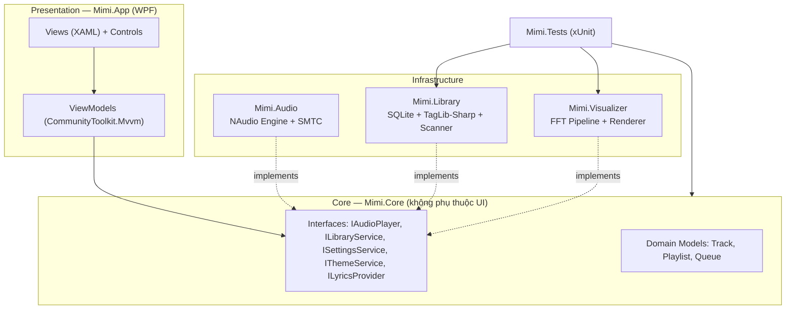
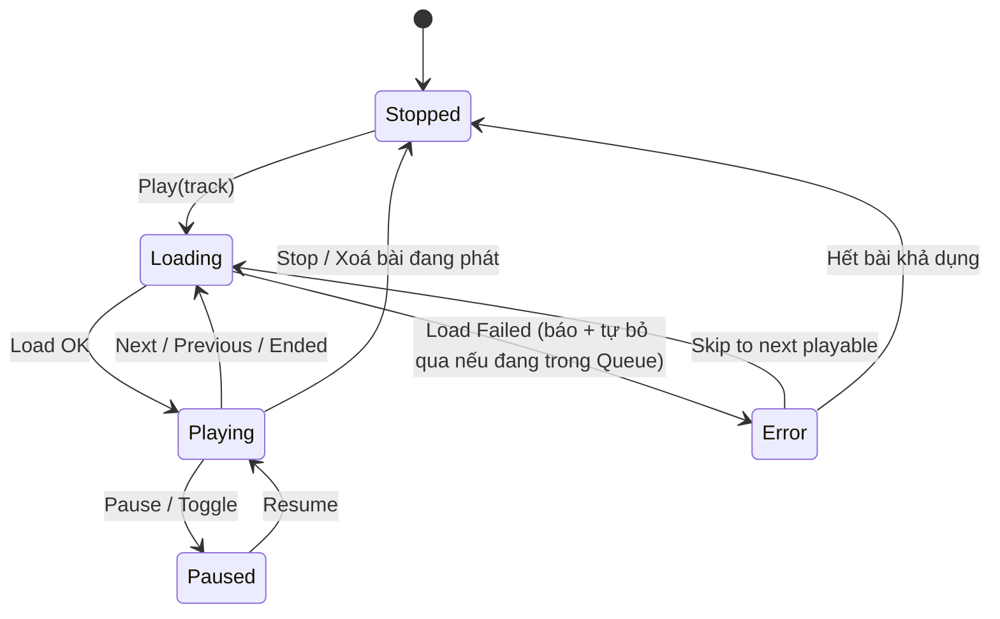
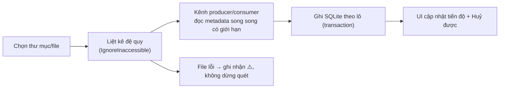

# MIMI — LỘ TRÌNH THIẾT KẾ & PHÁT TRIỂN PHẦN MỀM
## Ứng dụng nghe nhạc phong cách Anime × Hatsune Miku-inspired

| Thuộc tính | Nội dung |
|---|---|
| Tên sản phẩm | **Mimi** — Music Universe |
| Loại tài liệu | Product Design & Development Roadmap (Thiết kế sản phẩm + Lộ trình phát triển) |
| Phiên bản tài liệu | 1.1 — 29/10/2026 |
| Trạng thái | Baseline để triển khai (thay thế `BUILD-NEXT.md`) |
| Nền tảng | Windows 10/11 Desktop |
| Công nghệ hiện tại | C# 12 · WPF · .NET 8 · NAudio 2.2.1 · CommunityToolkit.Mvvm · Microsoft.Extensions.DependencyInjection · Serilog · xUnit · JSON persistence |
| Mô hình phát hành | **Mã nguồn mở, miễn phí cho cộng đồng** (GitHub: `lxmtuu/Mimi`) |
| Ưu tiên tính năng số 1 | **Visualizer (sân khấu sóng nhạc)** |
| Ngôn ngữ giao diện mục tiêu | **Song ngữ Tiếng Việt / English** (chuyển đổi tại runtime) |
| Đầu ra build | `Mimi.sln` → `src/Mimi.App` → `Mimi.exe` · Namespace `Mimi.*` · Dữ liệu `%LocalAppData%\Mimi` |

> **Định vị một câu:** *Mimi là một "sân khấu nghe nhạc anime" trên desktop — nơi thư viện nhạc local của bạn được trình diễn cùng visualizer neon teal/hồng lấy cảm hứng từ văn hoá Vocaloid, chạy hoàn toàn offline, tôn trọng bản quyền và thuộc về cộng đồng.*

---

## MỤC LỤC

1. [Tầm nhìn, sứ mệnh & định vị](#1-tầm-nhìn-sứ-mệnh--định-vị)
2. [Nguyên tắc vàng về IP: "Miku-inspired", không phải "Miku chính thức"](#2-nguyên-tắc-vàng-về-ip-miku-inspired-không-phải-miku-chính-thức)
3. [Người dùng mục tiêu & hành trình sử dụng](#3-người-dùng-mục-tiêu--hành-trình-sử-dụng)
4. [Nguyên tắc thiết kế sản phẩm](#4-nguyên-tắc-thiết-kế-sản-phẩm)
5. [Design System — "Mimi Neon Stage"](#5-design-system--mimi-neon-stage)
6. [Kiến trúc thông tin & đặc tả màn hình](#6-kiến-trúc-thông-tin--đặc-tả-màn-hình)
7. [Kiến trúc kỹ thuật đích](#7-kiến-trúc-kỹ-thuật-đích)
8. [Thiết kế chi tiết từng phân hệ](#8-thiết-kế-chi-tiết-từng-phân-hệ)
9. [Lộ trình triển khai theo Phase](#9-lộ-trình-triển-khai-theo-phase)
10. [Backlog ưu tiên (MoSCoW)](#10-backlog-ưu-tiên-moscow)
11. [Quy trình phát triển & CI/CD](#11-quy-trình-phát-triển--cicd)
12. [Chiến lược kiểm thử](#12-chiến-lược-kiểm-thử)
13. [Đăng ký rủi ro (Risk Register)](#13-đăng-ký-rủi-ro-risk-register)
14. [Chỉ số đo thành công (KPI)](#14-chỉ-số-đo-thành-công-kpi)
15. [Sổ quyết định cần chốt (Decision Log)](#15-sổ-quyết-định-cần-chốt-decision-log)
16. [Phụ lục A — Kết quả rà soát hiện trạng](#phụ-lục-a--kết-quả-rà-soát-hiện-trạng-29102026)
17. [Phụ lục B — Bảng kiểm chứng định dạng trên Windows](#phụ-lục-b--bảng-kiểm-chứng-định-dạng-âm-thanh-trên-windows)
18. [Phụ lục C — Thuật ngữ](#phụ-lục-c--thuật-ngữ)

---

## 1. Tầm nhìn, sứ mệnh & định vị

### 1.1. Tầm nhìn (Vision)
Biến việc nghe nhạc local — vốn đang khô khan trong các trình phát mặc định — thành một **buổi biểu diễn trực quan** mang đậm văn hoá anime/Vocaloid, nơi mỗi bài hát có sân khấu riêng: sóng nhạc neon, ảnh bìa, lời hát chạy chữ kiểu karaoke và một linh vật gốc (original mascot) mang tên **Mimi**.

### 1.2. Sứ mệnh (Mission)
- Phát nhạc local **nhanh, ổn định, không quảng cáo, không thu thập dữ liệu** (offline-first).
- Mang lại trải nghiệm thị giác "live stage" mượt 60fps mà các trình phát phổ thông không có.
- Mở mã nguồn để cộng đồng fan anime/Vocaloid cùng đóng góp theme, bản dịch và tính năng — theo cách **tôn trọng tuyệt đối bản quyền** của nghệ sĩ và chủ sở hữu IP.

### 1.3. Giá trị khác biệt (Differentiators)
| # | Khác biệt | Ý nghĩa |
|---|---|---|
| 1 | **Visualizer-first**: sân khấu sóng nhạc là trung tâm, không phải tính năng phụ | Lý do người dùng chọn Mimi thay vì Groove/Media Player |
| 2 | **Anime aesthetic có hệ thống**: Design System neon teal × sakura pink, mascot gốc, theme pack cộng đồng | Nhận diện cảm xúc mạnh, hợp văn hoá fan |
| 3 | **Offline & riêng tư tuyệt đối**: không tài khoản, không telemetry bắt buộc | Niềm tin cộng đồng open-source |
| 4 | **Song ngữ Việt/Anh ngay từ thiết kế** | Hiếm có ở phần mềm fan-made; tiếp cận cả người dùng VN và quốc tế |

### 1.4. Ngoài phạm vi (Non-goals) — nói rõ để chống phình phạm vi
- ❌ Không scrape, không tải lậu, không bẻ DRM của bất kỳ dịch vụ streaming nào.
- ❌ Không phân phối artwork/voicebank/logo chính thức của Hatsune Miku hay bất kỳ IP nào khi chưa có giấy phép.
- ❌ Không làm mobile/web trong giai đoạn này (kiến trúc lõi tách lớp để tương lai có thể tái sử dụng).
- ❌ Không đồng bộ cloud, không mạng xã hội trong app cho tới v1.0.

---

## 2. Nguyên tắc vàng về IP: "Miku-inspired", không phải "Miku chính thức"

Hatsune Miku là tài sản trí tuệ của **Crypton Future Media, INC.** Một dự án open-source phát hành công khai **không được** đóng gói hình ảnh, logo, tên thương mại hay giọng hát chính thức nếu chưa có license (kể cả license CC BY-NC của Miku cũng có điều kiện chặt chẽ và không bao phủ mọi loại sử dụng trong phần mềm). Thiết kế của Mimi tuân thủ mô hình 3 tầng an toàn pháp lý sau:

| Tầng | Nội dung | Quy tắc |
|---|---|---|
| **Tầng 1 — Core gốc (mặc định theo app)** | Mascot **Mimi** là nhân vật *nguyên bản* do dự án sáng tạo: cảm hứng từ tinh thần "ca sĩ ảo tương lai" (tóc teal, tai nghe, sân khấu neon) nhưng **kiểu tóc, trang phục, tỉ lệ, logo đều thiết kế riêng**, không sao chép tạo hình Miku | Được đóng gói & phát hành tự do theo license của dự án |
| **Tầng 2 — Theme cộng đồng (người dùng tự nạp)** | Theme Engine cho phép người dùng tự đưa ảnh/màu của họ vào thư mục `Themes\` trên máy cá nhân | App chỉ cung cấp *cơ chế*; repo & bản phát hành **không chứa** asset IP của bên thứ ba. Kèm điều khoản: người dùng chịu trách nhiệm về asset họ nạp |
| **Tầng 3 — Hợp tác có license (tương lai, có cổng duyệt)** | Nếu sau này xin được phép chính thức (VD: Piapro/Crypton collaboration) mới phát hành theme mang IP thật | Bắt buộc có văn bản license lưu trong `docs/legal/` trước khi merge |

**Checklist pháp lý bắt buộc trước mỗi bản phát hành công khai:** rà soát asset (font OFL/MIT, icon, ảnh), license thư viện (NAudio MIT; TagLib-Sharp LGPL-2.1 — dùng dạng NuGet dynamic link + ghi attribution), không dùng từ "Hatsune Miku" làm tên app/tên tính năng chính thức (chỉ dùng mô tả "Vocaloid-inspired" trong tài liệu giới thiệu kèm disclaimer *"Mimi is a fan-inspired, non-commercial open-source project. Hatsune Miku is a trademark of Crypton Future Media, INC. This project is not affiliated with or endorsed by Crypton."*).

---

## 3. Người dùng mục tiêu & hành trình sử dụng

### 3.1. Personas
| Persona | Chân dung | Nhu cầu cốt lõi (Job-to-be-done) |
|---|---|---|
| **A — Fan anime/Vocaloid (16–30)** | Nghe nhạc Nhật, Vocaloid covers, OST; thích cá nhân hoá desktop | "Khi tôi nghe nhạc Vocaloid, hãy cho tôi một sân khấu neon sống động để vừa nghe vừa chill/để màn hình phụ" |
| **B — Nhà sưu tầm nhạc local** | Có 500–20.000 file FLAC/MP3, ghét phụ thuộc streaming | "Hãy quét thư viện lớn của tôi thật nhanh, hiện đúng metadata/ảnh bìa, tìm kiếm không dấu được, đừng làm mất dữ liệu" |
| **C — Contributor cộng đồng** | Dev/designer/dịch giả fan dự án | "Hãy cho tôi kiến trúc rõ ràng, theme format và quy trình đóng góp dễ để tôi gửi PR đầu tiên trong 1 buổi tối" |

### 3.2. Hành trình chính (Core Journey)
```
Cài đặt → Mở app (màn hình chào + mascot) → Thêm thư mục nhạc (quét nền có tiến độ)
→ Thư viện hiện metadata/ảnh bìa → Chọn bài → NOW PLAYING + Visualizer Stage
→ Yêu thích / tạo Playlist → Hát theo Lyrics → Đổi Theme / đổi ngôn ngữ VI–EN
→ Đóng app → Mở lại: khôi phục bài & vị trí & queue của phiên trước
```

### 3.3. Yêu cầu trải nghiệm then chốt
- Thời gian từ mở app → nghe được bài đầu tiên: **< 3 thao tác** với người mới.
- Mọi thao tác phát nhạc chính làm được bằng **bàn phím & media keys** (không cần chuột).
- Không bao giờ mất thư viện/favorites vì lỗi ghi file hoặc nâng cấp phiên bản (migration có kiểm thử).

---

## 4. Nguyên tắc thiết kế sản phẩm

1. **Stage First** — Nhạc đang phát và visualizer luôn là nhân vật chính của màn hình; mọi thứ khác lùi về phụ trợ.
2. **Offline First, Privacy Always** — Mọi tính năng lõi chạy không cần mạng; dữ liệu ở máy người dùng.
3. **Never Lose User Data** — Ghi dữ liệu luôn atomic + có migration + có backup trước khi nâng cấp schema.
4. **Performance is a Feature** — Ngân sách hiệu năng là yêu cầu bắt buộc (60fps visualizer, quét 10.000 file không treo UI), đo được bằng số.
5. **Accessible by Default** — Tương phản đạt WCAG 2.2 AA, focus nhìn thấy được, tôn trọng `prefers-reduced-motion` của Windows.
6. **Bilingual by Design** — Không hard-code chuỗi UI; mọi text qua tài nguyên `Strings` để dịch VI/EN và cộng đồng dịch thêm.
7. **Respect Creators** — Chỉ tích hợp nguồn nhạc/lời/ảnh khi điều khoản cho phép rõ ràng; ghi attribution đầy đủ.

---

## 5. Design System — "Mimi Neon Stage"

Design System kế thừa bảng màu hiện tại của app (đang có trong `App.xaml`) và chuẩn hoá thành **Design Tokens** để dùng nhất quán + làm nền cho Theme Engine.

### 5.1. Bảng màu (Color Tokens)

| Token | Hex | Vai trò | Ghi chú |
|---|---|---|---|
| `color.bg.app` | `#0B101B` | Nền ứng dụng (sân khấu đêm) | Kế thừa `BgColor` hiện tại |
| `color.bg.panel` | `#121C2B` | Panel/Card | Kế thừa `PanelColor` |
| `color.bg.raised` | `#172638` | Card lồng, input, badge | Đang dùng rải rác → gom thành token |
| `color.brand.teal` | `#39C5BB` | Màu thương hiệu chính (Miku-teal family) | Điểm neo cảm hứng Vocaloid |
| `color.brand.teal.bright` | `#47E6D0` | Accent phát sáng, nút Play, sóng nhạc | = `AccentColor` hiện tại |
| `color.brand.sakura` | `#FF8FCB` | Accent phụ (hồng sakura) | = `PinkColor` hiện tại |
| `color.brand.sakura.hot` | `#FF5CAE` | Đỉnh sóng nhạc, trạng thái "hot" | Đang có trong gradient visualizer |
| `color.text.primary` | `#F3F7FF` | Chữ chính trên nền tối | Tương phản > 12:1 trên `bg.app` |
| `color.text.secondary` | `#9BAEC3` | Chữ phụ, mô tả | Đạt AA cho chữ thường |
| `color.text.muted` | `#8296AE` | Label, caption | Chỉ dùng cho chữ ≥ 11px |
| `⚠️ color.text.faint` | ~~`#60758D`~~ → `#7E93AC` | Footer/meta (cần nâng sáng) | Mã hiện tại **chưa đạt AA** cho chữ 10px → sửa ở Phase 1 |
| `color.state.success/warning/error` | `#3ED598 / #FFB020 / #FF5C7A` | Trạng thái hệ thống | Không dùng teal/hồng cho lỗi để tránh nhầm brand |
| `gradient.stage` | `#183E4D → #252542 → #171A2A` | Nền hero/Now Playing | Kế thừa gradient hiện tại |
| `gradient.spectrum` | `#47E6D0 → #FF5CAE` (dọc) | Cột sóng nhạc | Kế thừa visualizer hiện tại |

**Quy tắc:** cấm hard-code hex trong View (trừ file token); mọi màu qua `ResourceDictionary` theo token. Dark theme là mặc định; Light theme ("Daylight Stage") để Phase 5 khi Theme Engine hoàn thiện.

### 5.2. Typography
| Hạng mục | Lựa chọn | Lý do |
|---|---|---|
| Font chính (UI + Display) | **Be Vietnam Pro** (Google Fonts, OFL) — Regular/Medium/SemiBold/ExtraBold | Hỗ trợ **tiếng Việt hoàn hảo** (dấu, đa tầng), phong cách hiện đại hợp anime-tech; fallback `Segoe UI Variable` |
| Font số/mono | **Cascadia Mono** | Thời gian phát, thông số kỹ thuật |
| Thang chữ (px) | Display 30/36 · H1 21/28 · H2 17/24 · Body 13/18 · Small 12/16 · Caption 11/14 · Micro 10/13 (chỉ cho label in hoa, tracking +8%) | Chuẩn hoá từ kích thước đang dùng trong `MainWindow.xaml` |

### 5.3. Không gian, hình khối, hiệu ứng
- **Spacing:** lưới 4px (4/8/12/16/24/32). **Radius:** card 16–20, nút 10–12, badge 999 (kế thừa hiện tại).
- **Elevation kiểu "phát sáng sân khấu":** hạn chế `DropShadowEffect` hàng loạt (đắt GPU/CPU — bài học từ visualizer v1); glow chỉ dành cho phần tử anh hùng (nút Play, cột sóng) và phải đo hiệu năng.
- **Icon:** dùng bộ vector nhất quán (**Fluent UI System Icons** hoặc Lucide, license MIT) — **loại bỏ** kiểu "icon bằng chữ" hiện tại (`MUSIC`, `LOVE`, `Folder`, `▶|`) ở Phase 1–2.
- **Motion:** hover 120ms, chuyển panel 200–250ms `CubicEase`; visualizer phản ứng theo nhạc nhưng UI chrome không rung theo bass; tắt/giảm motion khi Windows bật giảm chuyển động.
- **Mascot Mimi (brief sáng tạo):** nhân vật ca sĩ ảo nguyên bản — tóc teal buộc hai bên *kiểu riêng của Mimi* (ngắn/vừa, phụ kiện ngôi sao–tai nghe mèo "Mi"), trang phục sân khấu tương lai teal×trắng×hồng. Cần bộ tối thiểu: avatar tròn, biểu cảm (vui/ngủ/lỗi), pose chào cho empty-state, pose "biểu diễn" cho Stage mode. Tuyệt đối không trace/copy tạo hình nhân vật có bản quyền. (Quyết định thuê artist hay dùng đóng góp cộng đồng: xem [Decision Log D-06](#15-sổ-quyết-định-cần-chốt-decision-log).)

### 5.4. Theme Engine (đặc tả tóm tắt)
- **Theme Pack** = thư mục chứa `theme.json` (ghi đè token màu/gradient) + `assets/` (ảnh nền, avatar mascot tuỳ chọn) + `LICENSE.txt` của tác giả theme.
- Theme tích hợp sẵn: `Neon Stage` (mặc định) · `Sakura Dream` · `Midnight Live` · `Mono Focus`.
- App **chỉ nạp** theme từ `%LocalAppData%\Mimi\Themes\`; validate JSON bằng schema, lỗi → quay về mặc định và báo lỗi thân thiện (không crash).

---

## 6. Kiến trúc thông tin & đặc tả màn hình

### 6.1. Sơ đồ điều hướng
```
Shell (Sidebar + Nội dung + Now Playing)
├── Home            — chào + nghe gần đây + yêu thích nổi bật + lối tắt thêm nhạc
├── My Library      — toàn bộ thư viện (bảng/lưới, sắp xếp, lọc)
├── Favorites       — bài đã thích
├── Playlists       — danh sách + chi tiết 1 playlist (CRUD, kéo thả thứ tự)
├── Queue           — hàng đợi phát (Now / Next)
├── Stage           — Visualizer toàn màn hình (F11) + Lyrics lớn
├── Lyrics          — lời đồng bộ trong panel Now Playing
└── Settings        — Thư viện & quét · Âm thanh · Giao diện/Theme · Ngôn ngữ · Phím tắt · Chẩn đoán · Giới thiệu
```

### 6.2. Khung cửa sổ chính (Shell) — wireframe mục tiêu
```
┌──────────────────────────────────────────────────────────────────────────┐
│ ◈ MIMI  Music Universe                    [Tìm kiếm........]   [VI|EN]   │  Header: search toàn cục + đổi ngôn ngữ
├────────────┬──────────────────────────────────────────┬──────────────────┤
│ YOUR SPACE │  HERO (gọn, thu được khi có nhạc)        │  NOW PLAYING     │
│ ⌂ Home     │ ┌──────────────────────────────────────┐ │ ┌──────────────┐ │
│ ♪ Library  │ │ Tiêu đề mục      [Sắp xếp] [Xem]    │ │ │  ẢNH BÌA     │ │
│ ♥ Favorite │ │ # │ Bài hát │ Nghệ sĩ │ Album │ ◐  │ │ │  + sóng nhạc │ │
│ ≡ Playlist │ │ 1 │ ...     │ ...     │ ...   │ 3:45│ │ │  phủ dưới    │ │
│ + Tạo mới  │ │ ... (ảo hoá danh sách 10k dòng)    │ │ └──────────────┘ │
│            │ └──────────────────────────────────────┘ │  Tên bài — Nghệ sĩ│
│ THƯ VIỆN   │  Trạng thái rỗng: mascot + nút Thêm nhạc │  ──●──────── 1:23 │
│ + Thêm file│                                          │  ⏮  ▶/⏸  ⏭  🔀 🔁 │
│ ▸ Quét thư │                                          │  Âm lượng ──●── 70%│
│   mục      │                                          │  [Lời] [Hàng đợi] │
├────────────┴──────────────────────────────────────────┴──────────────────┤
│ MIMI vX.Y · 1.234 bài · Đang phát: ...                    [Stage ⛶ F11]│  Status bar thật (thay footer trang trí)
└──────────────────────────────────────────────────────────────────────────┘
```
**Responsive:** ≥1280px đủ 3 cột; 900–1279px Now Playing thu thành thanh dưới (mini-player); <900px sidebar thành icon-rail. Bỏ giới hạn cứng `MinWidth=1050` hiện tại (hạ xuống 760 kèm layout thích ứng, Phase 2).

### 6.3. Đặc tả từng màn hình (tóm tắt triển khai)

| Màn hình | Thành phần chính | Trạng thái bắt buộc | Ghi chú từ hiện trạng |
|---|---|---|---|
| **Home** | Hero chào theo giờ, Nghe gần đây, Yêu thích, Playlist gợi ý | Rỗng (chưa có nhạc) | Nút HOME hiện tại **chưa có handler** → nối ở Phase 0 |
| **Library** | Bảng: #/Bài hát/Nghệ sĩ/Album/Thời lượng/Định dạng/♥; sắp xếp theo cột; tìm kiếm không dấu; chọn nhiều | Đang quét (tiến độ + Huỷ), lỗi từng file (badge ⚠️) | Hiện chỉ có TITLE/FORMAT, title = tên file → Phase 3 metadata |
| **Favorites** | Như Library, lọc `is_favorite` | Rỗng có hướng dẫn | Hiện chỉ bật/tắt qua menu chuột phải ẩn → thêm cột ♥ bấm trực tiếp |
| **Playlists** | CRUD, kéo-thả bài vào, đổi thứ tự, phát tất cả/xáo trộn | Rỗng, trùng tên | Chưa có (Phase 3) |
| **Queue** | Đang phát / Kế tiếp, kéo sắp xếp, xoá khỏi hàng đợi | Rỗng | Chưa có (Phase 4) — nền cho shuffle/repeat đúng nghĩa |
| **Now Playing** | Ảnh bìa lớn, sóng nhạc phủ, seek, shuffle/repeat/mute, % volume | Chưa chọn bài, file lỗi | Bổ sung shuffle/repeat/mute/% (Phase 4) |
| **Stage (toàn màn hình)** | Visualizer chiếm trọn, lời lớn, thông tin bài tối giản, ẩn con trỏ | Tạm dừng (sóng hạ dần) | Điểm nhấn sản phẩm (Phase 1) |
| **Settings** | 6 nhóm như sơ đồ; mọi thay đổi lưu ngay + khôi phục mặc định | — | Chưa có settings (Phase 3–5) |
| **Diagnostics** | Phiên bản, thư mục dữ liệu/log, nút mở log, xuất thông tin hỗ trợ | — | Thay cơ chế ghi file debug `%TEMP%` hiện tại |

---

## 7. Kiến trúc kỹ thuật đích

Tại thời điểm rà soát ban đầu, dự án là 1 project WPF với `MainWindow.xaml.cs` 435 dòng ôm toàn bộ logic — phù hợp prototype nhưng **không kiểm thử được và khó nhận đóng góp** (file còn phình thêm sau các vá Phase 0, càng củng cố nhu cầu refactor theo Phase 2). Kiến trúc đích (đạt ở Phase 2, chuyển đổi dần, không "viết lại từ đầu"):

**Hiện trạng code sau Phase 2 (29/10/2026):** repo đã có `Mimi.sln` gồm `Mimi.App`, `Mimi.Core`, `Mimi.Audio`, `Mimi.Library`, `Mimi.Visualizer` và `Mimi.Tests`. `MainWindow.xaml.cs` còn 145 dòng glue-code; nghiệp vụ nằm ở `MainWindowViewModel`/`TrackItemViewModel` và các contract `IAudioPlayer`, `ILibraryService`, `IUserDataService`. FFT/AGC đã tách thành `SpectrumAnalyzer` để test độc lập. Các phần SQLite, async scanner, theme/lyrics trong sơ đồ vẫn là đích của các Phase sau, chưa được tính là đã triển khai.



**Nguyên tắc kiến trúc**
- **MVVM + DI:** ViewModel qua `CommunityToolkit.Mvvm` (source-generator `ObservableProperty`/`RelayCommand`); đăng ký dịch vụ bằng `Microsoft.Extensions.DependencyInjection` trong `App.xaml.cs`.
- **Tách project theo phân hệ** (`.sln` gồm `Mimi.App`, `Mimi.Core`, `Mimi.Audio`, `Mimi.Library`, `Mimi.Visualizer`, `Mimi.Tests`) — Core không tham chiếu WPF/NAudio để unit-test thuần.
- **Logging chuẩn:** Serilog ghi file xoay vòng tại `%LocalAppData%\Mimi\logs\` (thay file debug rời rạc); handler `DispatcherUnhandledException` + `TaskScheduler.UnobservedTaskException` ghi log và hiện thông báo thân thiện thay vì chết im lặng.
- **Async có kỷ luật:** mọi I/O (quét, đọc metadata, ghi DB) là `async` + `CancellationToken` + báo tiến độ `IProgress<T>`; cấm chặn UI thread.
- **Version dữ liệu:** mọi định dạng lưu (settings JSON, SQLite) có `schema_version` + migration từng bước + sao lưu 1 bản trước khi migrate.

---

## 8. Thiết kế chi tiết từng phân hệ

### 8.1. Audio Engine & Playback
- **Đầu ra:** đánh giá chuyển `WaveOutEvent` → **`WasapiOut` (shared mode)** để giảm độ trễ và tích hợp tốt với Windows; giữ WaveOut làm fallback (Quyết định D-03, đo thực tế ở Phase 0/4).
- **Máy trạng thái phát nhạc (chuẩn hoá mọi chuyển đổi, sửa gốc các lỗi trạng thái hiện tại):**

  *Quy tắc sắt rút ra từ rà soát: chỉ gán "bài hiện tại" **sau khi Load thành công**; file lỗi bị đánh dấu `⚠️` trong thư viện, không làm kẹt nút Play.*
- **Queue & thứ tự phát:** `PlaybackQueue` là nguồn sự thật duy nhất cho Next/Previous/Ended. Khi người dùng phát từ Library/Favorites/Playlist/Search, queue = **danh sách đang nhìn thấy** (đã lọc) tại thời điểm phát — sửa triệt để lỗi "Next nhảy ngoài Favorites" hiện tại.
- **Shuffle:** thuật toán *shuffle-bag* (phát hết 1 vòng không lặp mới xáo lại); **Repeat:** Off / All / One. Lưu lịch sử phát để Previous quay đúng bài vừa nghe khi shuffle.
- **Tích hợp Windows (Phase 4):** media keys toàn cục qua **SMTC** (System Media Transport Controls) — hiện tên bài/ảnh bìa trên overlay Windows, điều khiển từ bàn phím/màn hình khoá; nút thumbnail trên taskbar; phím tắt trong app (Space, Ctrl+←/→, ←/→ tua 5s, ↑/↓ volume, Ctrl+F tìm kiếm, F11 Stage, Esc thoát Stage) — có bảng tra cứu trong Settings.
- **Định dạng:** không tin vào đuôi file. Phase 0 lập [bảng kiểm chứng decode](#phụ-lục-b--bảng-kiểm-chứng-định-dạng-âm-thanh-trên-windows) trên Win10/11 thật (MP3/WAV/AIFF qua NAudio; AAC/M4A/WMA/FLAC qua Media Foundation) rồi mới công bố danh sách hỗ trợ chính thức; cân nhắc bổ sung `.ogg/.opus` bằng decoder tương thích license (đánh giá ở Phase 3).

### 8.2. Library & Metadata (SQLite)
- **Công nghệ:** `Microsoft.Data.Sqlite` + migration thủ công có version (nhẹ, kiểm soát tốt) — thay `library.json`/`favorites.json` (có bộ nhập dữ liệu cũ tự động lần chạy đầu, giữ file JSON làm backup `.bak`).
- **Lược đồ cốt lõi:**
```sql
tracks(id PK, file_path UNIQUE, title, artist, album, album_artist,
       duration_ms, year, genre, format, bitrate, sample_rate,
       file_size, file_mtime, added_at, last_played_at, play_count,
       is_favorite, is_missing, has_error)
playlists(id PK, name, created_at, updated_at)
playlist_tracks(playlist_id FK, track_id FK, position, added_at, PK(playlist_id, position))
play_history(id PK, track_id FK, played_at, completed)
settings(key PK, value_json)
schema_migrations(version PK, applied_at)
-- Tìm kiếm toàn văn: FTS5 trên (title, artist, album) + cột *_normalized bỏ dấu tiếng Việt
```
- **Metadata:** TagLib-Sharp đọc ID3/Vorbis/MP4 tags + ảnh bìa nhúng; ảnh bìa cache xuống `%LocalAppData%\Mimi\cache\covers\{hash}.jpg` (resize 2 cỡ: 96/512) để cuộn danh sách không giải mã lại. Thiếu tag → fallback tên file (hành vi hiện tại) + cờ `metadata_source`.
- **Pipeline quét (sửa gốc lỗi "1 thư mục lỗi = mất tất cả"):**

  Mục tiêu: quét 10.000 file UI vẫn phản hồi; rescan tăng dần theo `file_mtime/size`; `FileSystemWatcher` theo dõi thư mục đã đăng ký (Phase 3, có debounce + tắt được).
- **Tìm kiếm tiếng Việt:** chuẩn hoá bỏ dấu (NFD + loại `CombiningDiacriticalMarks`, `đ→d`) cả phía truy vấn và dữ liệu — gõ "Miku" hay "miku", "Nhac" vẫn tìm thấy "Nhạc".

### 8.3. Visualizer — "Stage Engine" (ƯU TIÊN SỐ 1 ⭐)
Đây là linh hồn sản phẩm nên được thiết kế như một phân hệ độc lập có ngân sách hiệu năng riêng.

- **Pipeline đích:**
```
AudioFileReader (unity gain)
  → VisualizerTap (ISampleProvider, ghi ring-buffer, KHÔNG chặn luồng audio)
  → FFT Worker (thread riêng: Hann window → FFT 2048 → dải logarit → chuẩn hoá dB + AGC → làm mượt theo thời gian)
  → Kênh khung hình bất biến (immutable frames, chỉ giữ frame mới nhất)
  → Renderer (CompositionTarget.Rendering ~60fps)
  → VolumeSampleProvider (âm lượng áp SAU điểm lấy mẫu) → Output
```
  Ba sửa chữa nền tảng so với v1 hiện tại: (1) lấy mẫu **trước volume** để vặn nhỏ tiếng sóng vẫn đầy; (2) chuẩn hoá biên độ theo **dB + tự động khuếch đại (AGC)** thay hệ số cứng `×40`; (3) khi Pause/Stop, mức sóng **hạ dần về 0** (decay theo thời gian) thay vì đóng băng.
- **Công nghệ vẽ (cổng quyết định D-04):** Bước 1 dùng **`DrawingVisual`/`StreamGeometry`** (thuần WPF, không thêm phụ thuộc) với brush đóng băng dùng lại, **cấm cấp phát trong vòng lặp vẽ**. Bước 2 chỉ chuyển **SkiaSharp** nếu số đo cho thấy cần hiệu ứng particles/glow nặng hơn. Loại bỏ hoàn toàn mô hình "64 Rectangle + 64 DropShadow" của v1.
- **Chế độ trình diễn (ra mắt dần):** `Neon Spectrum` (cột) → `Twin Wave` (sóng đôi) → `Halo Circle` (vòng tròn quanh ảnh bìa) → `Particle Stage` (hạt theo beat) → `Lyrics Reactive` (nền phản ứng khi có lời). Phát hiện nhịp (beat detection bằng năng lượng dải bass) làm nền cho Particle/Stage — Phase 1 phần sau.
- **Ngân sách hiệu năng (tiêu chí nghiệm thu cứng):** 60fps ±5% ở 1080p trên iGPU phổ thông; CPU của riêng visualizer < 5% một nhân; 0 allocation/frame ở renderer (kiểm bằng profiler); tự hạ xuống 30fps khi cửa sổ không focus hoặc Windows ở chế độ tiết kiệm pin.

### 8.4. Lyrics
- Thứ tự nguồn an toàn pháp lý: **(1)** file `.lrc` cùng thư mục/tên với bài hát (người dùng tự có), **(2)** lời nhúng trong tag, **(3)** nhà cung cấp có license rõ ràng (chỉ sau cổng pháp lý Phase 6). Hiển thị đồng bộ từng dòng kiểu karaoke (tô sáng chạy chữ), cỡ chữ lớn ở Stage mode; hỗ trợ offset ± để khớp nhạc.

### 8.5. Online / Streaming (cổng nghiên cứu — không cam kết phát hành)
- Chỉ thiết kế **interface** `IStreamingProvider` (Search/Browse/Playback qua SDK chính thức) và tài liệu đánh giá điều khoản từng nhà cung cấp trong `docs/legal/`. Điều kiện triển khai bất kỳ provider nào: điều khoản **cho phép rõ ràng** phát trên desktop client bên thứ ba + OAuth (token mã hoá bằng DPAPI, **không bao giờ** nhúng client secret) + attribution theo yêu cầu. Không đạt → không làm. Đây là cam kết giữ dự án open-source được an toàn lâu dài.

### 8.6. Song ngữ Việt/Anh (Localization)
- Toàn bộ chuỗi UI chuyển vào `Resources/Strings.vi-VN.resx` + `Strings.en-US.resx` (en là fallback); đổi ngôn ngữ **tức thì không khởi động lại** qua `LocalizationService`; lần đầu tự chọn theo ngôn ngữ Windows.
- Quy ước dịch: giữ tên riêng (Mimi, Stage, Library có bản dịch "Thư viện"), thuật ngữ kỹ thuật phổ thông giữ English khi tự nhiên hơn (Playlist, Queue → kèm chú thích). Cộng đồng thêm ngôn ngữ chỉ cần gửi 1 file `.resx` (có hướng dẫn trong `CONTRIBUTING.md`).

### 8.7. Settings & khôi phục phiên
`settings.json` có `version`, ghi atomic (ghi file tạm → `File.Move(overwrite)`): âm lượng/mute, shuffle/repeat, kích thước & vị trí cửa sổ, cột sắp xếp, theme, ngôn ngữ, thư mục theo dõi, bài & vị trí & queue của phiên trước (khôi phục ở trạng thái Pause, không tự phát tiếng gây giật mình).

---

## 9. Lộ trình triển khai theo Phase

> **Cách đọc:** Mỗi Phase kết thúc bằng một bản build chạy được + tiêu chí nghiệm thu (Exit Criteria) kiểm chứng được. Cỡ công việc: **S** ≤ 3 buổi, **M** ≈ 1–2 tuần, **L** ≈ 3–5 tuần, **XL** > 5 tuần (ước lượng cho 1 dev bán thời gian ~10–15h/tuần, chỉ để lập thứ tự — không phải cam kết ngày tháng). Thứ tự đã phản ánh lựa chọn của chủ dự án: *ổn định trước → Visualizer làm điểm nhấn sớm → kiến trúc bền cho cộng đồng → thư viện mạnh → song ngữ/theme → lyrics → phát hành công khai.*

### Phase 0 — Ổn định nền tảng (đề xuất tag `v0.1.1`) · Cỡ: **M**
**Mục tiêu:** sửa toàn bộ lỗi đúng/sai từ rà soát 29/10/2026, biến prototype thành bản dùng hằng ngày không khó chịu.

**Trạng thái 29/10/2026:** phần code đã triển khai trên branch `arena/cdda374d-mimi` (commit `2f4318a`) và [Windows CI build Release đã đạt](https://github.com/lxmtuu/Mimi/actions/runs/40820442896). Phase **chưa đóng** cho tới khi hoàn tất kiểm chứng định dạng và kiểm thử tay các tiêu chí Exit trên Windows 10/11 thật.
- [x] Quét thư mục từng cấp: thư mục con không đọc được chỉ bị bỏ qua cục bộ, không theo junction/symlink và báo số thư mục đã bỏ qua thay vì trả rỗng im lặng (`Services/LibraryService.cs`)
- [x] Next/Previous/Ended đi theo **danh sách đang lọc**; gán bài hiện tại **sau khi Load thành công**; file lỗi → đánh dấu + tự bỏ qua
- [x] Seek: dùng sự kiện kéo Thumb + hỗ trợ phím mũi tên; hết lỗi kẹt cờ seek làm đóng băng thanh tiến trình
- [x] Xoá bài khỏi thư viện (menu chuột phải + phím Delete); nút **HOME** có chức năng; cột ♥ bấm trực tiếp để thích/bỏ thích
- [x] Visualizer v1 vá nhanh: sóng hạ dần khi pause/stop; lấy mẫu trước volume; tắt ghi file debug ở bản Release (`[Conditional("DEBUG")]`); dùng chung hằng số `BandCount`
- [x] Lưu JSON kiểu atomic + dọn favorites "chết" khi thư viện khôi phục thành công; lưu volume; dọn dead code (`wasPlaying`, handler rỗng…)
- [x] Thay `FolderBrowserDialog` (WinForms) bằng `Microsoft.Win32.OpenFolderDialog`, bỏ `UseWindowsForms`
- [x] Thêm `.editorconfig`, bổ sung `.gitignore` chuẩn Visual Studio, `app.manifest` khai báo DPI PerMonitorV2, icon tạm thời cho `Mimi.exe`
- [x] Thêm GitHub Actions build Release trên Windows để kiểm chứng compile/đóng gói cơ bản ngay từ Phase 0
- [ ] Điền [bảng kiểm chứng định dạng](#phụ-lục-b--bảng-kiểm-chứng-định-dạng-âm-thanh-trên-windows) trên máy Windows thật
- **Exit:** mọi mục P0 (Phụ lục A) đóng; mở app → quét thư mục có thư mục con bị khoá vẫn ra nhạc; Next trong Favorites không thoát Favorites; file nhạc hỏng không làm kẹt Play; build Release không sinh file debug.

### Phase 1 — Visualizer "Stage Engine" Beta (`v0.2.0`) · Cỡ: **L** ⭐
**Mục tiêu:** đưa điểm nhấn sản phẩm lên chuẩn trình diễn 60fps.

**Trạng thái 29/10/2026:** phần code đã triển khai trên branch `arena/cdda374d-mimi` (commit `199729d`) và [Windows CI build Release đã đạt](https://github.com/lxmtuu/Mimi/actions/runs/40822288933). Phase **chưa đóng** cho tới khi đo FPS/CPU/mức cấp phát và nghiệm thu thị giác trên máy Windows tham chiếu thật.
- [x] Tách pipeline: ring-buffer + FFT worker thread + khung hình bất biến (mục 8.3)
- [x] Renderer `DrawingVisual` chạy theo `CompositionTarget.Rendering`; brush/pen đóng băng; không cấp phát buffer/brush/pen/control trong vòng lặp vẽ
- [x] Chuẩn hoá dB + AGC; làm mượt theo thời gian thực (không phụ thuộc số cửa sổ FFT)
- [x] 3 chế độ: Neon Spectrum / Twin Wave / Halo Circle; Stage toàn màn hình (F11, Esc thoát, ẩn trỏ chuột)
- [x] Tự giảm xuống 30fps khi cửa sổ mất focus hoặc Windows bật Battery Saver; chỉ số Diagnostics trong panel chính và Stage hiện fps + thời gian vẽ
- **Exit:** đạt ngân sách hiệu năng mục 8.3 trên máy tham chiếu; bài to/nhỏ sóng đều đẹp (không bão hoà/câm); pause → sóng hạ mượt về sàn.

### Phase 2 — Kiến trúc bền vững cho cộng đồng (`v0.3.0`) · Cỡ: **L**
**Mục tiêu:** codebase để người khác đóng góp được: MVVM, test, CI.

**Trạng thái 29/10/2026:** phần code đã triển khai trên branch `arena/cdda374d-mimi` (chuỗi commit `7ba4e58`…`64011ca`), app/manifest đã nâng lên `0.3.0` và [Windows CI build + unit test đã đạt](https://github.com/lxmtuu/Mimi/actions/runs/40825705081). Phase **chưa đóng/tag** cho tới khi nghiệm thu trên Windows thật: khởi động qua DI, toàn bộ thao tác MVVM, log/crash handler, layout/DPI/focus, có PR mẫu qua CI và contributor mới build thử theo README. Bộ test FFT mới cũng phát hiện và sửa lỗi thang magnitude bị chia thừa một lần theo `FftSize`; mức sóng vì thế cần nghiệm thu lại cùng checklist Phase 1.
- [x] Tạo `Mimi.sln` + tách project theo mục 7; chuyển logic khỏi `MainWindow.xaml.cs` sang `MainWindowViewModel`, `TrackItemViewModel` và service contract
- [x] DI + Logging (Serilog) + xử lý crash toàn cục có log
- [x] Unit test xUnit: LibraryService (lọc/trùng/quét đệ quy), chuẩn hoá tìm kiếm bỏ dấu, thuật toán dải FFT/AGC/decay, playback navigation, shuffle-bag, migration dữ liệu rename
- [x] Mở rộng GitHub Actions sẵn có: restore/build/test `Mimi.sln` trên `windows-latest`, tải TRX + artifact build, annotation khi test lỗi; cảnh báo biên dịch = lỗi qua `Directory.Build.props`
- [x] Layout co giãn hơn (`MinWidth` 1050 → 960, cột có `MinWidth`, panel Now Playing cuộn khi cửa sổ thấp), icon vector thay icon-chữ, focus-visible + nhãn accessibility; nâng tương phản chữ phụ/mờ — biến thể mini-player/icon-rail dưới 900px vẫn thuộc thiết kế tương lai
- **Exit:** `MainWindow.xaml.cs` < 150 dòng (chỉ còn glue-code); CI xanh trên PR mẫu; contributor mới build được theo README trong < 15 phút.

### Phase 3 — Thư viện chuyên nghiệp (`v0.4.0`) · Cỡ: **XL**
**Mục tiêu:** từ "danh sách file" thành thư viện nhạc thật.
- [ ] SQLite + migrations + nhập dữ liệu từ JSON cũ (kiểm thử nâng cấp từ v0.1.x/v0.2/v0.3)
- [ ] Metadata đầy đủ (nghệ sĩ/album/năm/thể loại/thời lượng/bitrate) + ảnh bìa + cache; cột sắp xếp/lọc; tìm kiếm FTS5 bỏ dấu
- [ ] Quét bất đồng bộ có tiến độ/huỷ; rescan tăng dần; (tuỳ chọn) theo dõi thư mục bằng FileSystemWatcher
- [ ] Playlists CRUD + kéo thả thứ tự; Lịch sử nghe & "Nghe gần đây" cho Home; lưu Settings + khôi phục phiên
- [ ] Kéo-thả file/thư mục từ Explorer vào app; mở file bằng "Open with Mimi" (đăng ký đuôi file tuỳ chọn)
- **Exit:** thư viện 10.000 bài: cuộn mượt (ảo hoá), tìm < 100ms, quét nền không treo UI; tắt app giữa lúc ghi không hỏng DB.

### Phase 4 — Hoàn thiện trải nghiệm phát nhạc (`v0.5.0`) · Cỡ: **M**
- [ ] Queue có UI kéo sắp xếp; Shuffle-bag + Repeat Off/All/One hoàn chỉnh; Mute + % volume; tua 5/10s
- [ ] Media keys + SMTC overlay của Windows; taskbar thumbnail controls; bảng phím tắt trong Settings
- [ ] Đánh giá & (nếu đạt) chuyển WasapiOut; xử lý đổi thiết bị âm thanh giữa chừng (rút tai nghe → tự pause)
- **Exit:** điều khiển trọn vẹn không cần chuột; overlay media của Windows hiện đúng bài/ảnh bìa; đổi output device không crash.

### Phase 5 — Song ngữ & Theme cộng đồng (`v0.6.0`) · Cỡ: **L**
- [ ] Trích toàn bộ chuỗi UI sang `.resx`; dịch VI/EN đầy đủ (kể cả hộp thoại lỗi); chuyển ngôn ngữ tức thì; font Be Vietnam Pro đóng gói
- [ ] Theme Engine + 4 theme sẵn có + schema validate; tài liệu "Tự làm theme Mimi" cho cộng đồng; áp dụng Design Tokens triệt để (0 hex hard-code ngoài token)
- [ ] Bộ mascot Mimi v1 xuất hiện ở empty-states/Home/Stage theo brief mục 5.3 (asset gốc, có ghi nguồn tác giả)
- **Exit:** đổi VI↔EN không sót chuỗi Anh/Việt lẫn lộn (quét tự động tìm hard-code); nạp theme lỗi không crash; kiểm tra tương phản AA cả 4 theme.

### Phase 6 — Lyrics & cổng Online (`v0.7.0`) · Cỡ: **M** (Lyrics) + Spike nghiên cứu
- [ ] Lyrics `.lrc` + embedded, đồng bộ karaoke, chỉnh offset; chế độ lời lớn trên Stage
- [ ] *Spike (không cam kết code phát hành):* hoàn thiện `IStreamingProvider` + bộ hồ sơ đánh giá điều khoản trong `docs/legal/`; chỉ triển khai provider nào vượt cổng pháp lý mục 8.5
- **Exit:** bài có `.lrc` hát đúng nhịp ±100ms sau offset; hồ sơ pháp lý kết luận rõ "làm/không làm" từng provider bằng văn bản.

### Phase 7 — Phát hành công khai `v1.0.0` · Cỡ: **L**
- [ ] Chốt LICENSE cho code của dự án (đề xuất MIT — D-01) + trang attribution của mọi thư viện/asset; disclaimer IP (mục 2) trong app & README
- [ ] Đóng gói cài đặt + auto-update (so sánh Velopack/Inno Setup/MSIX — D-02), ký số (cân nhắc SignPath Foundation miễn phí cho OSS), kênh phát hành GitHub Releases kèm checksum
- [ ] `CHANGELOG.md` theo Keep a Changelog + SemVer; `CONTRIBUTING.md`, issue/PR templates, Dependabot; chính sách bảo mật dữ liệu (Privacy: offline, không telemetry)
- [ ] Lượt kiểm thử phát hành đầy đủ (mục 12) trên Win10 & Win11 sạch (máy ảo), kiểm tra nâng cấp từ v0.6 → v1.0 giữ nguyên thư viện
- **Exit:** người lạ tải bản phát hành → cài → nghe nhạc + Stage + đổi VI/EN thành công mà không cần cài .NET (self-contained) ; quy trình phát hành lặp lại được bằng 1 workflow.

---

## 10. Backlog ưu tiên (MoSCoW)

| Mức | Hạng mục |
|---|---|
| **Must** (v1.0 bắt buộc) | Phát local ổn định + định dạng đã kiểm chứng · Queue/Shuffle/Repeat · SQLite metadata + bìa · Visualizer 60fps · Song ngữ VI/EN · Không mất dữ liệu khi nâng cấp · Installer + LICENSE |
| **Should** | SMTC/media keys · Lyrics LRC · Theme Engine · FileSystemWatcher · WasapiOut · Particle Stage |
| **Could** | Beat detection nâng cao · Equalizer 10 band · Crossfade/gapless · ReplayGain · Mini-player luôn-nổi · Thống kê nghe nhạc cuối năm kiểu "Mimi Wrapped" (offline) |
| **Won't (giai đoạn này)** | Streaming lậu/scrape · Mobile · Đồng bộ cloud · Bán hàng trong app |

---

## 11. Quy trình phát triển & CI/CD

- **Nhánh:** trunk-based — `main` luôn build được; nhánh ngắn `feat/*`, `fix/*`, `docs/*`; PR bắt buộc qua CI (build + test, Windows runner vì WPF không build trên Linux).
- **Commit:** Conventional Commits (`feat(visualizer): ...`, `fix(library): ...`) để sinh CHANGELOG bán tự động.
- **CI mẫu (GitHub Actions):** `windows-latest` → `dotnet restore` → `dotnet build -c Release` → `dotnet test` → (khi tag `v*`) đóng gói + tạo GitHub Release.
- **Cổng chất lượng:** 0 cảnh báo mới; mọi thay đổi chạm dữ liệu người dùng phải kèm test migration; mọi tính năng UI kèm đủ 3 trạng thái rỗng/đang tải/lỗi và chuỗi ở cả VI+EN.

## 12. Chiến lược kiểm thử

| Tầng | Nội dung | Công cụ |
|---|---|---|
| Unit | Scanner, chuẩn hoá tiếng Việt, FFT bands, shuffle-bag, settings/migration | xUnit (`Mimi.Tests`) |
| Integration | SQLite migrations từ mọi phiên bản cũ, đọc metadata bộ file mẫu đủ định dạng | xUnit + file mẫu tự sinh |
| UI/Manual | Checklist phát hành: cài sạch, quét thư mục lỗi quyền, file hỏng, rút tai nghe, đổi DPI 100–200%, bàn phím-only, VI/EN | Checklist trong PR release |
| Hiệu năng | Visualizer fps/CPU, quét 10k file, khởi động lạnh | Profiler + trang Diagnostics |
| Tương thích | Win10 22H2 + Win11, .NET runtime self-contained | Máy ảo sạch |

## 13. Đăng ký rủi ro (Risk Register)

| ID | Rủi ro | Mức | Giảm thiểu |
|---|---|---|---|
| R-01 | Vi phạm IP Hatsune Miku khi phát hành công khai | **Cao** | Mô hình 3 tầng (mục 2); mascot gốc; rà soát asset trước release; disclaimer |
| R-02 | Định dạng nhận theo đuôi nhưng không giải mã được thật (FLAC/AAC qua Media Foundation tuỳ máy) | Cao | Bảng kiểm chứng Phase 0; chỉ công bố định dạng đã test; file lỗi có badge rõ ràng |
| R-03 | Visualizer ngốn CPU/GPU như v1 (DropShadow hàng loạt) | Trung bình | Ngân sách hiệu năng cứng + đo bằng profiler là tiêu chí nghiệm thu Phase 1 |
| R-04 | Mất dữ liệu khi chuyển JSON → SQLite | Cao | Migration có backup + test tự động mọi đường nâng cấp |
| R-05 | Maintainer đơn lẻ quá tải, phình phạm vi vì online/streaming | Trung bình | Non-goals rõ ràng; cổng pháp lý cho online; mỗi Phase đều phát hành được độc lập |
| R-06 | License thư viện (LGPL của TagLib-Sharp…) ảnh hưởng phát hành | Thấp | Kiểm toán license Phase 7; ưu tiên MIT/BSD/Apache; attribution đầy đủ |

## 14. Chỉ số đo thành công (KPI)

- **Độ ổn định:** 0 lỗi P0 mở quá 1 Phase; crash có log truy được nguyên nhân.
- **Hiệu năng:** khởi động lạnh < 1.5s (SSD phổ thông); visualizer 60fps; tìm kiếm < 100ms @10k bài.
- **Trải nghiệm:** người mới nghe được bài đầu trong ≤ 3 thao tác; toàn bộ thao tác chính dùng được bằng bàn phím.
- **Cộng đồng:** bản phát hành cài sạch không cần dev hỗ trợ; có ít nhất quy trình đóng góp theme/bản dịch chạy được đầu-cuối.

## 15. Sổ quyết định cần chốt (Decision Log)

| ID | Quyết định | Đề xuất của tài liệu này | Chốt khi |
|---|---|---|---|
| D-01 | LICENSE mã nguồn dự án | **MIT** (đơn giản, thân thiện cộng đồng) | Trước Phase 7 (cần chủ dự án xác nhận) |
| D-02 | Công nghệ đóng gói/auto-update | **Velopack** (hiện đại, delta update) hoặc Inno Setup (quen thuộc) | Phase 7, sau khi thử nghiệm ký số |
| D-03 | WaveOutEvent → WasapiOut | Chuyển nếu đo được độ trễ/ổn định tốt hơn | Phase 4 |
| D-04 | Renderer: DrawingVisual vs SkiaSharp | **DrawingVisual trước**, SkiaSharp chỉ khi số đo yêu cầu | Phase 1 |
| D-05 | Thêm decoder `.ogg/.opus` | Đánh giá license/độ nặng của thư viện ứng viên | Phase 3 |
| D-06 | Sản xuất mascot Mimi gốc | Thuê artist hoặc mở đợt đóng góp cộng đồng có brief + chuyển nhượng quyền rõ ràng | Phase 5 |
| D-07 | Ký số bản phát hành | Đăng ký SignPath Foundation (miễn phí cho OSS đủ điều kiện) | Phase 7 |

---

## Phụ lục A — Kết quả rà soát hiện trạng (29/10/2026)

Rà soát tĩnh toàn bộ 11 file (~1.016 dòng) tại commit đổi tên `a685ca2`. Mức: 🔴 P0 đúng/sai · 🟠 P1 chất lượng/nợ kỹ thuật.

| # | Phát hiện | Mức | Xử lý tại |
|---|---|---|---|
| A-01 | `LibraryService.ScanFolder`: 1 thư mục con không quyền truy cập → mất **toàn bộ** kết quả quét, im lặng | 🔴 | Phase 0 |
| A-02 | Next/Previous/Ended chạy theo danh sách gốc, không theo danh sách đang lọc (Favorites/Search) | 🔴 | Phase 0 (Queue hoá ở Phase 4) |
| A-03 | `PlayTrack` gán bài hiện tại trước khi Load thành công → file lỗi làm kẹt trạng thái Play | 🔴 | Phase 0 |
| A-04 | Seek bằng bàn phím không chạy; thả chuột ngoài slider có thể kẹt cờ seek → đóng băng tiến trình | 🔴 | Phase 0 |
| A-05 | Không xoá được bài khỏi thư viện | 🔴 | Phase 0 |
| A-06 | Visualizer đóng băng khi pause/stop; lấy mẫu sau volume; hệ số cứng ×40; ~6fps; 64 DropShadow + cấp phát Brush mỗi frame; ghi file debug mỗi giây ở cả bản Release | 🟠 | Vá Phase 0 → làm lại Phase 1 |
| A-07 | JSON ghi không atomic, không version/backup; favorites giữ đường dẫn chết; không lưu settings | 🟠 | Phase 0 (atomic) → Phase 3 (SQLite) |
| A-08 | `MainWindow.xaml.cs` 435 dòng "god-class"; không MVVM/interface/test/CI; không xử lý crash toàn cục | 🟠 | Phase 2 |
| A-09 | Nút HOME không handler; dead code (`wasPlaying`, `Stop()` thừa, handler rỗng); WinForms chỉ cho 1 dialog | 🟠 | Phase 0 |
| A-10 | Thiếu icon/manifest DPI/version/LICENSE/.editorconfig/.sln; `.gitignore` tối thiểu | 🟠 | Phase 0/2/7 |
| A-11 | Tài liệu lệch code (README vẫn coi FFT visualizer là tương lai dù đã có v1) | 🟠 | Tài liệu này thay thế |
| A-12 | Định dạng hỗ trợ khai theo đuôi file, chưa kiểm chứng giải mã; thiếu `.ogg/.opus` | 🟠 | Phase 0 (kiểm chứng) / D-05 |

**Điểm mạnh giữ lại:** đã tách `AudioService`/`LibraryService`/`VisualizerSampleProvider`; FFT dùng Hann window + dải logarit đúng hướng; chống trùng đường dẫn không phân biệt hoa/thường; khôi phục thư viện khi khởi động; migration dữ liệu sau đổi tên; hoàn toàn offline, không secret, không scraping.

## Phụ lục B — Bảng kiểm chứng định dạng âm thanh trên Windows

*Điền trên máy Windows thật ở Phase 0 (mỗi ô: ✅ phát tốt / ⚠️ có điều kiện / ❌ lỗi — kèm ghi chú phiên bản Windows). Chỉ định dạng ✅ mới được công bố chính thức.*

| Định dạng | Win10 22H2 | Win11 | Seek | Metadata dự kiến | Ghi chú |
|---|---|---|---|---|---|
| `.mp3` | ☐ | ☐ | ☐ | ID3 | |
| `.wav` | ☐ | ☐ | ☐ | RIFF/ID3 | |
| `.flac` | ☐ | ☐ | ☐ | Vorbis comment | Qua Media Foundation? |
| `.m4a` / `.aac` | ☐ | ☐ | ☐ | MP4 tags | Qua Media Foundation? |
| `.wma` | ☐ | ☐ | ☐ | ASF | Định dạng cũ |
| `.aif` / `.aiff` | ☐ | ☐ | ☐ | ID3 chunk | |
| `.ogg` / `.opus` | — | — | — | Vorbis comment | Chưa hỗ trợ → D-05 |

## Phụ lục C — Thuật ngữ

- **Stage Mode:** chế độ visualizer toàn màn hình của Mimi.
- **Shuffle-bag:** xáo trộn không lặp cho tới khi phát hết một vòng.
- **SMTC:** System Media Transport Controls — cơ chế điều khiển media tích hợp của Windows.
- **Atomic write:** ghi file tạm rồi thay thế nguyên tử, tránh file hỏng khi mất điện/crash.
- **Theme Pack:** gói giao diện cộng đồng gồm `theme.json` + asset + license riêng.
- **Legal gate (cổng pháp lý):** điểm kiểm soát bắt buộc có kết luận bằng văn bản mới được triển khai tính năng liên quan IP/bản quyền.

---
*Tài liệu này là nguồn sự thật duy nhất (single source of truth) về thiết kế & lộ trình của Mimi kể từ 29/10/2026. `BUILD-NEXT.md` được giữ lại dưới dạng trỏ về tài liệu này để tránh lệch tài liệu. Mọi thay đổi lộ trình đi qua PR sửa trực tiếp file này kèm cập nhật Decision Log.*
